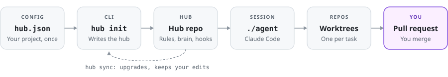
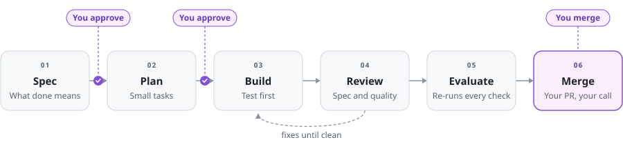

<!-- TODO: add a logo at docs/assets/logo.svg (and logo-dark.svg for a <picture> light/dark pair) -->

<h1 align="center">agent-hub</h1>

<p align="center">
  <strong>A home base for AI coding agents, for developers who run Claude Code across several repos.<br>
  One command gives each project shared rules, memory and workflow, pinned to a version and kept up to date.</strong>
</p>

<p align="center">
  <a href="https://github.com/jroquette/agent-hub/actions/workflows/ci.yml"></a>
  
  <!-- Static badge: bump with each release tag (scripts/check_release.py keeps the package versions in lockstep; follow-up: automate). -->
  
  
</p>

<p align="center">
  <a href="#-quick-start">Quick Start</a> ·
  <a href="docs/DAILY-WORKFLOW.md">Daily workflow</a> ·
  <a href="#-documentation">Docs</a> ·
  <a href="docs/SPEC.md">Spec</a> ·
  <a href="#-contributing">Contributing</a>
</p>

<!-- TODO: record a demo GIF (hub init → ./agent) and put it here (AGH-74) -->

```bash
hub init demo --repos acme/backend,acme/frontend --tracker linear:DEMO \
  --branch-prefix jdoe/ --hub-repo acme/demo-hub
```

```text
created 113 files (61 managed, 52 seeded) and 28 links in /home/jdoe/work/demo-hub

Next steps:
  1. cd /home/jdoe/work/demo-hub
  2. review hub.json, AGENTS.project.md and README.md
  3. git add -A && git commit -m "Create the hub"
  4. start Claude Code with every repo attached: ./agent
  5. to upgrade later: edit platform.version in hub.json, then run hub sync
```

> [!IMPORTANT]
> agent-hub is **experimental** (0.x). The generator, its commands and the web control plane work and are tested, but
> names and files can still change between releases. It supports **Claude Code** and **Linear** today. The repository
> is public: installing needs no credential.

## Contents

- [What is this?](#-what-is-this)
- [What you get](#-what-you-get)
- [How the agents work](#-how-the-agents-work)
- [What the agents can reach](#-what-the-agents-can-reach)
- [The brain: your team's memory](#-the-brain-your-teams-memory)
- [Quick Start](#-quick-start)
- [Documentation](#-documentation)
- [Limits today](#-limits-today)
- [FAQ](#-faq)
- [Contributing](#-contributing)
- [License and credits](#-license-and-credits)

## 💡 What is this?

AI coding agents such as Claude Code can write, test and open pull requests on their own. To do it well, they need
what a new teammate needs: the project's rules, its memory of past decisions and a clear way of working. Today that
setup is written by hand, one project at a time, and it drifts as soon as a second project copies it.

agent-hub turns that setup into a product. For each project it creates a **hub**: a small private git repository next
to the project's code repositories (the *repos*). The code stays in the repos; the hub holds the rulebook, the
notebook and the checklists that every agent session starts from.

<p align="center">
  <picture>
    <source media="(prefers-color-scheme: dark)" srcset="docs/assets/how-it-works-dark.svg">
    
  </picture>
</p>

You describe the project once in `hub.json`. The `hub` command-line tool (CLI) turns it into the hub. `./agent` starts
Claude Code with every repo attached and the hub's rules, memory and workflow loaded. Later, `hub sync` upgrades the
hub to a newer release without overwriting what your project changed.

## 🎁 What you get

`hub init` writes about 110 files into the new hub. The ones that matter day to day:

| Part | What it gives you |
| --- | --- |
| `AGENTS.md`, `CLAUDE.md`, `AGENTS.project.md` | The rules every agent reads first: base rules from the platform, plus your project's own |
| `brain/` | The team's memory: current focus, journal, decisions, learnings, playbooks, feature records and an inbox. It starts empty ([below](#-the-brain-your-teams-memory)) |
| `plugin/hub-workflow/` | More than 25 slash commands (`/kickoff`, `/feature`, `/change`, `/review`, `/handoff`…) and helper agents (researcher, architect, reviewers, evaluator…) |
| Hooks and sandbox | Guardrails that run on their own: no secrets, no push to `main`, no force-push, no AI attribution, no finish while the fast checks fail |
| `workflows/` | Ready-made multi-step flows you can edit: `deliver`, `review`, `spike`, `incident`, `upgrade`, `security-sweep`, `doc-drift`, `release` and more |
| `./agent`, `./hub` | One command to start a session with every repo attached, and the CLI at the version `hub.json` pins |
| `hub web` | A local web app with live sessions, workflow runs, approvals waiting for you, features and hub health |

Why teams use it:

- 🚀 **Start in minutes, not days.** Rules, memory, workflow, guardrails and launcher come in one command.
- 🔁 **Upgrade without losing your edits.** `hub sync` rewrites only the files the platform owns; `hub.lock` tells them
  apart from yours.
- 📌 **Same behavior on every machine.** Each hub pins one release, so laptops, CI and cloud sessions run the same code.
- 🛡️ **Agents inside clear limits.** You approve the spec and the plan and you merge; hooks keep the agents to the rules.
- 🧠 **Memory that grows with use.** Agents search the brain before they plan and propose what they learned.
- 🩺 **Problems caught early.** `hub doctor` finds broken links, missing files and drift from the template, each with a
  one-line fix.

## 🧩 How the agents work

You type the commands in a Claude Code session started with `./agent` from the hub. A normal day:

1. **`/kickoff`** shows the brief (current focus, recent journal, each repo's git, PR and CI state) and proposes the next
   ready issue.
2. **`./hub start DEMO-7`** creates isolated worktrees from a fresh `origin/main`, moves the issue to *In Progress* and
   opens the session on it.
3. **`/feature`** (or `/change` for a small fix) does the work:

<p align="center">
  <picture>
    <source media="(prefers-color-scheme: dark)" srcset="docs/assets/feature-flow-dark.svg">
    
  </picture>
</p>

4. **`/handoff`** updates `brain/now.md` and the day's journal, so the next session starts where this one stopped.

Each helper agent runs in a fresh context with one job: the `researcher` documents the code, the `architect` writes
the plan, the `spec-reviewer` and `quality-reviewer` check each task, and the `evaluator` re-runs every check before
the PR. The full list of commands, agents and hooks: [docs/DAILY-WORKFLOW.md](docs/DAILY-WORKFLOW.md).

## 🔐 What the agents can reach

| The agents can | The agents cannot |
| --- | --- |
| Read and change the repos in `hub.json`, in worktrees only | Push to `main`, force-push or merge a PR |
| Read the hub's brain and the repos' `docs/` (`search` and `read` through `hub mcp`) | Write the brain directly: they propose notes to `brain/_inbox/` |
| Read and update the tracker (Linear) and open PRs with `gh` | Read `.env` files, keys or the paths in `guard.deny_paths` |
| Run the repo's commands inside Claude Code's sandbox | Reach hosts outside the sandbox allowlist, or use SSH |
| Ask you before risky edits (test assertions, `hub.json`, guarded paths) | Sign a commit or PR as an AI, or name a branch `claude/…` |

Commits and PRs carry your name. The guard is a tripwire, not a security boundary: it blocks the usual mistakes, and
the sandbox adds a second barrier. Details: [What the hooks do for you](docs/DAILY-WORKFLOW.md#what-the-hooks-do-for-you).

## 🧠 The brain: your team's memory

The brain is a folder of plain Markdown files in the hub, versioned with git:

| Folder | What it holds |
| --- | --- |
| `now.md` | The current focus, the work in flight and the exact next step |
| `journal/` | What happened, one file per day |
| `decisions/`, `learnings/`, `playbooks/`, `domain/` | Why things were decided, pitfalls, procedures, domain rules |
| `features/` | Each feature's spec, research, plan, tickets and evaluations |
| `_inbox/` | Proposals from agents, waiting for your review |
| `auto/workspace/` | Your personal notes, gitignored and never committed |

What to know:

- **Each hub has its own brain, and it starts empty.** Nothing from other projects comes with it. It becomes useful as
  your sessions add to it: `/handoff` writes the journal, and agents propose learnings to `_inbox/`.
- **Agents read it on their own.** `hub mcp` gives every session `search` and `read` over the brain and the repos'
  `docs/`, and the commands search it before planning.
- **Only people promote knowledge.** An inbox note becomes a learning or a decision only after you approve it
  (`/learn promote`, or in `hub web`). Decisions are superseded, never edited.

More: [docs/design/memory-layers.md](docs/design/memory-layers.md).

## 🚀 Quick Start

**Prerequisites**

- What everyone on a hub needs (uv, git, Claude Code, Python 3.9 or newer, optional `gh` and tracker credential, with
  the known traps): the Requirements table of the **Join this hub** section that every generated hub's `README.md`
  carries; its source is [`README.md.tmpl`](packages/generator/src/agent_hub/generator/templates/README.md.tmpl).
- To create a hub: a GitHub repository for it (`--hub-repo`) and a Linear team for its tracker.

To join a hub that already exists instead, clone it next to the project's repos and run `./hub setup` in it (see the
hub's `README.md`, **Join this hub**); the steps below create a new hub.

**1. Check that you can run the CLI.** `uvx` builds the tagged release from git and caches it; the first run takes a
little longer.

```bash
uvx --from 'git+https://github.com/jroquette/agent-hub@v0.39.0#subdirectory=packages/agent-hub' hub --version
```

You should see `0.39.0`.

> [!TIP]
> To have `hub` on your `PATH`, install it once with
> `uv tool install 'git+https://github.com/jroquette/agent-hub@v0.39.0#subdirectory=packages/agent-hub'`.
> Generated hubs never need this: their `./hub` shim runs the release pinned in `hub.json`.

**2. Create an empty folder for the hub.** It should be a sibling of the project's repos.

```bash
mkdir -p demo-hub && cd demo-hub && git init
```

**3. Generate the hub.** Replace the project name, repos, tracker team, branch prefix and hub repo with yours
(`--hub-repo` is needed until the folder has a GitHub `origin`; for several tracker teams, list them, e.g.
`--tracker linear:APP,OPS`, the first the default). The author comes
from your git `user.name` and `user.email` unless you pass `--author-name` and `--author-email`.

```bash
uvx --from 'git+https://github.com/jroquette/agent-hub@v0.39.0#subdirectory=packages/agent-hub' \
  hub init demo --repos acme/backend,acme/frontend --tracker linear:DEMO --branch-prefix jdoe/ --hub-repo acme/demo-hub
```

You should see `created 113 files (61 managed, 52 seeded) and 28 links` followed by the next steps.

> [!NOTE]
> `hub init` writes only into an empty folder (a `.git` is fine). Run it again in the same folder and it refuses with
> `already a hub; run hub sync`, writing nothing. In a folder holding other files it refuses and suggests
> `hub sync --adopt`, which joins a hand-made hub from 0.7.0 on; with an older release, use a new empty folder instead.

**4. Check the new hub.** From now on, use the hub's own `./hub` shim.

```bash
./hub doctor
```

Expected output (the infos only say that the repos are not cloned next to the hub yet):

```text
info brain.leak ../backend: repo backend is not checked out next to the hub; its repo checks are skipped Fix: clone the repo next to the hub
info brain.leak ../frontend: repo frontend is not checked out next to the hub; its repo checks are skipped Fix: clone the repo next to the hub
0 errors, 0 warnings, 2 infos
```

**5. Check that the hub matches its release.** `--check` only plans and writes nothing.

```bash
./hub sync --check
```

You should see `up to date`.

**6. Commit it and start an agent session.**

```bash
git add -A && git commit -m "Create the hub"
./agent
```

> [!NOTE]
> `./agent` (and `hub agent`) attaches the repos listed in `hub.json` that are cloned next to the hub (`../backend`,
> `../frontend` in this example), prints a `not attached` warning for each one it cannot find, and passes every
> other argument to `claude`.

To see your sessions and runs on one screen, run the control plane with `make up` (Docker) or `make run` from a clone
of this repo, then `make connect HUB=../demo-hub`: [docs/CONTROL-PLANE.md](docs/CONTROL-PLANE.md).

## 📚 Documentation

| I want to… | Read |
| --- | --- |
| Learn the session routine, the commands, the agents and the hooks | [docs/DAILY-WORKFLOW.md](docs/DAILY-WORKFLOW.md) |
| Follow a tutorial or a recipe (upgrade, worktrees, `hub doctor`…) | [docs/GUIDE.md](docs/GUIDE.md) |
| Run or edit a multi-step workflow, or a scenario | [docs/WORKFLOWS.md](docs/WORKFLOWS.md) |
| Pick the right flow for a task | [docs/FLOWS.md](docs/FLOWS.md) |
| Set `hub.json`, `hub.local.json` or environment variables | [docs/CONFIGURATION.md](docs/CONFIGURATION.md) |
| Run the web control plane | [docs/CONTROL-PLANE.md](docs/CONTROL-PLANE.md) |
| See every CLI command, the architecture and the stack | [docs/REFERENCE.md](docs/REFERENCE.md) |
| Set up agent-hub for a project as an AI agent | [docs/USING.md](docs/USING.md) (also [llms.txt](llms.txt)) |
| Understand the product and its phases | [docs/SPEC.md](docs/SPEC.md) |
| See what changed in each release | [CHANGELOG.md](CHANGELOG.md) |

## 🚧 Limits today

- **Claude Code and Linear only.** The tracker and the event model are ports, so other trackers and agents can come in
  as adapters later.
- **The brain starts empty.** There is no starter pack of generic learnings or playbooks yet.
- **You need a terminal and git.** You run a few commands and edit one JSON file; the agents do the programming.
- **Experimental.** Releases are 0.x; read the [CHANGELOG](CHANGELOG.md) before you move a hub's pin.

Where it is going: the phases in [docs/SPEC.md](docs/SPEC.md#mvp-and-phases).

## ❓ FAQ

**Does it replace Claude Code?**
No. agent-hub prepares, launches and observes Claude Code sessions; it is not an agent or a model runtime.

**Is it free? Can I use it in my company?**
Yes. agent-hub is open source under the [Apache License 2.0](LICENSE): you may use, change and redistribute it,
commercially too, as long as you keep the license and [NOTICE](NOTICE). It is experimental, and comes with no
warranty.

**Will `hub sync` overwrite my changes?**
Not the files your project owns. `hub.lock` records which files are managed by the platform and which were seeded for
you. A managed file you edited by hand shows up as a conflict instead of being overwritten silently; run
`hub sync --check` first to see the plan.

**Does it send my code or transcripts anywhere?**
No. agent-hub runs on your machine and has no server: `hub web` listens on `127.0.0.1` and stores metadata only, and
`hub collect` writes to a local SQLite file. Its network calls go to GitHub: fetching the pinned release, `git fetch`
in `hub worktree` and `hub start`, `git clone` or `git fetch` of each repo and `gh auth status` in `hub setup`, the
push and `gh pr create` of `hub run --live`, and `gh` for the PR and CI lines of `hub brief` unless you pass
`--no-network`. The generated `make usage` target downloads `ccusage` from npm. `hub next`, `hub run` and `hub start`
call Linear, with `LINEAR_API_KEY` or, with `tracker.transport` `"mcp"`, through your Linear MCP server and
`claude -p`. Your agent sessions still talk to their model provider as usual.

**Why does an agent's `git fetch` fail with `Broken pipe`, or `./hub` with `Operation not permitted`?**
That is Claude Code's sandbox, which every hub turns on on purpose: agents' Bash may write only in the workspace and
`$TMPDIR`, reach only allowlisted HTTP(S) hosts, and never SSH. The hub's own network commands (`git fetch`/`push`,
`gh`, `./hub worktree`, `make worktree`) are excluded, but only when the Bash call is exactly that command:
`cd repo && git fetch`, `git -C repo fetch` or a redirect stay sandboxed. A failed fetch in `hub worktree` prints the
bare `git fetch` to run, then `./hub worktree --no-fetch <name>`. `./hub doctor` checks it all (`sandbox.workflow`).

**Can a team share one hub?**
Yes. Leave the author and branch prefix out of `hub.json`; each developer keeps theirs in a `hub.local.json` that is
never committed. A teammate clones the hub next to the repos and runs `./hub setup` (see the **Join this hub** section
of the generated hub's `README.md`).

## 🤝 Contributing

agent-hub is early, and one person maintains it. For now, contributions come as
[GitHub issues](https://github.com/jroquette/agent-hub/issues), not pull requests:

- **Found a bug?** Open an issue with what you ran, what you expected and what happened. Add the `hub --version` output
  and your OS.
- **Have an idea or a question?** Open an issue and describe the problem you want solved, not only the solution.
- **Found a security problem?** Do not open an issue: follow [SECURITY.md](SECURITY.md).

Pull requests from outside are not accepted yet. The CI and the review process are built around one maintainer, and
an outside pull request would not pass them. This will change once the project settles.

The maintainer's own process (tracker, branches, gates, releases) is in [docs/CONTRIBUTING.md](docs/CONTRIBUTING.md).
Instructions for AI agents working in this repo are in [AGENTS.md](AGENTS.md).

## 📄 License and credits

agent-hub is licensed under the [Apache License, Version 2.0](LICENSE); see [NOTICE](NOTICE).

Built on [uv](https://github.com/astral-sh/uv), [Typer](https://github.com/fastapi/typer),
[Pydantic](https://github.com/pydantic/pydantic), [SQLAlchemy](https://github.com/sqlalchemy/sqlalchemy) and
[Alembic](https://github.com/sqlalchemy/alembic), and made for [Claude Code](https://docs.anthropic.com/en/docs/claude-code).
The generated workflow plugin ships its own third-party notices
(`plugin/hub-workflow/NOTICE` in each hub).

<p align="right"><a href="#contents">Back to top ↑</a></p>
