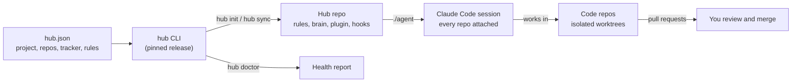
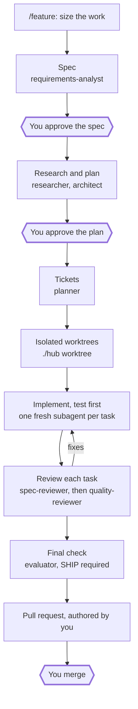
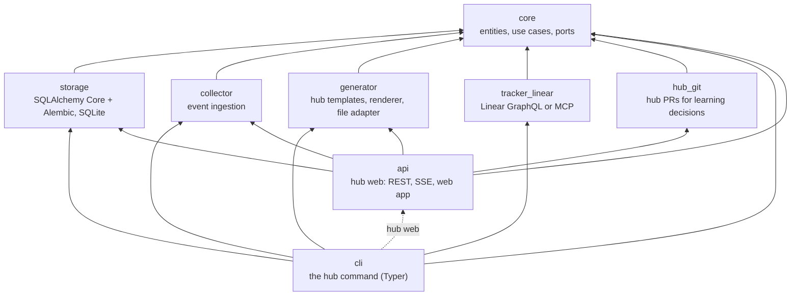

<!-- TODO: add a logo at docs/assets/logo.svg (and logo-dark.svg for a <picture> light/dark pair) -->

<h1 align="center">agent-hub</h1>

<p align="center">
  <strong>A home base for AI coding agents, for developers who run Claude Code across several repos.<br>
  One command gives each project shared rules, memory and workflow, pinned to a version and kept up to date.</strong>
</p>

<p align="center">
  <a href="https://github.com/jroquette/agent-hub/actions/workflows/ci.yml"></a>
  
  <!-- Static badge: bump with each release tag (scripts/check_release.py keeps the package versions in lockstep; follow-up: automate). -->
  
  
</p>

<p align="center">
  <a href="docs/SPEC.md">Spec</a> ·
  <a href="#-quick-start">Quick Start</a> ·
  <a href="#-usage-guide">Usage guide</a> ·
  <a href="#-roadmap">Roadmap</a> ·
  <a href="#-contributing">Contributing</a>
</p>

<!-- TODO: record a demo GIF (hub init → ./agent) and put it here -->

```bash
hub init demo --repos acme/backend,acme/frontend --tracker linear:DEMO \
  --branch-prefix jdoe/ --hub-repo acme/demo-hub
```

```text
created 74 files (52 managed, 22 seeded) and 25 links in /home/jdoe/work/demo-hub

Next steps:
  1. cd /home/jdoe/work/demo-hub
  2. review hub.json, AGENTS.project.md and README.md
  3. git add -A && git commit -m "Create the hub"
  4. start Claude Code with every repo attached: ./agent
  5. to upgrade later: edit platform.version in hub.json, then run hub sync
```

This output is for a folder where `git init` already ran; in a folder without `.git`, a `git init` step follows `cd`.

> [!IMPORTANT]
> agent-hub is **experimental** (0.x, Phase 2 of 4 in the [spec](docs/SPEC.md)). The hub generator and its commands
> work and are tested; the web control plane is read-only (it watches, it does not act yet). The repository is
> public: installing needs no credential.

## Contents

- [What is this?](#-what-is-this)
- [Why use it?](#-why-use-it)
- [How it works](#-how-it-works)
- [Quick Start](#-quick-start)
- [Run the control plane](#-run-the-control-plane)
- [Daily workflow](#-daily-workflow)
- [Usage guide](#-usage-guide)
- [Configuration](#-configuration)
- [Technical reference](#-technical-reference)
- [Roadmap](#-roadmap)
- [FAQ](#-faq)
- [Contributing](#-contributing)
- [License and credits](#-license-and-credits)

## 💡 What is this?

AI coding agents such as Claude Code can now write, test and open pull requests on their own. To do that well, they
need the same things a new teammate needs: the project's rules, its memory of past decisions, and a clear way of
working. Today that setup is written by hand, one project at a time, and it drifts as soon as a second project copies
it.

agent-hub turns that setup into a product. For each project it creates a **hub**: a small private git repository that
sits next to the project's code repositories (the *repos*) and holds everything the agents should know and follow.
Think of it as the project's operations room: the code lives in the repos, while the hub keeps the rulebook, the
notebook and the checklists that every agent session starts from.

The hub is generated by the `hub` command-line tool (CLI, a program you run in the terminal). The same tool later
updates the hub to a newer template without overwriting what your project changed, checks that the hub is healthy,
and starts agent sessions with every repo attached.

The longer-term goal, described in the [spec](docs/SPEC.md), is to also *observe* the agents: see on one screen what
each session did, decided and learned.

## ✨ Why use it?

- 🚀 **Start a new project in minutes, not days.** `hub init` writes the rules, the memory folder, the workflow plugin,
  the safety hooks and the launcher in one go.
- 🔁 **Upgrade without losing your changes.** `hub sync` updates the files the platform owns and leaves the ones your
  project owns alone; a lock file tells them apart.
- 📌 **Same behavior on every machine.** Each hub pins one release of the tool, so your laptop, CI and cloud sessions
  run exactly the same version, with no global install.
- 🛡️ **Guardrails built in.** The generated hooks block secrets, pushes to `main`, force-pushes and AI attribution, and
  keep a session from finishing while the repo's fast checks fail on the code it changed.
- 🩺 **Catch problems early.** `hub doctor` finds broken links, missing files, oversized instruction files and drift
  from the template, each with a one-line fix.
- 🧠 **Memory you control.** Agents propose what they learned into an inbox; only a human promotes it into the brain.

| Without agent-hub | With agent-hub |
| --- | --- |
| Rules, launcher and hooks copied by hand from another project | Generated from `hub.json` in one command |
| Project names hard-coded in scripts | Every project value lives in one validated file |
| Template fixes copied project by project | `hub sync` brings them in and keeps your edits |
| Each machine runs whatever version it has | The release is pinned per hub and fetched on demand |

## 🧭 How it works



You describe the project once in `hub.json`: its name, its repos, its task tracker and a few rules. The `hub` CLI turns
that file into a hub repository full of ready-to-use files. When you run `./agent` from the hub, Claude Code starts
with every repo attached and the hub's rules, memory and workflow already loaded. The agent works in isolated copies of
the repos (git worktrees), and every change reaches `main` only through a pull request that you merge.

## 🚀 Quick Start

**Prerequisites**

- What everyone on a hub needs (uv, git, Claude Code, Python 3.9 or newer, optional `gh` and tracker credential, with
  the known traps): the Requirements table of the **Join this hub** section that every generated hub's `README.md`
  carries; its source is [`README.md.tmpl`](packages/generator/src/agent_hub/generator/templates/README.md.tmpl).
- To create a hub: a GitHub repository for it (`--hub-repo`) and a Linear team for its tracker.

To join a hub that already exists instead, clone it next to the project's repos and run `./hub setup` in it (see the
hub's `README.md`, **Join this hub**); the steps below create a new hub.

**1. Check that you can run the CLI.** `uvx` builds the tagged release from git and caches it; the first run takes a
little longer.

```bash
uvx --from 'git+https://github.com/jroquette/agent-hub@v0.13.0#subdirectory=packages/agent-hub' hub --version
```

You should see `0.13.0`.

> [!TIP]
> To have `hub` on your `PATH`, install it once with
> `uv tool install 'git+https://github.com/jroquette/agent-hub@v0.13.0#subdirectory=packages/agent-hub'`.
> Generated hubs never need this: their `./hub` shim runs the release pinned in `hub.json`.

**2. Create an empty folder for the hub.** It should be a sibling of the project's repos.

```bash
mkdir -p demo-hub && cd demo-hub && git init
```

**3. Generate the hub.** Replace the project name, repos, tracker team, branch prefix and hub repo with yours
(`--hub-repo` is needed until the folder has a GitHub `origin`; for several tracker teams, list them, e.g.
`--tracker linear:APP,OPS`, the first the default). The author comes
from your git `user.name` and `user.email` unless you pass `--author-name` and `--author-email`.

```bash
uvx --from 'git+https://github.com/jroquette/agent-hub@v0.13.0#subdirectory=packages/agent-hub' \
  hub init demo --repos acme/backend,acme/frontend --tracker linear:DEMO --branch-prefix jdoe/ --hub-repo acme/demo-hub
```

You should see `created 74 files (52 managed, 22 seeded) and 25 links` followed by the next steps.

> [!NOTE]
> `hub init` writes only into an empty folder (a `.git` is fine). Run it again in the same folder and it refuses with
> `already a hub; run hub sync`, writing nothing. In a folder holding other files it refuses and suggests
> `hub sync --adopt`, which joins a hand-made hub from 0.7.0 on; with an older release, use a new empty folder instead.

**4. Check the new hub.** From now on, use the hub's own `./hub` shim.

```bash
./hub doctor
```

Expected output (the infos only say that the repos are not cloned next to the hub yet):

```text
info brain.leak ../backend: repo backend is not checked out next to the hub; its repo checks are skipped Fix: clone the repo next to the hub
info brain.leak ../frontend: repo frontend is not checked out next to the hub; its repo checks are skipped Fix: clone the repo next to the hub
0 errors, 0 warnings, 2 infos
```

**5. Check that the hub matches its release.** `--check` only plans and writes nothing.

```bash
./hub sync --check
```

You should see `up to date`.

**6. Commit it and start an agent session.**

```bash
git add -A && git commit -m "Create the hub"
./agent
```

> [!NOTE]
> `./agent` (and `hub agent`) attaches the repos listed in `hub.json` that are cloned next to the hub (`../backend`,
> `../frontend` in this example), prints a `not attached` warning for each one it cannot find, and passes every
> other argument to `claude`.

## 📡 Run the control plane

The control plane is `hub web`: a REST API and a web app that show your hubs' live sessions, workflow runs, approvals,
features and health as they happen. It listens on `127.0.0.1` only (port 7420) and stores metadata only: never
prompts, outputs or file contents. The commands below run from a clone of this repo.

**In Docker (three commands).** The image runs as a non-root user on a read-only file system, and the port is
published on the host's loopback only. The folder that holds this clone (your workspace with the hubs) is mounted
read-only; set `AGENT_HUB_HUBS_ROOT` to use another one (see `.env.example`).

```bash
make up                              # build and start; prints http://127.0.0.1:7420
make connect HUB=../my-project-hub   # register a hub and check that it sends events
make down                            # stop (the data volume is kept); make logs, make ps
```

**Locally (one command).** No Docker; the database is `~/.local/share/agent-hub/agent-hub.db` unless `AGENT_HUB_DB`
says otherwise.

```bash
make run                             # the same as uv run hub web
```

**See it with sample data.** With the app running (either way), `make demo` loads a synthetic demo hub, a live session
with a guard denial, a session waiting on a guard ask, a failed run and an ended session with its cost, so every
screen has content. It never reads your real transcripts.

**Work on the web app.** `make dev` starts the API on 7420 and the Vite dev server with hot reload on
`http://127.0.0.1:5173`, which forwards `/api` to the API; Ctrl C stops both.

A hub sends events once its release has the sensor (`plugin/hub-workflow/hooks/event_sensor.py`, from 0.9.0): move
`platform.version` in its `hub.json` and run `./hub sync`. `make connect` tells you when a hub needs it. The design
and its safety rules: [ADR 0022](docs/adr/0022-container-packaging.md); the guide for other projects:
[docs/USING.md](docs/USING.md).

## 🔄 Daily workflow

Once the hub exists, you work inside Claude Code. The hub gives it a set of slash commands (*skills*) and helper agents
(*subagents*), shipped in the generated `plugin/hub-workflow/` plugin. You type the commands, for example `/kickoff`, in
a session started with `./agent` from the hub. The commands hand parts of the work to the agents.

You stay in charge of the decisions: you approve the spec and the plan, and you merge the pull request. The agents do
the rest, and the hooks keep them inside the project's rules.

### Your session routine

1. **Start with `/kickoff`** (or after `/clear`). It shows the session brief (`./hub brief`), reads `brain/now.md` and
   the newest journal day, runs `check_fast` in each repo that has local changes, and proposes the next item. It asks
   before starting and never edits anything.
2. **Pick up an issue with `./hub start <ISSUE>`** (optional, from the hub's terminal). It creates the issue's
   worktrees in the repos (or finds them: run it again to resume), moves the issue to `tracker.states.started`, then
   opens Claude Code from the hub with those worktrees attached and the issue as the first prompt. `--repo DIR` limits
   it to some repos; `--no-agent` stops before the session and prints the command that launches it. The hub's
   `Makefile` has no target for it: call `./hub`.
3. **Do the work.** Use `/feature` for a change, `/research` or `/recall` for questions (see
   [Skills and agents](#skills-and-agents)).
4. **End with `/handoff`.** It rewrites `brain/now.md` (focus, work in flight, the exact next step, risks to watch)
   and appends what was done, verified and learned to the day's journal, `brain/journal/YYYY/MM/DD.md`. The next
   session picks up from there without you explaining it again.

### From idea to merged change: `/feature`

`/feature <idea or issue id>` is the golden path. It sizes the work first, then chains the agents below. The hexagons
are where it stops and waits for you.



The size decides the ceremony:

- **Spike**: throwaway learning. Step 0 (Brief) still applies; no spec, no tickets and no plan gate; it is timeboxed,
  the findings go to `research.md`, and nothing is merged.
- **Bounded** (the default): a few pull requests at most, with a known design. You may approve the spec and the plan
  together.
- **Architectural**: a new contract between repos or services, or a decision that warrants an ADR. Both gates apply.
  A path under `guard.ask_before_edit` alone does not make a feature architectural.

<details>
<summary><strong>What happens at each step</strong></summary>

0. **Brief.** The issue's description holds the six brief headings (Problem, Why, Why now, Outcome, Invariants,
   Acceptance criteria); the session drafts the missing ones with you, one question at a time, and writes them to the
   tracker issue.
1. **Size it.** The session asks if the size is unclear.
2. **Spec.** The `brainstorming` skill asks you questions one at a time in the main session, then
   `requirements-analyst` writes `brain/features/<slug>/spec.md` with acceptance criteria (Given/When/Then).
3. **Research and plan.** `researcher` writes `research.md` (or `/research` runs inline for small questions);
   `architect` writes `plan.md`, small tasks each with a verification command.
4. **Tickets.** `planner` writes `features.json` (checked by `./hub doctor --only features.tracker`) and `issues.md`;
   the session then creates the issues in the tracker team from `hub.json`.
5. **Workspace.** `./hub worktree <team>-<n>-<slug>` creates the worktrees, named after the issue.
6. **Implement.** One fresh subagent per task, failing test first, the repo's `check_fast` green after each task.
   Existing assertions are never weakened.
7. **Review.** `spec-reviewer` checks the diff matches the spec and plan, nothing missing and nothing extra; then
   `quality-reviewer` checks domain rules, security, idempotency and what is extra. The session weighs each finding
   and sends back only the ones it accepts.
8. **Verify and finish.** `evaluator` re-runs every check and writes `eval.md`; it must say `SHIP`. The pull request is
   opened on a `project.branch_prefix` branch, authored by you.
9. **Compound.** You go through the agents' learning proposals in `brain/_inbox/` and decide where each lands;
   `/handoff` if the work spans sessions.

</details>

> [!IMPORTANT]
> `/feature` uses two things the hub does not install:
>
> - the [superpowers](https://github.com/obra/superpowers) plugin, optional: its `brainstorming`,
>   `subagent-driven-development`, `test-driven-development` and `finishing-a-development-branch` skills are used
>   when it is enabled, and each step has a one-line fallback otherwise. To enable it, add
>   `"enabledPlugins": {"superpowers@claude-plugins-official": true}` to `.claude/settings.project.json`, run
>   `hub sync`; each developer also runs `claude plugin install superpowers@claude-plugins-official --scope local`
>   once. Cloud sessions do not install repo-declared plugins: there, enable it on the claude.ai account;
> - a tracker connector in Claude Code (for example Linear), so the session can create the issues. The `hub` CLI's
>   tracker commands, `hub next` and `hub run`, list ready issues and take one to a PR but create none.
>
> Set up the connector, and superpowers if you want it, in Claude Code before your first `/feature`.

### Skills and agents

| Command | What it does | When to use it |
| --- | --- | --- |
| `/kickoff` | Shows the brief, runs the fast checks in repos with changes, proposes the next item | At the start of a session, or after `/clear` |
| `/feature <idea or issue>` | Takes an idea to a merged, verified change (above) | For any change to the repos |
| `/fix <issue>` | Takes a bug or a small task to a PR: a failing test committed first (RED), the smallest fix, the repo's gates and one `quality-reviewer` pass; no spec, plan or `brain/features/` folder | For a bug or a small task in one repo, at most 5 changed non-test files, no new contract and no guarded path; anything bigger goes to `/feature` |
| `/handoff [title]` | Updates `brain/now.md` and the day's journal | At the end of a session |
| `/research <question or issue>` | Documents how the code works today, with `path:line` references and no critique; writes `research.md` | Before planning, or for a question that spans many files |
| `/create-plan <issue or slug>` | Turns a spec and its research into `plan.md`: small tasks, contracts first, each with a verification command; waits for your approval before any code | When a spec is ready and needs a plan |
| `/recall <topic>` | Answers "what do we know about X, why was Y decided" from the brain, ADRs and past session transcripts, with sources | Before deciding something again |
| `/learn [personal] <one sentence>` | Proposes one verified, non-obvious learning to `brain/_inbox/`; you decide whether and where it lands. With `personal`, writes your own preference or machine detail to `brain/auto/workspace/` (gitignored, never committed) | When the next session should know something |
| `/triage <issue \| --backlog \| --hygiene> [--limit N]` | Brings a tracker issue to Definition of Ready (ACs, size, repos, dependencies, a verification command), then labels it ready or `needs-human`; `--backlog` takes the unlabeled open issues one by one, `--hygiene` reports orphan, stale and duplicate issues (at most 50 read per run, or `--limit N`) | Before an issue goes to `/fix`, `/feature` or `hub run` |
| `/deliver <PR or issue>` | Drives an open PR to merged: conflicts, red CI and review threads, the gates before each push, the default branch's CI after the merge, then the tracker | After the PR is open |
| `/review <PR>` | Reviews someone else's PR against its ticket, the ADRs and the brain; posts only what you approve | For a teammate's PR or one `hub run` opened |
| `/release [version]` | Cuts a platform release: merged PRs, the bump, the check on the exact commit, notes with what `hub sync` rewrites, then the hub's pin bump | When `main` holds what the next version ships |
| `/incident <symptom or issue>` | Investigates a problem with no known reproduction: evidence, ranked hypotheses, a gated mitigation, then `/fix` and a postmortem | When `/fix` cannot start because nothing reproduces yet |
| `/refactor <issue>` | Makes a behaviour-preserving change: characterization tests first, then batched PRs that each pass `check` alone | When a refactor is too big for `/fix` and needs no spec |
| `/upgrade [package or tool]` | Bumps a dependency, toolchain or plugin pin after reading its changelog, adapting to breaking changes | For dependency and toolchain bumps |
| `/adr <question or issue>` | Records an architectural decision: options and trade-offs, your pick, a new ADR that supersedes and never edits | For a decision outside a `/feature` |
| `/onboard [propose \| apply]` | Reads each repo read-only and proposes `hub.json` values, gates and `AGENTS.project.md` with `path:line` evidence; applies them only after your approval (`propose` only writes the proposal, for a headless run) | The first session in a new hub, or after adding a repo |
| `/retro [period]` | Turns the period's run metrics into at most five evidence-backed changes to the workflows, filed as issues | Weekly, or after a rough stretch |

An AI agent that sets up agent-hub for another project follows [docs/USING.md](docs/USING.md), a runbook that ends in `/onboard`.

Claude runs `/research`, `/create-plan` and `/recall` on its own when they fit; every other command runs only when
you type it.

<details>
<summary><strong>The agents behind the commands</strong></summary>

`/feature` starts these agents, each in a fresh context. Each one reads the brain first and ends with a compound step:
at most one learning proposal for `brain/_inbox/` (the `spec-reviewer` reports plan ambiguities instead).

| Agent | Role | Writes | Read-only? |
| --- | --- | --- | --- |
| `requirements-analyst` | Drafts the spec: acceptance criteria in Given/When/Then, non-functional requirements, invariants, open questions | `spec.md` | Writes only the spec |
| `researcher` | Documents how the code works today across the repos, with `path:line` evidence | `research.md` | Yes, apart from `research.md` |
| `architect` | Turns the approved spec and research into a plan, with ADR drafts for architectural decisions | `plan.md`, `adr-draft-<topic>.md` | No code or tests |
| `planner` | Turns the approved plan into one entry per acceptance criterion and tracker issue drafts; does not call the tracker | `features.json`, `issues.md` | Writes only those two files |
| `spec-reviewer` | After each task: does the diff match the spec and plan, nothing missing and nothing extra | PASS or FAIL | Yes (no write tool) |
| `quality-reviewer` | After `spec-reviewer` passes: domain invariants, security and secrets, idempotency | APPROVE or CHANGES | Yes (no write tool) |
| `evaluator` | Final verdict: re-runs every verification, `check_fast`, `check` and `hub doctor` | `eval.md` (SHIP or NO-SHIP), `features.json` | Writes only those two files |

</details>

**Add your own.** Put a skill in `plugin/<project>/skills/<name>/SKILL.md` or an agent in
`plugin/<project>/agents/<name>.md`, then run `./hub sync`: it links them into `.claude/`, where every session in the
hub finds them. Pick a name `hub-workflow` does not use: on a clash `hub sync` stops with a conflict (exit 3) and writes
nothing until you rename yours.

### What the hooks do for you

Hooks are small scripts Claude Code runs on its own at fixed moments; you never call them. The hub has six:

- **When a session starts** (`SessionStart`), the brief from `./hub brief` is put in the agent's context. If the pinned
  release cannot run, a shorter brief with `brain/now.md` and the names of the newest journal files takes its place,
  and its header says why.
- **Before the agent runs a command or opens or changes a file** (`PreToolUse`), the *guard* blocks dangerous actions
  (force-pushes, pushes to the default branch, reading secret files, AI attribution) and asks you before risky ones
  (removing test assertions, editing the hooks or `hub.json`, paths in `guard.ask_before_edit`).
- **After each edit** (`PostToolUse`) of a file in a repo, the repo's own formatter and linter run on it (they tidy the
  code and point out mistakes: ruff for Python, prettier and eslint for JavaScript and TypeScript, when the repo has
  them installed), and any problem left over goes back to the agent.
- **When the agent wants to finish** (`Stop`), the *stop gate* runs `check_fast` in each repo checkout whose code
  changed during the session: the checkout holding the session's folder, then each one holding a file that the session
  or one of its subagents edited (read from the session's transcripts; never the hub). The session starts at the
  transcript's first timestamp; when none can be read (or it lies in the future), at the transcript file's creation
  time, else 12 hours ago, and then, if the session's folder is in no checkout, the gate checks nothing and says so when
  a repo changed. While a check fails, it blocks the finish and sends the failures back to the agent. After 3 blocks in
  a row it lets go with a warning, so a session never loops forever. When the checks pass, it reminds the agent to run
  `/handoff`. Everything fits in one 160 s budget (Claude Code stops the hook at 180 s): each check gets the repo's
  `check_fast_timeout` (150 s if unset), capped by the time left, and is stopped together with everything it started. A
  repo whose check timed out or did not get to run prints a `not run` line instead: it never blocks, and it is never
  silently counted as passing; transcripts read only in part (out of time, or past the newest 1,024 subagent files) add
  a note. A repo without `check_fast` has no Stop gate: when it changed, the gate names it (`no check_fast configured`)
  and never blocks; `hub doctor` warns.
- **Before Claude Code shortens a long conversation to free memory** (`PreCompact`), a snapshot (your last request, and
  the branch and changed files of each checkout) is saved to `brain/auto/workspace/session-snapshot.md` (your personal
  memory folder, gitignored) and put back in the context afterwards.
- **When the session ends** (`SessionEnd`), a short log entry is appended to `brain/_inbox/sessions/YYYY-MM-DD.md` for
  you to review.

<details>
<summary><strong>What the guard blocks and asks, and how to configure it</strong></summary>

**Blocked, always:**

- force-pushes and pushes to `main`, `master`, `project.default_branch` or any `repos[].default_branch`, from any
  directory;
- `curl … | sh`, and network calls to the hosts in `guard.deny_hosts`;
- deleting Docker volumes (`docker volume rm|prune`, `compose down -v`) and infrastructure commands: without
  `guard.infra`, `terraform apply|destroy|import`, any `aws` subcommand, `pulumi up|destroy`, `kubectl apply|delete`,
  `cdk deploy|destroy`; with it, see *Infra commands* below;
- reading secret files (`.env*` other than `.env.example`, `.env.sample`, `.env.template`, `.env.test`,
  `.env.development` and `.env.staging`, `*.pem`, `*.key`, `*.p12`, `*.pfx`, SSH private keys), from any tool or
  command;
- AI attribution in commits, tags and pull requests, and `claude/…` branches;
- touching the `.git` internals, and reading or changing any path in `guard.deny_paths`.

**Asked first:**

- editing the guard's own files (`plugin/hub-workflow/hooks/`, `plugin/<project>/hooks/`, `.claude/settings*.json`,
  `hub.json`, `hub.lock`), or removing or moving their folders;
- removing assertions from a test, or adding skip, xfail, quarantine or fixme markers;
- deleting or `sed`-editing test files from the shell;
- writing in `brain/` outside `now.md`, `journal/`, `_inbox/`, `auto/` and `features/`;
- editing a path in `guard.ask_before_edit`.

**Infra commands.** Set `guard.infra` in `hub.json` (even `{}`) and the guard classifies commands that run `aws`,
`cdk`, `terraform`, `pulumi`, `kubectl`, `helm`, `sam` or `serverless` by environment instead. The command is split
into parts at `;`, `&&`, `||`, `|` and newlines, and each part into its calls (at a single `&`, `$( )`, backticks,
`<( )`, `( )` and `{ }`). A command with a `guard.infra.prod_markers` match anywhere in it is blocked. Each part
and each call that names a tool must carry its environment, matched by a `guard.infra.allow` pattern (e.g.
`--profile demo-dev` or an `AWS_PROFILE=demo-dev ` prefix, whichever your patterns match, on that part: an exported
or inherited one, or one from an earlier part, does not count; neither does a trailing ` # comment`), or be
local-only (`version`, `--version`, `help` or `--help` for any tool, `kubectl`'s version only with `--client`;
`cdk synth|ls|list|init|doctor|context`, `terraform fmt|validate`, `terraform init -backend=false`,
`helm template|lint`, `sam build|validate`); anything else is blocked. On an allowed environment, deploy, destroy and delete verbs
(`terraform apply|destroy|import`, `kubectl apply|delete|…`, `aws s3 rm`, `aws … delete-*`, `cdk deploy`, …) are
asked first. A command that would pass is asked first too unless every character in it is an ASCII letter or digit,
a space, a tab or one of `_ - . / : = @ , + %`, joined only by `;`, `&&`, `||`, `|` or newlines: a `$`, a quote, a
brace, `<`, `>`, a backtick, `\`, `#`, `(`, `)`, `*`, `?`, `[`, `]`, `~`, `!`, a single `&`, a carriage return or any
other character is asked about, by name, since the guard cannot tell what the shell makes of it. So is a word that can
run a command, or change its environment, out of the guard's sight: a shell (`sh`, `bash`, `zsh`, `dash`, `ksh`,
`fish`), `python*`, `perl`, `node`, `ruby`, `php`, `xargs`, `eval`, `exec`, `source`, `.` as a command, `env -i` or
`env -u` (any spelling), `sudo`, `su`, `doas`, a lone `--`, `parallel` and a `sed` that runs its text (`sed e`,
`s/…/…/e`, `-f script`); last, a part that sets the environment twice (`AWS_PROFILE=a AWS_PROFILE=b aws …`,
`--profile a --profile b`, or under two spellings: `AWS_PROFILE=a aws … --profile b`, `--stack a -s b`); then any
environment selector the guard knows that no `guard.infra.allow` match holds whole, so a pattern must match the setting
(`--profile demo-dev`, `AWS_PROFILE=demo-dev`), not its value alone. The selectors are the variables `AWS_PROFILE`,
`AWS_DEFAULT_PROFILE`, `KUBECONFIG`, `KUBE_CONTEXT`, `HELM_KUBECONTEXT`, `TF_WORKSPACE`, `TF_DATA_DIR`,
`TF_CLI_ARGS[_*]`, `PULUMI_BACKEND_URL`, `AWS_CONFIG_FILE`, `AWS_SHARED_CREDENTIALS_FILE`, `AWS_ROLE_ARN` and
`CDK_DEFAULT_ACCOUNT` named anywhere in the command (any word holding the name as an identifier, so `export AWS_PROFILE`,
`read AWS_PROFILE` or `printf -v AWS_PROFILE staging` ask too), and the flags `--profile`, `--aws-profile`, `--context`,
`--kube-context`, `--cluster`, `--server`, `--user`, `--kubeconfig`, `--kube-apiserver`, `-chdir`, `--cwd`, `--stack`,
`-s`, `--stage`, `--workspace`, `-var-file`, `-backend-config` (one dash or two where terraform takes both) and
pulumi's `-C`, as `--x v` or `--x=v`, in a part that names a tool: `AWS_PROFILE=staging terraform plan
-var-file=dev.tfvars` is asked about even though `-var-file=dev.tfvars` is allowed. Last, commands that change a
tool's own configuration are always asked about: `aws configure set|import`, `kubectl config
set-context|use-context|set-cluster|set-credentials|use|set|rename-context|delete-context`, `terraform workspace
select|new`, `pulumi stack select`. A deploy verb's ask keeps its
reason. Other selectors (`--endpoint-url`, `--region`, `TF_VAR_*`), abbreviated or glued options (`--prof`,
`-sprod`) and globs are not checked. A tool word with
nothing after it (`… | xargs aws`), or with a `$`, `,` or `}` glued to it (`aws$x`, `{aws,s3}`), counts as a call
with no environment. The tool is found behind wrappers, quotes and redirections (`env aws …`, `bash -c "aws …"`,
`aws>/dev/null …`), but its name is case-sensitive and quoting tricks inside it (`a""ws`) hide it. If `guard.infra` or
one of its patterns cannot be used (a wrong value, or regex syntax the system Python 3.9 lacks), every infra command
is blocked until it is fixed. Patterns are Python `re`, searched with no flags on every such command: avoid nested
quantifiers like `(a+)+`. With `guard.infra`, the generated `.claude/settings.json` no longer denies `terraform *`
and `aws *`, so the guard decides those commands (every other deny stays); run `./hub sync` after adding or removing
`guard.infra`, and add `Bash(terraform *)` or `Bash(aws *)` to `permissions.deny` in `.claude/settings.project.json`
to keep a blanket deny. The sandbox still limits the network: add your cloud API hosts to
`sandbox.network.allowedDomains` in `.claude/settings.project.json`, then run `./hub sync`. Listing the tools in
`sandbox.excludedCommands` instead runs them outside the sandbox with the host's credentials and network.

Everything else goes through Claude Code's normal permission rules.

**Configuration.** The lists come from `hub.json`: `guard.ask_before_edit`, `guard.deny_paths` and `guard.deny_hosts`,
plus `project.default_branch` and each `repos[].default_branch`. The branch hint's prefix is the developer's
(`hub.local.json`, else `hub.json`, else git config; see [developer-identity](docs/design/developer-identity.md)).
An entry `@hub/<path>` means
`<path>` inside the hub. A `hub.json` named by `$HUB_CONFIG` can only add entries to these lists, never remove them.
Only the hub's own `hub.json` turns `guard.infra` on and sets `guard.infra.allow`: `hub.local.json` cannot set it, and
a `$HUB_CONFIG` file can only add `guard.infra.prod_markers`.

**Your own rules.** The seeded `plugin/<project>/hooks/project_guard.py` defines `check(event, cfg)`, which returns
`None`, or `("ask", reason)` or `("deny", reason)`; by default it does nothing. It runs in a separate process with a
3-second timeout, only when the base guard did not already deny, and it can only make the verdict stricter. A crash, a
timeout or an unexpected answer becomes an ask that names the cause. `hub doctor` (rule `hooks.guard-extension`)
checks that the file parses and defines `check`.

**When something goes wrong.** If the guard itself fails, it asks you; it never lets a call through unchecked. The
other hooks fail open: on an error they print one line and let the session continue. All hooks are Python 3.9
standard-library scripts run by the system `python3`.

**Where they are wired.** The hub's `.claude/settings.json` runs the hooks from `plugin/hub-workflow/hooks/`, so they
also work in cloud sessions, which do not install plugins. Do not also enable `hub-workflow` from a plugin
marketplace: the hooks would run twice.

</details>

> [!TIP]
> **This README was built this way.** Issue AGH-33 went through `/feature`: sized *bounded*, spec and plan approved,
> tickets, a worktree, the implementation, then a real run of the Quick Start and the spec and quality reviews, which
> caught real gaps (a wrong expected output, missing credential and install caveats) before the evaluator and
> [pull request #24](https://github.com/jroquette/agent-hub/pull/24). The workflow docs it lacked became AGH-40, this
> section.

## 📖 Usage guide

### Tutorial: from an empty folder to a working session

This is the most common path: a project with two repos tracked in Linear.

1. **Lay out the workspace.** The hub and the repos are siblings, because every repo is found at `../<dir>` from the
   hub:

   ```text
   work/
   ├── demo-hub/   # the hub (this is where you run ./agent)
   ├── backend/    # repos[0].dir in hub.json
   └── frontend/   # repos[1].dir in hub.json
   ```

2. **Generate the hub** with `hub init` (Quick Start, step 3). It writes three kinds of things:
   - **managed** files, owned by the platform and rewritten by `hub sync` (base rules in `AGENTS.md`, the
     `plugin/hub-workflow/` plugin, `.claude/settings.json`, the `./hub` and `./agent` shims, the `Makefile`, whose `next` and `run-issue` targets call `hub next` and
     `hub run`);
   - **seeded** files, written once and then yours (`hub.json`, `AGENTS.project.md`, `Makefile.project`, the `brain/`
     skeleton, the project plugin `plugin/<project>/`);
   - **links** from `.claude/agents/` and `.claude/skills/` into the plugins.

   `hub.lock` records which is which, so later syncs never touch your files.

3. **Make it yours.** Put project rules in `AGENTS.project.md`, project make targets in `Makefile.project`, and the
   current focus in `brain/now.md`. Set each repo's `check_fast` and `check` commands in `hub.json`.

4. **Start each session from the hub.** `./hub brief` prints what the agent should know first: `brain/now.md`, the
   last journal days and each repo's git, PR and CI state. The SessionStart hook injects the same brief.

5. **Work in isolated worktrees.** For issue `DEMO-7`, `./hub worktree demo-7-login` creates
   `<repo>/.claude/worktrees/demo-7-login` on branch `jdoe/demo-7-login` in every repo, from a freshly fetched
   `origin/main`. Remove them with `./hub worktree --remove demo-7-login` (branches are kept).

6. **Keep the hub healthy.** Run `./hub doctor` in CI or before a release of your hub, and upgrade with the recipe
   below. Your hub's CI needs no secret for this public repository; only when `platform.repository` names a private
   source does `./hub` need the Actions secret `AGENT_HUB_READ_TOKEN`, a token with read-only Contents on that
   repository only ([the hub's CI](docs/design/hub-adopt.md#in-the-hubs-ci)).

### Recipes

<details>
<summary><strong>Upgrade a hub to a newer release</strong></summary>

Edit `platform.version` in `hub.json`, then sync through the shim, which already runs the new release:

```bash
./hub sync --check   # plan only: exit 4 when changes are pending, 3 on a conflict
./hub sync           # apply: managed files are rewritten, seeded files are left alone
```

`./hub sync` prints `up to date` when nothing changed. A `hub` whose version differs from the pin refuses to sync and
prints the pinned `uvx` command to use instead.

</details>

<details>
<summary><strong>Create a hub from an existing <code>hub.json</code></strong></summary>

The recipes that call a bare `hub` assume it is installed (Quick Start tip), or prefixed with the `uvx --from …` of
step 1.

```bash
hub init --config path/to/hub.json --dir path/to/new-hub
```

The file's `platform.version` must equal the running CLI's version.

</details>

<details>
<summary><strong>Run only some <code>hub doctor</code> rules, or get JSON</strong></summary>

```bash
./hub doctor --only links.dead --only instructions.size
./hub doctor --json
```

Exit codes: `0` no errors, `1` at least one error, `2` usage error. Rules and their meaning are in
[docs/design/hub-doctor.md](docs/design/hub-doctor.md).

</details>

<details>
<summary><strong>Create worktrees in one repo only</strong></summary>

```bash
./hub worktree demo-7-login --only backend
```

A repo can ship executable `scripts/worktree-setup.sh` and `scripts/worktree-teardown.sh`; `hub worktree` (and
`hub run`, setup only) runs them with the worktree path and `HUB_WORKTREE_NAME`, `HUB_WORKTREE_BRANCH`, `HUB_REPO_DIR`,
`HUB_HUB_DIR`, `HUB_WORKTREE_SLOT` and `HUB_PORT_OFFSET`, for env files, databases or ports. `HUB_REPO_DIR` and
`HUB_HUB_DIR` are the repo's and the hub's main checkouts; `HUB_PORT_OFFSET` is the slot × 100, to add to the repo's
ports, and two tasks can share a slot. See [docs/design/worktree-environment.md](docs/design/worktree-environment.md).

</details>

<details>
<summary><strong>Store agent events (synthetic data only, for now)</strong></summary>

`hub collect` ingests canonical events (the [event model](docs/SPEC.md#data-sources-and-event-model)) from JSON Lines,
all or nothing:

```bash
cat > events.jsonl <<'EOF'
{"project":"demo","session":"s-1","type":"session.start","timestamp":"2026-10-01T09:00:00+00:00","source":"claude_code","source_id":"evt-1"}
{"project":"demo","session":"s-1","type":"tool.call","timestamp":"2026-10-01T09:00:05+00:00","source":"claude_code","source_id":"evt-2","payload":{"tool":"Read"},"repo":"backend"}
EOF
hub collect events.jsonl --db ./events.db
```

```text
appended 2, duplicates 0
```

Running it again prints `appended 0, duplicates 2`: an identical event is skipped, never written twice.

> [!WARNING]
> Redaction of secrets is not built yet. Until it ships, feed `hub collect` synthetic events only, never real
> transcripts or hook payloads.

</details>

## 🧾 Configuration

### `hub.json`

`hub.json` is the only place with project values. It is plain JSON, validated by the `HubConfig` model, with a JSON
Schema (`hub.schema.json`) for editors. Unknown keys are errors; keys starting with `_` are ignored. Full contract:
[docs/design/project-config.md](docs/design/project-config.md).

| Key | Required | Default | Description |
| --- | --- | --- | --- |
| `schema_version` | yes | | Always `1` for now |
| `platform.version` | yes | | The agent-hub release the hub runs (`X.Y.Z`) |
| `platform.repository` | no | `git+https://github.com/jroquette/agent-hub` | The platform's git source, `git+https://<host>/<path>`, e.g. a private fork; the hub runs `<repository>@v<platform.version>#subdirectory=packages/agent-hub` |
| `project.name` | yes | | Kebab-case project name |
| `project.hub_repo` | yes | | GitHub `owner/name` of the hub |
| `project.branch_prefix` | no | per developer | Prefix of every branch, e.g. `jdoe/`; leave it out on a team hub (see `hub.local.json` below) |
| `project.default_branch` | no | `main` | Base of worktrees unless a repo sets its own; the guard blocks pushes to it |
| `project.author_name`, `project.author_email` | no | per developer | Author of commits and PRs; leave them out on a team hub (see `hub.local.json` below) |
| `project.conventions.branch` | no | `{prefix}{issue_lower}-{slug}` | Branch pattern; placeholders `{prefix}`, `{ISSUE}`, `{issue_lower}`, `{slug}`, and it needs `{ISSUE}` or `{issue_lower}` |
| `project.conventions.commit_title` | no | `{type}({scope}): {summary} ({ISSUE})` | Commit title pattern; placeholders `{ISSUE}`, `{type}`, `{scope}`, `{summary}`, and it needs `{summary}` |
| `project.conventions.pr_title` | no | the effective `commit_title` | PR title pattern, with `commit_title`'s placeholders |
| `tracker.kind` | yes | | Task tracker; only `linear` today |
| `tracker.team` | one of the two | | Tracker team key, e.g. `DEMO` |
| `tracker.teams` | one of the two | | Several team keys, the first the default, e.g. `["APP", "OPS"]` |
| `tracker.transport` | no | `api` | How the CLI reaches Linear: `api` (GraphQL with `LINEAR_API_KEY`) or `mcp` (the Linear MCP server through `claude -p`, [ADR 0015](docs/adr/0015-linear-mcp-tracker-transport.md)); `hub.local.json` may set it per developer |
| `tracker.ready_label` | no | `agent-ready` | Label of issues an agent may pick up |
| `tracker.failed_label` | no | `agent-failed` | Label set when an agent run fails |
| `tracker.states.started` | no | `In Progress` | State `hub start` moves an issue to: on a fresh start, or on a resume while the issue is unstarted |
| `tracker.states.review` | no | `In Review` | Reserved for the review step; not read yet |
| `repos[].dir` | yes | | Folder name of the repo, next to the hub |
| `repos[].github` | yes | | GitHub `owner/name` |
| `repos[].role` | no | `app` | Free string; `app` is the only known value |
| `repos[].check_fast` | no | | The repo's fast gate command, run by the Stop hook; unset or blank, the repo has no Stop gate |
| `repos[].check_fast_timeout` | no | `150` | Seconds the Stop hook gives `check_fast` (1–160, within its 160 s budget) |
| `repos[].check` | yes | | The repo's full gate command (not blank), run before a PR |
| `repos[].default_branch` | no | `project.default_branch` | Base of the repo's worktrees and PRs; the guard blocks pushes to it |
| `repos[].conventions` | no | | Overrides `project.conventions` for this repo, key by key |
| `guard.ask_before_edit` | no | `[]` | Paths where the guard asks before an edit |
| `guard.deny_paths` | no | `[]` | Paths the guard never lets the agent read or edit |
| `guard.deny_hosts` | no | `[]` | Hosts the guard blocks network calls to |
| `guard.infra` | no | absent | Present, even `{}`, the guard classifies infra commands by environment (see the guard section) and `.claude/settings.json` drops its `terraform *` and `aws *` denies (after `./hub sync`); absent, the fixed infra rule |
| `guard.infra.allow` | no | `[]` | Python `re` patterns for allowed environments, e.g. `(?<![^ \t])--profile[= ]demo-dev(?![^ \t])` and `^[ \t]*AWS_PROFILE=demo-dev(?=[ \t])`; bound each by a space or tab (an `AWS_PROFILE` prefix by the part's start), since `\b` also matches `demo-dev.x` or `>--profile=demo-dev` and `\s` also matches a carriage return the shell does not split on |
| `guard.infra.prod_markers` | no | `[]` | Python `re` patterns that mark production; a match anywhere in an infra command blocks it |
| `modules` | no | `{}` | Optional modules (`cloud`, `bench`, `contract-sync`, `marketplace`), from 0.6.0: each selected one renders its files and `mk/<id>.mk`; `contract-sync` takes `{"source": <repo dir>, "target": <repo dir>}`, the others `{}` |
| `doctor.rules` | no | `{}` | Per-rule `hub doctor` settings |

Example (synthetic project):

```jsonc
{
  "$schema": "./hub.schema.json",
  "schema_version": 1,
  "platform": { "version": "0.13.0" },         // the release ./hub runs
  "project": {
    "name": "demo",
    "hub_repo": "acme/demo-hub",
    "branch_prefix": "jdoe/",                   // branches: jdoe/<team>-<n>-<desc>
    "author_name": "Jane Doe",
    "author_email": "jane@example.com"
  },
  "tracker": { "kind": "linear", "team": "DEMO" },
  "repos": [
    {
      "dir": "backend",                         // cloned at ../backend
      "github": "acme/backend",
      "check_fast": "make check-fast",          // the Stop hook runs this
      "check_fast_timeout": 120,                // seconds the Stop hook gives it (1–160)
      "check": "make check"                     // the full gate before a PR
    }
  ],
  "guard": { "ask_before_edit": ["backend/docs/adr"] }
}
```

> [!NOTE]
> The comments above are for reading only: `hub.json` is plain JSON and must not contain comments.

### `hub.local.json`

On a hub shared by a team, leave the identity out of `hub.json`: each developer sets their own in a `hub.local.json`
at the root of the hub's main checkout. It is never committed, and only the CLI and the hooks read it, never `hub sync`.
`./hub setup` proposes it from the hub's git config and writes it after asking (`--yes`: without asking); it never
rewrites an existing one.

```json
{"project": {"branch_prefix": "jane/", "author_name": "Jane Roe", "author_email": "jane@example.com"},
 "tracker": {"transport": "mcp"}}
```

- **Keys:** only `project.branch_prefix`, `project.author_name`, `project.author_email` and `tracker.transport`, with
  `hub.json`'s rules, plus `_` comment keys; at most 64 KiB. Any other key is an error (`hub doctor` reports it).
- **Precedence, per key:** `hub.local.json`, else `hub.json`, else the hub repo's `git config user.name`/`user.email`.
  With no prefix in either file, the prefix is your email's local part plus `/` (`jane@example.com` gives `jane/`).
  With none at all, `hub worktree`, `hub run` and `hub start` refuse and name the three sources; `hub setup` reports
  the identity as missing.
- **Existing hubs:** `hub init` writes `hub.local.json` into `.gitignore`, but `.gitignore` is seeded, so `hub sync`
  never adds it. Add the line by hand: `echo hub.local.json >> .gitignore`.
- Nothing in it relaxes the guard: it cannot add or remove a guarded path, host, protected branch or repo.
- **Personal memory (existing hubs):** `hub sync` creates `brain/auto/workspace/.gitkeep` but never rewrites
  `.gitignore`; add both lines: `printf 'brain/auto/workspace/*\n!brain/auto/workspace/.gitkeep\n' >> .gitignore`.
  If a memory file was committed, `git ls-files brain/auto/workspace` lists it; run `git rm --cached -- <file>` for
  each one except `.gitkeep`. It stays on your disk and in history, but teammates who pull that commit lose their
  copy: tell them to copy it out first (or restore it with `git show <commit>~1:<file> > <file>`). `hub doctor`
  warns (`brain.memory`) until both lines are in `.gitignore` and no memory file is tracked.

Contract: [docs/design/developer-identity.md](docs/design/developer-identity.md).

### Environment variables

| Name | Required | Default | Description |
| --- | --- | --- | --- |
| `LINEAR_API_KEY` | for `hub next`, `hub run` and `hub start` with `tracker.transport` `"api"` (the default) | | Linear API key, read at call time; never stored in `hub.json`; `hub setup` reports it when missing |
| `AGENT_HUB_DB` | no | `$XDG_DATA_HOME/agent-hub/agent-hub.db`, else `~/.local/share/agent-hub/agent-hub.db` | Event database of `hub collect`; `--db` overrides it |
| `XDG_DATA_HOME` | no | | Used for the default database path when it is absolute |
| `HUB_AUTHOR_NAME`, `HUB_AUTHOR_EMAIL` | no | | Module `cloud`: your commit author in a cloud session, read by `scripts/cloud-setup.sh` only when `hub.json` names no author; written to the repo-local git config of the hub and each repo, never the global one (unset: a `WARN`, and commits carry the container's identity) |
| `AGENT_HUB_CLAUDE_PROJECTS` | no | `~/.claude/projects` | The only folder `hub web` reads transcripts from (absolute path) |
| `AGENT_HUB_ALLOWED_HOSTS` | no | | Extra exact `host[:port]` names `hub web` answers besides its loopback ones (comma list, never `*`) |
| `AGENT_HUB_IN_CONTAINER` | no | | Set to `1` by the agent-hub image only: lets `hub web --host` bind outside loopback inside the container |
| `AGENT_HUB_WEB_URL` | no | `http://127.0.0.1:7420` | Where a hub's event sensor sends events (loopback URLs only) |
| `AGENT_HUB_HUBS_ROOT`, `AGENT_HUB_PORT` | no | the folder holding this clone, `7420` | `make up`: the hubs folder mounted read-only, the host port (on 127.0.0.1) |
| `AGENT_HUB_ROOT` | no | the current folder | The hub folder for `hub setup`, `hub worktree`, `hub brief`, `hub agent`, `hub start`, `hub next`, `hub run` and `hub bench` (`hub sync` and `hub doctor` use the current folder); the `./hub` shim sets it for you |
| `BENCH_EFFORT` | no | `medium` | Module `bench`: the `effortLevel` of `hub bench`'s sessions, `low`, `medium` or `high` |

## 🧱 Technical reference

<details>
<summary><strong>Architecture</strong></summary>

agent-hub is a [uv](https://docs.astral.sh/uv/) workspace with one package per component, all in the implicit
namespace `agent_hub`, organized as a lean hexagonal architecture (ports and adapters): the domain and use cases live
in `core`, and every other package is an adapter around it. The CLI is the composition root that wires them together.



| Package | Distribution | Role |
| --- | --- | --- |
| `packages/core` | `agent-hub-core` | Entities, the canonical event, `HubConfig`, the init and sync planners, the doctor rules, ports (`EventStore`, `TrackerClient`), test fakes and contract suites |
| `packages/storage` | `agent-hub-storage` | SQLite event store and the Alembic migrations, shipped in the package |
| `packages/collector` | `agent-hub-collector` | Event collector adapter |
| `packages/generator` | `agent-hub-generator` | Hub templates as package data, the `@@` renderer, the managed/seeded registry, the file adapter |
| `packages/tracker_linear` | `agent-hub-tracker-linear` | `TrackerClient` over Linear's GraphQL API (stdlib only), and `McpTrackerClient` over the Linear MCP server through `claude -p` ([ADR 0015](docs/adr/0015-linear-mcp-tracker-transport.md)) |
| `packages/hub_git` | `agent-hub-hub-git` | Opens a hub pull request for a learning accepted or rejected in `hub web`, with `git` and `gh` from a temporary clone ([ADR 0024](docs/adr/0024-learning-actions-from-the-app.md)) |
| `packages/cli` | `agent-hub-cli` | The `hub` command |
| `packages/api` | `agent-hub-api` | `hub web`: the local REST and SSE API and the built web app ([ADR 0017](docs/adr/0017-api-second-composition-root.md)) |
| `packages/agent-hub` | `agent-hub` | Meta-package that installs all of the above |

`core` imports nothing internal; the five adapters never import each other; nothing imports `cli`, and `api` is
reached only from `hub web`. import-linter enforces this in `make check`. Details: [docs/ARCHITECTURE.md](docs/ARCHITECTURE.md).

</details>

<details>
<summary><strong>Folder structure</strong></summary>

```text
.
├── packages/                # one uv workspace member per component (see Architecture)
│   └── <pkg>/
│       ├── src/agent_hub/<pkg>/
│       └── tests/{unit,contract,integration}/
├── tests/
│   ├── unit/scripts/        # tests of the repo scripts
│   └── e2e/                 # installed hub + gate self-tests
├── scripts/                 # repo tooling: test layout, pytest levels, coverage floors, PR title, release, schema export
├── docs/
│   ├── SPEC.md              # product spec: vision, layers, event model, phases
│   ├── ARCHITECTURE.md      # packages, dependency rule, where code goes
│   ├── CONVENTIONS.md       # code rules and the tool that enforces each
│   ├── TESTING.md           # test levels, layout, fixtures, coverage floors
│   ├── CONTRIBUTING.md      # task workflow, branches, PRs, releases
│   ├── API.md               # REST API standard (Phase 2)
│   ├── design/              # one design doc per subject (config, generator, sync, doctor, …)
│   └── adr/                 # architecture decision records
├── .github/workflows/       # ci (make check), pr-title, release (tag check)
├── llms.txt, llms-full.txt  # the docs for AI agents, generated by scripts/build_llms_txt.py
├── CHANGELOG.md             # notable changes per release (Keep a Changelog)
├── SECURITY.md              # how to report a vulnerability
├── LICENSE, NOTICE          # Apache License 2.0 and attribution
├── Makefile                 # the gates: check-fast and check
└── pyproject.toml           # virtual workspace root, ruff config, dev tools
```

</details>

<details>
<summary><strong>CLI reference</strong></summary>

| Command | What it does |
| --- | --- |
| `hub init [PROJECT] --repos … --tracker kind:TEAM[,TEAM…] …` | Create a hub from flags (all flags: Quick Start step 3 and `hub init --help`) |
| `hub init --config hub.json [--dir …]` | Create a hub from an existing `hub.json` |
| `hub sync [--check]` | Reapply the templates without overwriting what the project customized |
| `hub sync --adopt [--accept PATH]… [--check]` | Join a hand-made hub to `hub.lock` (from 0.7.0): record what matches, create what is missing, list what differs |
| `hub doctor [--only RULE]… [--json]` | Check rules, links, dead references, instruction size and template drift |
| `hub setup [--yes]` | Set up this machine for the hub: tools (uv, git, python3, claude, gh) and the tracker credential, the developer identity (`hub.local.json` proposed from git config and written after asking; `--yes` without asking), each repo cloned or fetched next to the hub, then `hub doctor`; exit 0 when every line is `ok`, else 1, each missing line naming its fix |
| `hub worktree NAME [--only REPO] [--remove] [--no-fetch]` | Create (or remove) one task's worktrees in the hub's repos; `--no-fetch` starts from the already-fetched base |
| `hub brief [--no-network]` | Print the session brief: `now.md`, recent journal, repo/PR/CI state |
| `hub agent [ARGS…]` | Start `claude` with every repo attached; all arguments go to `claude` |
| `hub next` | Print the tracker's ready issues (`tracker.ready_label`), oldest first: id, repo, title and url |
| `hub run ISSUE --repo REPO [--live] [--max-turns N] [--budget USD] [--model M] [--effort low\|medium\|high] [--from implement\|verify]` | Take one issue to a PR: worktree, a headless implementing session, the repo's gate, PR, tracker report. Refuses (exit 1) an issue whose description lacks a brief section. A dry run unless `--live`; defaults `--max-turns 40`, `--budget 3.0`, `--model sonnet`, `--effort medium`; `--from verify` runs the gate, PR and report on the commits already made |
| `hub start ISSUE [--repo DIR]… [--no-agent]` | Start an issue: its worktrees (named `<issue>-<title slug>`), the issue moved to `tracker.states.started`, then `claude` from the hub with those worktrees attached and the issue as first prompt; a rerun resumes the task; `--no-agent` prints how to launch it |
| `hub bench [--validate] [--runs N] [--cases IDS] [--budget USD] …` | Benchmark the `hub-workflow` plugin on closed issues (module `bench`); `--validate` checks the graders |
| `hub web [--host HOST] [--port N] [--db PATH]` | Serve the control plane (REST API and web app) on `127.0.0.1:7420` until interrupted; another address only inside the agent-hub container (`AGENT_HUB_IN_CONTAINER=1`) |
| `hub collect [FILE\|-] [--db PATH]` | Ingest canonical events from JSON Lines, all or nothing |
| `hub --version` | Print the version |

Command contracts: [docs/design/hub-generator.md](docs/design/hub-generator.md), [hub-sync.md](docs/design/hub-sync.md),
[hub-adopt.md](docs/design/hub-adopt.md), [hub-doctor.md](docs/design/hub-doctor.md),
[hub-setup.md](docs/design/hub-setup.md), [hub-start.md](docs/design/hub-start.md).

</details>

<details>
<summary><strong>Stack and technical decisions</strong></summary>

| Choice | Why | Decision |
| --- | --- | --- |
| Python 3.14, uv workspace, one package per component | Clear boundaries, one lockfile, `uv tool install` gets everything | [ADR 0001](docs/adr/0001-uv-workspace-with-namespace-packages.md) |
| Lean hexagonal architecture | Domain logic testable with in-memory fakes; adapters swappable | [ADR 0002](docs/adr/0002-lean-hexagonal-architecture.md) |
| SQLAlchemy Core + Alembic on SQLite | Local-first now, Postgres by config later | [ADR 0003](docs/adr/0003-persistence-sqlalchemy-core-and-alembic.md) |
| CLI as the composition root | Only one place wires adapters to use cases | [ADR 0008](docs/adr/0008-cli-as-composition-root.md) |
| Managed vs seeded files, guarded by `hub.lock` | Sync can upgrade a hub without touching project edits | [ADR 0009](docs/adr/0009-hub-sync-by-file-ownership.md) |
| `hub.json` stays JSON with a Pydantic model | Hooks read it with the Python 3.9 standard library | [ADR 0010](docs/adr/0010-hub-json-config-contract.md) |
| Templates as package data; hub logic in the CLI | Hubs hold files and thin shims; logic is versioned and tested here | [ADR 0011](docs/adr/0011-templates-as-package-data.md), [ADR 0012](docs/adr/0012-cli-subsumes-hub-scripts.md) |
| Releases are git tags run through `uvx` | No package index; each hub pins its own release | [ADR 0013](docs/adr/0013-release-by-git-tags.md) |
| Tracker behind a core port; Linear over GraphQL | Swappable tracker; no SDK dependency | [ADR 0014](docs/adr/0014-tracker-port-linear-graphql.md) |
| A Linear MCP transport, chosen by `tracker.transport` | Machines without a Linear API key reach the tracker; each `claude -p` call gets only the Linear tools it needs | [ADR 0015](docs/adr/0015-linear-mcp-tracker-transport.md) |
| Identity from `hub.local.json`, then `hub.json`, then git config | A team shares one hub; each developer keeps their own branch prefix and author | [ADR 0016](docs/adr/0016-per-developer-identity.md) |

Generated hooks are the exception to "logic lives in the CLI": they stay Python 3.9 standard-library scripts that never
need the CLI. All but the guard fail open (the guard asks instead), so a session never breaks because of the
platform. Details: [What the hooks do for you](#what-the-hooks-do-for-you).

</details>

<details>
<summary><strong>Development setup</strong></summary>

Requirements: uv 0.9.0 or newer (CI pins 0.12.19) and a final Python 3.14 build. For the generator's hook tests, a
`python3.9` on `PATH` runs the rendered hooks on 3.9 as well (they are skipped locally without it).

```bash
uv sync --all-packages          # once per clone or worktree
uv run hub --help               # run the CLI from your checkout
make help                       # list the targets
```

The two gates:

- `make check-fast`, while working: format, lint, mypy `--strict`, test layout, version lockstep, unit and contract tests.
- `make check`, before a PR and in CI: `check-fast` plus integration and e2e tests, import contracts, migrations and
  coverage floors.

```bash
make check-fast > check-fast.log 2>&1; echo $?
make check > check.log 2>&1; echo $?
```

> [!TIP]
> Redirect the output and check the exit code: `make check | tail` hides it. Never run the gates with `-j`.

Coverage floors: `core` 90%, every other package 80%. Test levels and rules: [docs/TESTING.md](docs/TESTING.md).
Code rules: [docs/CONVENTIONS.md](docs/CONVENTIONS.md). Database migrations and the `hub.json` schema export:
[docs/CONTRIBUTING.md](docs/CONTRIBUTING.md).

</details>

## 📍 Roadmap

From the phases in [docs/SPEC.md](docs/SPEC.md#mvp-and-phases). Each phase starts when the previous one's gate passes.

**Done**

- [x] Phase 0, foundation: uv workspace, ADRs, `check-fast`/`check` gates, CI, the canonical event and `hub collect`
- [x] `hub init` with managed and seeded files, `hub.lock` and the `hub.json` schema
- [x] `hub sync` and `hub sync --check`
- [x] `hub doctor` with its rule set
- [x] `hub worktree`, `hub brief`, `hub agent`, and the `./hub` and `./agent` shims pinned per hub (release 0.4.0)
- [x] Tracker port with a Linear GraphQL adapter
- [x] `hub next` and `hub run`: take an `agent-ready` issue to a PR through the tracker port
- [x] Optional modules (`cloud`, `bench`, `contract-sync`, `marketplace`), their files and `hub bench` (release 0.6.0)
- [x] `hub sync --adopt [--accept PATH]…`: join a hand-made hub (release 0.7.0)
- [x] Dogfooding: the platform's own hub adopted with `hub sync --adopt` at 0.8.0
- [x] `hub start`, `hub setup` and `hub ship` (release 0.9.0)
- [x] The guard's infra rules and a hub workflow that works inside Claude Code's sandbox (release 0.10.0)
- [x] Phase 2's first slice: the control plane `hub web` with the hook sensor, transcript collector and redaction
  (release 0.9.0), then readable sessions, problems, learnings and the Brain browser (release 0.11.0)

**Now: Phase 1 gate and Phase 2**

- [ ] Phase 1 gate: an existing project's hand-made hub recreated with the same `make check` and bench
- [ ] Phase 2 gate: sessions of both projects live and in history

**Next**

- [ ] Phase 3, knowledge and decisions: provenance in the brain, inbox triage in the UI, extracted decisions, learning
  metrics
- [ ] Phase 4, workflows as data: a Python engine running declarative workflow documents, gates approved from the UI,
  adapters for other agents

## ❓ FAQ

**Do I need to know how to program to use it?**
You need to be comfortable in a terminal and with git: you run a few commands and edit one JSON file. The agents do
the programming; you review and merge their pull requests.

**Is it free? Can I use it in my company?**
Yes. agent-hub is open source under the [Apache License 2.0](LICENSE): you may use, change and redistribute it,
commercially too, as long as you keep the license and [NOTICE](NOTICE). It is experimental, and comes with no
warranty.

**Does it replace Claude Code?**
No. agent-hub prepares and launches Claude Code sessions (and will observe them); it is not an agent or a model
runtime.

**Will `hub sync` overwrite my changes?**
Not the files your project owns. `hub.lock` records which files are managed by the platform and which were seeded for
you. A managed file you edited by hand shows up as a conflict instead of being overwritten silently; run
`hub sync --check` first to see the plan.

**Does it send my code or transcripts anywhere?**
agent-hub itself runs on your machine and has no server: `hub collect` writes to a local SQLite file. Its network calls
go to GitHub: fetching the pinned release, `git fetch` in `hub worktree` and `hub start`, `git clone` or `git fetch`
of each repo and `gh auth status` in `hub setup`, the push and `gh pr create` of `hub run --live`, and `gh` for the
PR and CI lines of `hub brief` unless you pass `--no-network`. The generated `make usage` target downloads `ccusage`
from npm. `hub next`, `hub run` and `hub start` call Linear, with `LINEAR_API_KEY` or, with `tracker.transport`
`"mcp"`, through your Linear MCP server and `claude -p`. Your agent sessions still talk to their model provider as usual.

**Why does an agent's `git fetch` fail with `Broken pipe`, or `./hub` with `Operation not permitted`?**
That is Claude Code's sandbox, which every hub's `.claude/settings.json` turns on on purpose: agents' Bash may write only
in the workspace and `$TMPDIR`, reach only allowlisted HTTP(S) hosts, and never SSH. The hub's own network commands
(`git fetch`/`push`, `gh`, `./hub worktree`, `make worktree`) are excluded, but only when the Bash call is exactly that
command: `cd repo && git fetch`, `git -C repo fetch` or a redirect stay sandboxed. A failed fetch in `hub worktree`
prints the bare `git fetch` to run, then `./hub worktree --no-fetch <name>`. Since 0.10.0 the `./hub` shim moves uv's
folders into the hub (`.hub-uv/`) when the sandbox denies them, and `./hub doctor` checks it all (`sandbox.workflow`).

**Which trackers and agents are supported?**
Linear and Claude Code today. The tracker is a port (`TrackerClient`) and the event model is agent-neutral, so other
trackers and agents can come in as adapters.

## 🤝 Contributing

The full process is in [docs/CONTRIBUTING.md](docs/CONTRIBUTING.md). In short:

1. Start from a Linear issue in team AGH that meets the Definition of Ready.
2. Branch from a freshly fetched `origin/main` as `roquettejh/agh-<n>-<desc>`, run `uv sync --all-packages`, write the
   failing test first, and run `make check-fast` while you work.
3. Run `make check` before opening the PR. A change of scope or architecture updates
   [docs/SPEC.md](docs/SPEC.md) in the same PR.
4. Open the PR against `main` with a Conventional Commit title (`type(scope): subject`) and the
   [PR template](.github/pull_request_template.md). The owner reviews and squash-merges.

Instructions for AI agents working in this repo are in [AGENTS.md](AGENTS.md).

## 📄 License and credits

agent-hub is licensed under the [Apache License, Version 2.0](LICENSE); see [NOTICE](NOTICE).

Built on [uv](https://github.com/astral-sh/uv), [Typer](https://github.com/fastapi/typer),
[Pydantic](https://github.com/pydantic/pydantic), [SQLAlchemy](https://github.com/sqlalchemy/sqlalchemy) and
[Alembic](https://github.com/sqlalchemy/alembic), and made for [Claude Code](https://docs.anthropic.com/en/docs/claude-code).
The generated workflow plugin ships its own third-party notices
(`plugin/hub-workflow/NOTICE` in each hub).

<p align="right"><a href="#contents">Back to top ↑</a></p>
