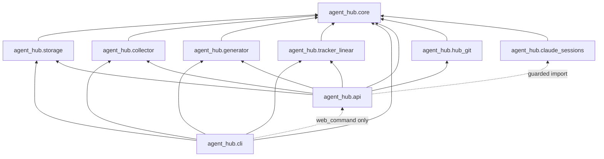
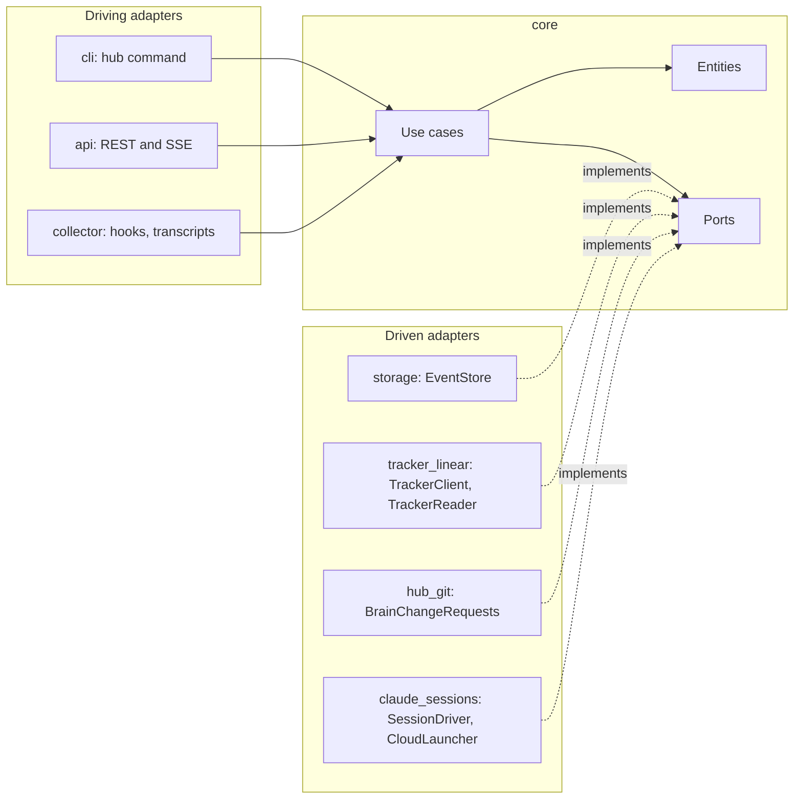

# Architecture

How the agent-hub code is organized and where new code goes. The product itself is described in [SPEC.md](SPEC.md); the
decisions behind this layout are [ADR 0001](adr/0001-uv-workspace-with-namespace-packages.md) (workspace),
[ADR 0002](adr/0002-lean-hexagonal-architecture.md) (hexagonal architecture) and
[ADR 0003](adr/0003-persistence-sqlalchemy-core-and-alembic.md) (persistence); the tracker port is
[ADR 0014](adr/0014-tracker-port-linear-graphql.md); the control plane (`packages/api`, `apps/web`) is
[ADR 0017](adr/0017-api-second-composition-root.md) to [ADR 0021](adr/0021-hook-event-sensor.md), and the learning actions'
`hub_git` adapter is [ADR 0024](adr/0024-learning-actions-from-the-app.md); the app's read-only tracker port is
[ADR 0025](adr/0025-reading-the-tracker-from-the-app.md); driving Claude Code sessions from the app (the
`claude_sessions` adapter) is [ADR 0031](adr/0031-driving-claude-code-sessions-from-the-app.md). The Phase 1 to 4 designs (hub config,
generator, doctor, domain model, events, workflows) are indexed in [design/README.md](design/README.md).

## Packages

The repo is a uv workspace. The root `pyproject.toml` is virtual (no `[project]` table); every member lives under
`packages/` and ships one distribution. All Python code shares the implicit namespace package `agent_hub`: there is no
`agent_hub/__init__.py` anywhere.

| Package dir | Distribution | Module root | Role |
|---|---|---|---|
| `packages/core` | `agent-hub-core` | `agent_hub.core` | Domain: entities, canonical event, Pydantic schemas, use cases, ports, the one JSON byte form and its parser (`agent_hub.core.json_form`: `dump_json`, `load_json_bytes`), the rendered-hub contract types and `hub.lock` (`agent_hub.core.hub_files`: `RenderedFile`, `RenderedLink`, `RenderedHub`; the lock model `HubLock` with `build_hub_lock`, `lock_bytes` and the reader `read_hub_lock`; the tree snapshot types; the extension inputs `ExtensionInputs` with `extension_inputs_from`, `entry_name_key` and `REFUSED_KEYS`, the keys a `*.project.json` sibling may not set (`extension_inputs.py`); the init planner `plan_init`, the sync planner `plan_sync` and the adopt planner `plan_adopt`); the config contract in `agent_hub.core.hub_config` (`model.py`: `HubConfig`; the schema, the version pre-check and the document check; `local_config.py`: `hub.local.json`; `effective_identity.py`: the developer's effective identity; `workspace_repos.py`: each repo's folder and `owner/name`, shared by `hub setup` and the generator); the tracker port `TrackerClient` and the `Issue` value object (`agent_hub.core.tracker.tracker_client`), and the read-only port `TrackerReader` with `IssueSummary` and `TicketSnapshot` (`agent_hub.core.tracker.tracker_reader`); the feature folds in `agent_hub.core.features` (`feature_record.py`: the `features.json` record; `ticket_planning.py`: rows and planning; `feature_evals.py` and `feature_reviews.py`: evals per delivery and review records; `scope_rules.py`: the eval scope rules (AC id, commit and re-run patterns, ticket aliases, the named scope) they share; `agent_outputs.py`: the checks of the agents' JSON outputs (`review_problems`, `eval_problems`) and their shipped schemas, over `output_models.py` (the models and bounds), `output_shape.py` (bytes to a document, shape problems), `review_output_checks.py`, `eval_output_checks.py` and `eval_output_scope.py` (the cross-checks); `golden_path.py`: the golden path; `feature_status.py` and `feature_tickets.py`: the feature views and its Tickets view; `ticket_snapshots.py`: the `TicketSnapshots` port of the snapshot cache); the pure workspace rules in `agent_hub.core.workspace` (`worktree_name.py`: the task worktree name `<team>-<n>[-<desc>]`, its branch and the names of an issue's task worktrees; `worktree_slot.py`: the task's port slot and offset; `branch_pattern.py`: a branch rendered from the `branch` convention; `shown_conventions.py`: the convention shapes and examples the rendered texts show and doctor skips; `brief_text.py`: the session brief's text; `agent_launch.py`: Claude Code's argv, the context text and the settings JSON; `task_slug.py`: `hub start`'s task name from the issue title and which folders belong to an issue; `start_prompt.py`: its session's first prompt; `start_task.py`: its use case over the `TrackerClient`, the `TaskWorktrees` and `SessionLauncher` ports; `setup_checklist.py`: `hub setup`'s items, their lines, the summary and the exit rule); the pure rules of `hub next`, `hub run` and `hub ship` in `agent_hub.core.runner` (`ready_list.py`, `brief.py`: the input brief's sections, placeholders and check, `issue_block.py`: the fenced issue block `hub run`'s and `hub start`'s prompts share, `session_prompt.py`, `verdict.py`, `run_texts.py`, `title_pattern.py`, `run_record.py`, `report_writes.py`, `ship_texts.py`: `hub ship`'s PR body, Related PRs section and comment); the pure rules of `hub bench` in `agent_hub.core.bench` (`bench_cases.py`: the cases file and its checks; `bench_plan.py`: jobs, waves and the budget stop; `bench_session.py`: the session settings, argv and records; `bench_summary.py`: the summary and `--validate`'s lines); the doctor in `agent_hub.core.doctor` (the finding, rule and snapshot types, the runner `run_rules.py` that selects, runs, retunes and sorts rules, the `registry.py` of released rules, and the rules, e.g. `config_rules.py`); test support in `agent_hub.core.testing` |
| `packages/storage` | `agent-hub-storage` | `agent_hub.storage` | Storage adapter: SQLAlchemy Core tables (`agent_hub.storage.db.metadata`), the SQLite `EventStore` and the Alembic migrations, shipped inside the package (`agent_hub/storage/migrations/`) |
| `packages/collector` | `agent-hub-collector` | `agent_hub.collector` | Collector adapter: maps outside input to canonical events, metadata only, and never stores them itself: `jsonl.py` (canonical JSON Lines), `claude_hooks.py` (`ClaudeHookMapper`, the sensor envelope to events, implementing core's `HookMapper`), `transcript.py` (a Claude Code transcript to events) with `transcript_tail.py` (`TranscriptTail`, core's `TranscriptTailer`: reads what a transcript gained, only under `~/.claude/projects/`, never through a link), `run_records.py` (`hub run` records to executor events) and `tool_metadata.py` (the metadata each tool call keeps) |
| `packages/generator` | `agent-hub-generator` | `agent_hub.generator` | Hub generator: the hub templates as package data (base rules, brain skeleton, the base plugin `plugin/hub-workflow/` with its hooks and their stdlib reader, the seeded project plugin under the project's name, the transcript and retro scripts), the `@@` renderer, the JSON built in code (`built_json.py`: `.claude/settings.json`, the project settings and manifest, and `base_hooks_block`, the release's base hooks for `hub doctor`), the classification registry and `render_hub(config, extensions)`, which returns a `RenderedHub` (files and plugin links; `project_json_siblings` names the `*.project.json` it merges), with `json_merge.py` (`merge_json`, the strict merge of a `*.project.json` sibling) and `links.py` (`plugin_links`, `project_links` for the project's agents and skills); and the file adapter, never following a link: `hub_tree.py` reads a hub tree, one root entry (`read_root_entry`) or only the planned paths (`read_planned_tree`), `doctor_tree.py` lists and reads a tree for `hub doctor` (`read_doctor_tree`: `git ls-files` or a walk, plus fixed paths by path), `regular_files.py` reads one regular file by name from an open folder (`read_regular`), which `feature_files.py` and `output_files.py` share, `output_files.py` reads an agent output and, for an eval output, its sibling record's head and `../features.json` for `hub validate-output` (`read_output`, `read_eval_inputs`), `file_adapter.py` writes a plan through temporary files and applies a sync plan with its deletes through one held root (`apply_sync`) ([ADR 0011](adr/0011-templates-as-package-data.md)); the workflow readers ([ADR 0032](adr/0032-workflow-engine.md)): `workflow_yaml.py` reads one workflow file into a JSON mapping and the line of each key path (`load_workflow_bytes` → `LoadedWorkflow`: PyYAML's `SafeLoader` refusing duplicate keys, anchors, aliases, tags and a second document, or core's strict JSON; 256 KiB), `workflow_discovery.py` finds the packs in the hub's `workflows/` and then the built-ins (`discover_workflows`, a hub workflow overriding a built-in of the same name, one problem per file) and resolves a pack's prompt and script paths inside the pack (`resolve_pack_file`) |
| `packages/tracker_linear` | `agent-hub-tracker-linear` | `agent_hub.tracker_linear` | Tracker adapter: `LinearGraphqlTrackerClient` (`graphql.py`) implements `TrackerClient` over Linear's GraphQL API with the standard library (`urllib`, no redirects followed, a 30 s timeout per socket operation); the key comes only from `LINEAR_API_KEY`, read at call time ([ADR 0014](adr/0014-tracker-port-linear-graphql.md)); `McpTrackerClient` (`mcp.py`) implements it over the user's Linear MCP server, each operation one or two headless `claude -p` calls run by `claude_process.py` (`run_claude`, the caller's process group, a timeout kills the child), with the request lines, prompts, per-call tool lists and reply checks in `mcp_protocol.py` ([ADR 0015](adr/0015-linear-mcp-tracker-transport.md)); `LinearGraphqlTrackerReader` (`graphql_reader.py`) implements the read-only `TrackerReader` for `hub web` over the same transport, moved to `graphql_transport.py` (`Post`, `urllib_post`, the shape check), 10 s per request and 20 s per read ([ADR 0025](adr/0025-reading-the-tracker-from-the-app.md)) |
| `packages/hub_git` | `agent-hub-hub-git` | `agent_hub.hub_git` | Hub git adapter ([ADR 0024](adr/0024-learning-actions-from-the-app.md)): `GitBrainChangeRequests` (`brain_change_requests.py`) implements core's `BrainChangeRequests` port, opening a hub pull request for a learning decision from a temporary `--reference-if-able` clone of the hub's `origin` (the user's checkout is never touched), plus `availability`, the reason a hub cannot take actions; `git_runner.py` (`GitRunner`, `GitSession`: `git` and `gh` as argv lists under one 60 s deadline, no prompt, git's location variables dropped, no output logged); `refspec_guard.py` (`push_argv`, the only way a push is built: never the default branch, never forced, only `<prefix>learning-` branches); `github_remote.py` (the `owner/name` of a GitHub remote and the PR URL `gh` prints); `errors.py` (`HubGitError`). Version `0.1.0`, outside the CLI's lockstep |
| `packages/claude_sessions` | `agent-hub-claude-sessions` | `agent_hub.claude_sessions` | Claude Code session adapter ([ADR 0031](adr/0031-driving-claude-code-sessions-from-the-app.md)), the only package that imports `claude_agent_sdk` (pinned `0.2.165`): `ClaudeSdkSessionDriver` (`sdk_driver.py`) implements core's `SessionDriver` with one `ClaudeSDKClient` per session pointed at the user's own `claude` (`cli_path`, so the bundled CLI never runs), with `options.py` (the session's `ClaudeAgentOptions`: default setting sources, partial messages, the mode, never a bypass mode), `message_mapping.py` (SDK messages to `DriverEvent`s), `permission_bridge.py` (`can_use_tool` parked until the browser answers), `environment.py` (the child's environment: `hub web`'s own plus `AGENT_HUB_WEB_URL`), `resumable.py` (past sessions of a workdir), `capabilities.py` (`claude --version` and `--help`, cached 60 s) and `process_tree.py` (bounded runs and the last-resort stop of a child's process group); `ClaudeCloudLauncher` (`cloud_launcher.py`) implements `CloudLauncher` over `claude -p --cloud`; `testing/stub_claude.py` is the stub CLI the tests put on `PATH`. Version `0.1.0`, outside the CLI's lockstep; installed only with the `sessions` extra |
| `packages/cli` | `agent-hub-cli` | `agent_hub.cli` | The `hub` command (Typer); entry point `agent_hub.cli.main:app`. The composition root: `command_exits` (the exit helpers the hub commands share), `sync_command` (`hub sync`: load, render, read, plan, apply), `sync_report` (its change lines and conflict report), `sync_steps` (the lock read, tree read, render and apply `hub sync` and `--adopt` share), `adopt_command` (`hub sync --adopt`: plan, apply the settled paths, list the rest) and `adopt_report` (its listing, refusal and way-out lines), `doctor_command` (`hub doctor`: read the config and the tree, run the rules, exit 0, 1 or 2; `check_hub`, the same check without output, which `hub setup` runs) and `doctor_report` (its finding lines, totals and JSON), `tracker_client` (`resolve_tracker_client`: the `TrackerClient` adapter for `tracker.kind` and `tracker.transport`), `worktree_command` (`hub worktree`: one task's worktrees in every repo, their setup and teardown scripts, `--remove`), `worktree_steps` (the worktree steps `hub worktree`, `hub run` and `hub start` share, with a repo subset and an issue's task folders, raising `WorktreeError`; the scripts' environment, `script_env`), `next_command` (`hub next`: one `list_ready`, one line per issue), `run_command` (`hub run`: options, usage checks, the key check, the dry run), `run_steps` (the live stages and the report), `run_children` (the children's argv and environments, the dry run's lines), `run_report` (the tracker writes in order, stopping at the first failure), `run_log` (the run id, the records and the inbox line), `push_guard` (the git config keys and the origin the fetch and the push refuse), `pr_steps` (the gate, push guard, push, PR and title steps `hub run` and `hub ship` share, raising `PrStepError`), `ship_command` (`hub ship`: usage checks, the issue read, the dry run), `ship_set` (the repos `hub ship` ships: an issue's task worktrees ahead of origin's default branch, raising `ShipError`), `ship_steps` (`hub ship`'s live phases: checks, push and PRs, links, tracker writes), `bench_command` (`hub bench`: options, usage checks, the module check, `--validate` or a run) and `bench_steps` (read the cases, the bench worktrees, the lock, the grades and the run loop), `brief_command` (`hub brief`: reads `now.md`, the journal, git in each checkout and `gh` at once, then prints core's brief text), `agent_command` (`hub agent`: writes the repos' context file, then `exec`s `claude` with every repo attached; `PassThroughCommand` keeps every argument), `claude_launch` (the launch `hub agent` and `hub start` share: the folders' context file, then `exec` of `claude`), `start_command` (`hub start`: usage checks, then core's `start_task` over `GitTaskWorktrees` and a Claude or printed session), `setup_command` (`hub setup`: the sections in order, then the summary and exit) with `setup_tools` (the tools and the tracker credential), `setup_identity` (report, or propose and write, `hub.local.json`) and `setup_repos` (clone each missing repo over the scheme of the hub's `origin`, fetch each present one), `exclusive_write` (publish a new file once, never over another), `child_process` (`run_child` and `stream_child`, the one runner of git and scripts, and `git_env`, which drops git's location variables) `hub_root` (`hub_root_or_exit`: the hub from `AGENT_HUB_ROOT` or the cwd; `main_checkout`: the main checkout when the hub is a worktree of its repo; `hub_checkout`: the hub's main checkout `hub run` and `hub ship` work from), `hub_config_reader` (read `hub.json` and `hub.local.json`, or their problem lines), `effective_config` (`hub.json` with `hub.local.json` over it, and the branch prefix), `generator`, `init_config` and `init_report` (`hub init`: its `hub.json`, its write and its lines), `git_defaults` (what `hub init` and the identity read from git, and `read_remote_scheme`, the scheme of the hub's `origin`), `validate_output_command` (`hub validate-output`: read one agent output and its eval inputs through the generator's `output_files`, print core's problems, the first 200 then the total), `collect` and `database_path` (`hub collect` and its database file) and `errors` (the command's own errors) |
| `packages/api` | `agent-hub-api` | `agent_hub.api` | The control plane's HTTP server (FastAPI, [API.md](API.md)), a second composition root ([ADR 0017](adr/0017-api-second-composition-root.md)): `composition.py` (`build_app(settings)` wires the SQLite store, the collector's mapper and tail, the generator's hub file readers and doctor snapshot, the registry, `hub_git`'s change requests and `tracker_linear`'s `LinearGraphqlTrackerReader` into core's read, ingestion and learning use cases; `RegisteredHubFacts` reads each project's hub, author and label rules, and `CachedAvailability` keeps a hub's action availability for 10 s), `ticket_snapshots.py` (`CachedTicketSnapshots`, the in-memory snapshot cache of the feature tickets: 60 s per project and id set, single flight, stale for up to 15 min after a failure, a 60 s pause after a 429, at most 256 entries), `app.py` (`create_app`), thin `routes/` (one module per resource), `rfc9457.py` (the one error mapping), `sse.py` and `change_feed.py` (SSE replay, heartbeats and the 500 ms high-water-mark poll), `local_security.py` (D25, the strict rule of the two learning decisions, and the refusal of any WebSocket scope), the agent sessions' wiring (`claude_adapters`, the guarded import of `claude_sessions`, else `UnavailableSessionDriver`; `session_token.py` and `session_access.py`, the per-launch token and the cookie gate of `/api/v1/agent-sessions/**`; `agent_session_sse.py`, the stream's frames and ids; `agent_session_runtime.py`, the sweep loop and the shutdown of live sessions; `workdir_listing.py`, the registered workdirs), `static_files.py` (serves `web_dist/`, the committed production build of `apps/web`) and `server.py` (binds the address `hub web` allows, then runs uvicorn on that socket); `openapi.json` beside the package is the committed contract. Version `0.1.0`, outside the CLI's lockstep |
| `packages/agent-hub` | `agent-hub` | `agent_hub_meta` (placeholder) | Meta-package: depends on the packages above but `claude_sessions` and declares the `hub` script, so `uv tool install agent-hub` installs everything; its `sessions` extra (`agent-hub-api[sessions]`) adds `claude_sessions` and the SDK (about 240 MiB, almost all the bundled CLI), so `uv tool install 'agent-hub[sessions]'` can drive sessions |

`apps/web` is the web app (React 18, TypeScript strict, Vite; [ADR 0020](adr/0020-web-stack-and-committed-build.md)),
outside the uv workspace, with its own `package.json` and `package-lock.json`: `src/api/schema.d.ts` (generated from
`openapi.json`), `src/lib/` (the typed `openapi-fetch` client, TanStack Query hooks, the one `EventSource` wrapper),
`src/components/` (the design system's components in TypeScript; tokens generated from the design's `tokens.json`),
`src/shell/` (sidebar, top bar, palette, collector pill), `src/screens/<name>/` (one folder per screen, its queries in
`queries.ts`) and `src/testing/builders.ts` (the only source of web fixtures). `vite build` writes into
`packages/api/src/agent_hub/api/web_dist/`, which is committed so an install from a git tag needs no Node, and
`make web-dist-check` fails when it differs from a fresh build.

Each package has the same shape:

```
packages/<pkg>/
  pyproject.toml
  src/agent_hub/<pkg>/        # no __init__.py in src/agent_hub/
  tests/unit/                 # mirrors src/agent_hub/<pkg>/
  tests/contract/             # contract suites run against this package's adapter (when it has one)
  tests/integration/          # real SQLite files under tmp_path
```

Repo tooling (the layout checker, coverage floors, PR-title lint, the release check, the pytest level plugin) lives in
`scripts/`, with its tests in the root `tests/unit/scripts/`. The root `tests/e2e/` holds the end-to-end tests. See
[TESTING.md](TESTING.md).

**Python and uv.** The workspace targets Python 3.14 (`.python-version` = `3.14`, `requires-python = ">=3.14"`); 3.14 is
the first release whose stdlib has `uuid.uuid7`, which the API ids use. uv must be 0.9.0 or newer
(`required-version = ">=0.9.0"`): older uv releases offer only 3.14 release candidates, and an rc already installed on
the machine can satisfy `3.14`. Fix with `uv self update` and `uv python install 3.14`. CI pins uv 0.12.19.

## Dependency rule

1. Every package may depend on `core`.
2. `core` depends on nothing internal, and not on the adapter libraries `sqlalchemy`, `alembic`, `typer` or
   `jsonschema` (workflow output contracts are checked in `generator`, behind core's `OutputValidator` port,
   [ADR 0032](adr/0032-workflow-engine.md)).
3. `agent_hub.cli` is the composition root ([ADR 0008](adr/0008-cli-as-composition-root.md)): it may import the adapter
   packages `storage`, `collector`, `generator` and `tracker_linear` to build adapters and pass them to core use cases.
   Nothing imports `cli`. `agent_hub.api`, the second composition root, may import `storage`, `collector`, `generator`,
   `tracker_linear`, `hub_git` and `claude_sessions`; `hub_git` is wired only there, for the learning decisions of
   `hub web`, `api` wires only the read-only `TrackerReader` of `tracker_linear`, never a `TrackerClient` or the MCP
   transport, and it imports `claude_sessions` inside one function of `composition.py` (an `ImportError`, the
   `sessions` extra missing, wires an unavailable driver). `cli` never imports `claude_sessions`.
4. The adapter packages (`storage`, `collector`, `generator`, `tracker_linear`, `hub_git`, `claude_sessions`) never
   import each other; they depend only on `core`. Only `claude_sessions` imports `claude_agent_sdk`.



import-linter enforces the rule with the contracts in `.importlinter` (`root_packages = agent_hub`,
`include_external_packages = True`):

- `core imports nothing internal` (forbidden): `agent_hub.core` must not import `agent_hub.storage`,
  `agent_hub.collector`, `agent_hub.generator`, `agent_hub.tracker_linear`, `agent_hub.hub_git`,
  `agent_hub.claude_sessions`, `agent_hub.cli`, `sqlalchemy`, `alembic` or `typer`.
- `cli is the composition root` (layers): `agent_hub.cli`, then `agent_hub.api`, above the independent sibling layers
  `agent_hub.storage | agent_hub.collector | agent_hub.generator | agent_hub.tracker_linear | agent_hub.hub_git |
  agent_hub.claude_sessions`. A lower layer importing a higher one, or one sibling importing another, breaks it, so
  `api` never imports `cli`.
- `cli reaches api only through web_command` (forbidden): only `agent_hub.cli.web_command`, which starts the server for
  `hub web`, may import `agent_hub.api`.
- `only claude_sessions imports the Claude Agent SDK` (forbidden): no other package, `api` and `cli` included,
  imports `claude_agent_sdk`. `allow_indirect_imports = True`: `api` reaches the SDK through `claude_sessions`, which
  is the point; a direct import still breaks it.
- `cli never imports claude_sessions` (forbidden), also with `allow_indirect_imports = True`: `web_command` reaches
  the adapter only through `api`'s composition; a direct import from any `cli` module breaks it.
- `core` must also not import `agent_hub.api`, `fastapi`, `starlette`, `uvicorn` or `yaml` (PyYAML lives in `generator`).

Run it with `make imports` (part of `make check`). A broken contract fails with its name followed by `BROKEN`.

Wiring happens only in the composition root: a CLI command builds the adapters it needs (for example the `storage`
implementation of `EventStore`) and passes them to the use case as port implementations. Use cases and adapters never
construct other adapters. `agent_hub.api` is a second composition root, one layer below `cli`: `build_app` wires the
adapters for the web server, and `hub web` (`cli.web_command`) only builds its settings and starts it. The meta-package `agent-hub` only bundles the distributions for installation; it holds no wiring.

Adding a package: create `packages/<pkg>/` with the shape above, then register it in `mypy.ini` (`files` and
`mypy_path`), in both `.importlinter` contracts (core's forbidden list and the layers list) and in the Makefile `COV`
list. The layout checker rule `package-registered` fails `make check-fast` until all of these are done. Then add it to
the PR-title scopes (`SCOPES` in `scripts/check_pr_title.py` and the list in CONTRIBUTING.md) and create its
`pkg:<name>` area label; the `tracker_*` adapters share the `tracker` scope and the `pkg:tracker` label.

## Hexagonal layout

`core` is the hexagon; everything else is an adapter around it.

- **Entities** (in core): frozen Pydantic models for the domain concepts of the SPEC glossary (Project, Hub, Repo,
  Workflow, WorkflowRun, Agent, Session, Brain, Learning) and the canonical event.
- **Use cases** (in core): one class or function per operation, named verb + object (`IngestTranscript`,
  `GenerateHub`). They take ports as arguments and return domain models.
- **Ports** (in core): interfaces for what the SPEC expects to swap: `EventStore` (SQLite now, Postgres later),
  `TrackerClient` (Linear first), `TrackerReader` (the app's read-only view of the tracker), `TranscriptSource` (Claude Code first); `hub start`'s `TaskWorktrees` and
  `SessionLauncher` (`agent_hub.core.workspace.start_task`), so its use case runs over fakes; `BrainChangeRequests`
  (`agent_hub.core.learnings.brain_change_requests`), the hub pull request of a learning decision, and the learning
  ports `LearningReads` and `LearningDecisions` the API routes depend on; `SessionDriver`, `CloudLauncher` and
  `AgentSessionStore` (`agent_hub.core.agent_sessions`), the Claude sessions `hub web` drives. No port where no swap
  is expected.
- **Adapters** (other packages): `storage` implements `EventStore`; `tracker_linear` implements `TrackerClient` and
  `TrackerReader`; `api` implements `TicketSnapshots` (`CachedTicketSnapshots`);
  `hub_git` implements `BrainChangeRequests`; `claude_sessions` implements `SessionDriver` and `CloudLauncher`, and
  `storage` `AgentSessionStore`; `cli`
  implements `TaskWorktrees` (`GitTaskWorktrees`) and `SessionLauncher` (`ClaudeSession`, `PrintedSession`);
  `collector` turns hook events and transcripts into canonical events and calls the ingestion use case; `cli` (and later
  `api`) parse input, call ONE use case and render the result; `generator` renders a hub's files and links from
  `HubConfig` and the extension inputs (and reads a hub tree and applies core's init and sync plans to disk) and
  implements no port ([ADR 0011](adr/0011-templates-as-package-data.md)). Adapters translate external errors into the
  package's domain exceptions at the boundary.
- **Errors**: `agent_hub.core.errors.AgentHubError` is the root; each package has its own `errors.py` with subclasses
  (`StorageError`, `CollectorError`, `GeneratorError`, …). A port's own failure lives in core, e.g. `TrackerError`,
  which every `TrackerClient` adapter raises.



The first port is `EventStore` (`agent_hub.core.events.event_store`): an append-only store of canonical events,
idempotent by `(source, source_id)`, that appends a batch all or nothing. The use case `IngestEvents` calls it. Its fake is
`InMemoryEventStore` (`agent_hub.core.testing.fakes`), and its contract suite `EventStoreContract`
(`agent_hub.core.testing.contracts`) runs against both the fake and `SqliteEventStore` (`agent_hub.storage.event_store`).

`hub collect` wires them: the collector parses JSON Lines into events, `open_event_store(path)` upgrades the SQLite file
to the latest migration (under a write lock) and returns the store, and `IngestEvents` appends the batch. The database
file is `--db PATH`, else the environment variable `AGENT_HUB_DB`, else `$XDG_DATA_HOME/agent-hub/agent-hub.db` (only
when `XDG_DATA_HOME` is absolute), else `~/.local/share/agent-hub/agent-hub.db`, where `~` is `HOME` when it is
non-empty and absolute, else the account's home from the password database; with neither, `hub collect` exits 1 asking
for `--db` or `AGENT_HUB_DB` (`agent_hub.cli.database_path`). SQLite runs in WAL mode, and the engine opens a connection
per use (no pool).

Phase 2 adds the read side and the live ingestion, all in core, with no I/O:

- **Ingestion.** `IngestEvents` redacts (`agent_hub.core.redaction`, rule set `r1`) and trims each payload to its
  type's keys (`agent_hub.core.events.payload_keys`) before append, for every entry point. `IngestHook`
  (`ingestion/ingest_hook.py`) takes one sensor envelope through the `HookMapper` port, appends its events, then reads
  the transcript it names through the `TranscriptTailer` port; both ports are implemented in `collector`.
- **Read ports** (`readmodels/read_ports.py`): `EventReadModels`, implemented by `FoldedEventReadModels`
  (`readmodels/event_read_models.py`), folds Sessions, WorkflowRuns, Approvals and Learnings from the store's new query
  methods (`query`, `find`, `high_water_mark`) and memoizes the folds by high-water mark (`fold_memo.py`);
  `HubReadModels`, implemented by `HubFilesReadModels` (`hubs/hub_read_models.py`), reads the registered hubs' files
  through a `HubFileReader` port and the doctor rules, with the `HubRegistry` port for `hubs.json` (adapter
  `storage/hub_registry.py`, `JsonHubRegistry`). The API's routes depend only on these two Protocols.
- **Learnings and the brain (AGH-201).** `ReadLearnings` (`learnings/read_learnings.py`, the `LearningReads` port)
  joins the folded learnings with their inbox notes, read on request through the `HubFileReader`'s bounded brain reads
  (`brain_tree`, `read_brain_file`, `brain_file_size`, implemented in `generator/brain_files.py`); `DecideLearning`
  (`learnings/decide_learning.py`, `LearningDecisions`) checks a decision, calls `BrainChangeRequests` and appends one
  `control_plane` event. The path rules of every brain read are pure (`brain/brain_path.py`). Session labels, actors
  and problems are folds beside the Session fold (`sessions/session_label.py`, `session_actors.py`,
  `session_problems.py`).
- **Skills tab (AGH-164).** `SkillReads` (`skills/skill_reads.py`) serves the catalog, an item's detail and a
  bundled file through two more `HubFileReader` reads: `skill_sources` (a stat-only listing of the skill roots) and
  `read_skill_file` (one bounded file, never through a link), implemented in `generator/skill_files.py`. Everything
  else is pure core in `core/skills/`: the path rule and limits (`skill_sources.py`), frontmatter, structure,
  diagnostics, hooks and external plugins, the catalog fold (`skill_catalog.py`) and the usage fold over the event
  snapshot (`skill_usage.py`, `EventReadModels.skill_usage`), which `HubFilesReadModels` joins (`usage=`).
- **Doctor snapshot.** The doctor tree reader moved from `cli` to `generator` (`doctor_snapshot.py`,
  `build_doctor_snapshot`; `hub_config_files.py` for `hub.json`, `hub.lock` and `hub.local.json`), so `hub doctor` and
  the Health screen run the same rules on the same snapshot; git stays in the composition roots and is injected.

The second port is `TrackerClient` (`agent_hub.core.tracker.tracker_client`): list the ready issues of a team, get an
issue, move its state, add or remove a label and comment, each failure a `TrackerError`. `move_state` returns whether
the issue moved; with `only_if_unstarted` it moves only from a `triage`, `backlog` or `unstarted` state. Its fake is
`InMemoryTrackerClient`, and its contract suite `TrackerClientContract` runs against the fake,
`LinearGraphqlTrackerClient` (`agent_hub.tracker_linear.graphql`) over an in-process fake of Linear's API, and
`McpTrackerClient` (`agent_hub.tracker_linear.mcp`) over an injected runner that plays the model. The CLI picks the
adapter from `tracker.kind` and `tracker.transport` with `resolve_tracker_client` (`agent_hub.cli.tracker_client`);
`hub next`, `hub run`, `hub ship` and `hub start` resolve it, after checking the key for transport `"api"`.

The app reads the tracker through a third, read-only port, `TrackerReader` (`agent_hub.core.tracker.tracker_reader`,
[ADR 0025](adr/0025-reading-the-tracker-from-the-app.md)): `issue_summaries(ids)` returns a `TicketSnapshot` of
`IssueSummary` values (title, state name and type, assignee, url, priority, estimate, `blocks`, `blocked_by`), the
ids Linear did not return (`missing`) and the blockers outside the ids (`external`); at most 200 ids per call, each
failure a `TrackerError` with a `kind`. It has no write method, so the app holds none. Its fake is
`InMemoryTrackerReader` and its contract suite `TrackerReaderContract` runs against the fake and
`LinearGraphqlTrackerReader` over an in-process fake of Linear's API. Only `api` wires it: `build_app` builds a reader
per read from `LINEAR_API_KEY` and the hub's `tracker.transport` (none without a key or with `"mcp"`: not connected)
behind `CachedTicketSnapshots`, core's `TicketSnapshots` port. `GET .../tickets` calls `fetch` (may read Linear); the
feature list and detail call `cached` (never read Linear). Planning and the golden path are pure core folds over the
plan and the snapshot; nothing from Linear is stored.

The sessions `hub web` drives ([ADR 0031](adr/0031-driving-claude-code-sessions-from-the-app.md), design in
[design/agent-sessions.md](design/agent-sessions.md)) go through a fourth port, `SessionDriver`
(`agent_hub.core.agent_sessions.driver`): async `start`, `send`, `interrupt`, `answer_permission`, `set_mode`,
`set_model`, `close`, `events` (a closed union of driver events), `list_resumable` and `capabilities`. Its fake is
`InMemorySessionDriver` and its contract suite `SessionDriverContract` runs against the fake and
`ClaudeSdkSessionDriver` over the stub CLI. The use case `AgentSessionControl` (`agent_sessions/control.py`) owns the
live sessions in `hub web`'s event loop: it pumps driver events through the pure rules (state machine, permission
policy, caps, delta ring, record text) into a gap-free log, stored redacted through `AgentSessionStore`
(`SqliteAgentSessionStore` in `storage`, tables `agent_sessions` and `agent_session_records`, migration 0004; the
hook-fed `events` table is untouched), wakes the streams in process, and applies deadlines, the idle timeout and
retention when the API's runtime calls `sweep(now)`. `CloudSessions` (`agent_sessions/cloud.py`) runs the cloud
link-out over `CloudLauncher`; `AgentSessionLinks` gives the session views their `agent_session_id`. Only `api` wires
them, and only outside the container.

## Deployment

The control plane runs as one process, `hub web`, on the developer's machine ([ADR 0022](adr/0022-container-packaging.md)):

- **Installed** (`uvx`, `uv tool install`, `make run`): it binds `127.0.0.1:7420` and serves the committed `web_dist`.
- **Container** (`Dockerfile`, `compose.yaml`, `make up`): the image builds the web app from `apps/web`'s lockfile and
  installs the workspace from `uv.lock` into `/opt/venv`; it runs as uid 10001 on a read-only root, with the database
  and registry in the `/data` volume. `hub web` binds `0.0.0.0` inside it only because the image sets
  `AGENT_HUB_IN_CONTAINER=1`; Compose publishes the port on the host's `127.0.0.1` only and mounts the hubs root and
  `~/.claude/projects` read-only at their host paths, so paths in the registry and in hook events match.
- **Development** (`make dev`): `hub web` on 7420 and Vite on `127.0.0.1:5173`, whose `/api` proxy
  (`apps/web/src/lib/devProxy.ts`) sends the API's Host, rewrites the dev app's own Origin to the API's and drops any
  other, so the API's checks, the learning decisions' strict rule included, need no exception.

The hub sensors post to `AGENT_HUB_WEB_URL` (default `http://127.0.0.1:7420`), the same address in every mode.

## Where does this code go

Paths are under `packages/<pkg>/src/agent_hub/<pkg>/` unless shown in full. `<area>` is a domain area folder such as
`ingestion/`; tests mirror the same path under `tests/unit/`.

| Code | Where | Notes |
|---|---|---|
| Entity (domain model) | `core`: `<area>/<entity>.py` | Frozen Pydantic model; no I/O |
| Use case | `core`: `<area>/<verb_object>.py`, e.g. `ingestion/ingest_transcript.py` | Named verb + object; depends on ports only |
| Port | `core`: `<area>/<port>.py`, e.g. `events/event_store.py` | Only where a swap is expected (ADR 0002) |
| Domain exception | the package's `errors.py` | Subclass of the package's root error, itself under `AgentHubError`; an adapter that only raises its port's core error (e.g. `TrackerError`) needs no `errors.py` |
| Adapter | the adapter package, e.g. `storage/<port>.py` | Implements a core port; translates external errors |
| Table | `storage`: `db.py` (`metadata`) | The single place tables are declared |
| Migration | `packages/storage/src/agent_hub/storage/migrations/versions/<NNNN>_<slug>.py` | Created with `python -m agent_hub.storage.migration revision --rev-id <NNNN>`; the Alembic config is built in code (`agent_hub.storage.migration.alembic_config`); see [CONTRIBUTING.md](CONTRIBUTING.md) |
| CLI command | `cli`: `main.py` or a command module registered on the Typer `app` | Parses input, calls one use case |
| Wiring adapters to use cases | `agent_hub.cli` (composition root, [ADR 0008](adr/0008-cli-as-composition-root.md)) | Builds the adapters and passes them to the use case as ports |
| API route | `api`: `routes/<resource>.py` | Thin: validate, call ONE use case or read port method, map the response ([API.md](API.md)); a new domain exception gets its problem in `rfc9457.py` |
| Read model (derived entity) | `core`: `<area>/fold_<entity>.py`, served through `readmodels/read_ports.py` | A pure fold over stored events with `now` injected; never writes |
| Web screen | `apps/web/src/screens/<name>/` (`index.tsx`, `queries.ts`, tests beside) | Data only through `useApi`; components from `src/components`; fixtures from `src/testing/builders.ts` |
| Fake of a port | `core`: `testing/fakes.py` (`agent_hub.core.testing.fakes`) | In-memory; checked by the port's contract suite |
| Builder of test data | `core`: `testing/builders.py` (`agent_hub.core.testing.builders`) | Synthetic data only |
| Port contract suite | `core`: `testing/contracts.py` (`agent_hub.core.testing.contracts`) | Run from each implementation's `tests/contract/` |
| Hub template | `generator`: `templates/<output path, no leading dot>.tmpl` plus a `registry.py` entry; a JSON file whose value comes from the config has a builder in `built_json.py` instead of a template | Package data read with `importlib.resources`; `@@{key}` placeholders from `placeholders.py`; built JSON is written by `dump_json` (`agent_hub.core.json_form`, re-exported by the generator's `json_form`) |
| Doctor rule | `core`: `doctor/<area>_rules.py` plus a `registry.py` entry | A pure function over the snapshot; its contract is in [design/hub-doctor.md](design/hub-doctor.md) |
| Repo tooling (gates, release check, `seed_demo`, `connect_hub`) | `scripts/<verb_object>.py`, tests in `tests/unit/scripts/` | Run as `python -m scripts.<name>` when it imports another script |

Module and folder names never use `utils`, `util`, `helpers`, `helper`, `common` or `misc` (layout checker rule
`forbidden-module`); name the module after what it does.
