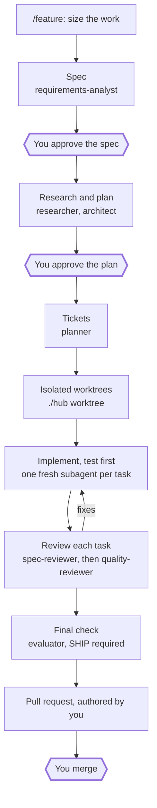

# Daily workflow

Once the hub exists, you work inside Claude Code. The hub gives it a set of slash commands (*skills*) and helper agents
(*subagents*), shipped in the generated `plugin/hub-workflow/` plugin. You type the commands, for example `/kickoff`, in
a session started with `./agent` from the hub. The commands hand parts of the work to the agents.

You stay in charge of the decisions: you approve the spec and the plan, and you merge the pull request. The agents do
the rest, and the hooks keep them inside the project's rules.

## Your session routine

1. **Start with `/kickoff`** (or after `/clear`). It shows the session brief (`./hub brief`), reads `brain/now.md` and
   the newest journal day, runs `check_fast` in each repo that has local changes, and proposes the next item. It asks
   before starting and never edits anything.
2. **Pick up an issue with `./hub start <ISSUE>`** (optional, from the hub's terminal). It creates the issue's
   worktrees in the repos (or finds them: run it again to resume), moves the issue to `tracker.states.started`, then
   opens Claude Code from the hub with those worktrees attached and the issue as the first prompt. `--repo DIR` limits
   it to some repos; `--no-agent` stops before the session and prints the command that launches it. The hub's
   `Makefile` has no target for it: call `./hub`.
3. **Do the work.** Use `/feature` for a change, `/research` or `/recall` for questions (see
   [Skills and agents](#skills-and-agents)).
4. **End with `/handoff`.** It rewrites `brain/now.md` (focus, work in flight, the exact next step, risks to watch)
   and appends what was done, verified and learned to the day's journal, `brain/journal/YYYY/MM/DD.md`. The next
   session picks up from there without you explaining it again.

## From idea to merged change: `/feature`

`/feature <idea or issue id>` is the golden path. It sizes the work first, then chains the agents below. The hexagons
are where it stops and waits for you.

The size decides the ceremony:

- **Spike**: throwaway learning. Step 0 (Brief) still applies; no spec, no tickets and no plan gate; it is timeboxed,
  the findings go to `research.md`, and nothing is merged.
- **Bounded** (the default): a few pull requests at most, with a known design. You may approve the spec and the plan
  together.
- **Architectural**: a new contract between repos or services, or a decision that warrants an ADR. Both gates apply.
  A path under `guard.ask_before_edit` alone does not make a feature architectural.

### What happens at each step

0. **Brief.** The issue's description holds the six brief headings (Problem, Why, Why now, Outcome, Invariants,
   Acceptance criteria); the session drafts the missing ones with you, one question at a time, and writes them to the
   tracker issue.
1. **Size it.** The session asks if the size is unclear.
2. **Spec.** The `brainstorming` skill asks you questions one at a time in the main session, then
   `requirements-analyst` writes `brain/features/<slug>/spec.md` with acceptance criteria (Given/When/Then).
3. **Research and plan.** `researcher` writes `research.md` (or `/research` runs inline for small questions);
   `architect` writes `plan.md`, small tasks each with a verification command.
4. **Tickets.** `planner` writes `features.json` (checked by `./hub doctor --only features.tracker`) and `issues.md`;
   the session then creates the issues in the tracker team from `hub.json`.
5. **Workspace.** `./hub worktree <team>-<n>-<slug>` creates the worktrees, named after the issue.
6. **Implement.** One fresh subagent per task, failing test first, the repo's `check_fast` green after each task.
   Existing assertions are never weakened.
7. **Review.** `spec-reviewer` checks the diff matches the spec and plan, nothing missing and nothing extra; then
   `quality-reviewer` checks domain rules, security, idempotency and what is extra. The session weighs each finding
   and sends back only the ones it accepts.
8. **Verify and finish.** `evaluator` re-runs every check and writes `eval.md`; it must say `SHIP`. The pull request is
   opened on a `project.branch_prefix` branch, authored by you.
9. **Compound.** You go through the agents' learning proposals in `brain/_inbox/` and decide where each lands
   (`/learn promote` runs the weekly `inbox` review: one gate per group, then one hub PR); `/handoff` if the work spans
   sessions.

> [!IMPORTANT]
> `/feature` uses two things the hub does not install:
>
> - the [superpowers](https://github.com/obra/superpowers) plugin, optional: its `brainstorming`,
>   `subagent-driven-development`, `test-driven-development` and `finishing-a-development-branch` skills are used
>   when it is enabled, and each step has a one-line fallback otherwise. To enable it, add
>   `"enabledPlugins": {"superpowers@claude-plugins-official": true}` to `.claude/settings.project.json`, run
>   `hub sync`; each developer also runs `claude plugin install superpowers@claude-plugins-official --scope local`
>   once. Cloud sessions do not install repo-declared plugins: there, enable it on the claude.ai account;
> - a tracker connector in Claude Code (for example Linear), so the session can create the issues. The `hub` CLI's
>   tracker commands, `hub next` and `hub run`, list ready issues and take one to a PR but create none.
>
> Set up the connector, and superpowers if you want it, in Claude Code before your first `/feature`.

## Skills and agents

| Command | What it does | When to use it |
| --- | --- | --- |
| `/kickoff` | Shows the brief, runs the fast checks in repos with changes, proposes the next item | At the start of a session, or after `/clear` |
| `/feature <idea or issue>` | Takes an idea to a merged, verified change (above) | For any change to the repos |
| `/change <issue>` | Takes any small change in one repo to a PR: a failing test committed first (RED), the smallest fix, the repo's gates and one `quality-reviewer` pass; no spec, plan or `brain/features/` folder | For a bug, a tweak, docs, config or a small refactor in one repo, at most 5 changed non-test files, no new contract and no guarded path; anything bigger goes to `/feature` |
| `/implement <ticket>` | Takes one ticket of a planned feature to a PR through the `implement` workflow: context brief, a preflight against the plan, a plan change request you approve or decline on drift, review rounds, the ticket's eval; no spec, research or plan again | For each ticket `/feature`'s Build step lists as can-start; a ticket in no feature goes to `hub run` or `/change` |
| `/handoff [title]` | Updates `brain/now.md` and the day's journal | At the end of a session |
| `/research <question or issue>` | Documents how the code works today, with `path:line` references and no critique; writes `research.md` | Before planning, or for a question that spans many files |
| `/create-plan <issue or slug>` | Turns a spec and its research into `plan.md`: small tasks, contracts first, each with a verification command; waits for your approval before any code | When a spec is ready and needs a plan |
| `/recall <topic>` | Answers "what do we know about X, why was Y decided" from the brain, ADRs and past session transcripts, with sources | Before deciding something again |
| `/learn [personal\|promote] <one sentence>` | Proposes one verified, non-obvious learning to `brain/_inbox/`; you decide whether and where it lands. With `personal`, writes your own preference or machine detail to `brain/auto/workspace/` (gitignored, never committed). With `promote`, starts the `inbox` workflow: you decide each group of inbox notes at its gate, then merge one hub PR | When the next session should know something |
| `/triage <issue \| --backlog \| --hygiene> [--limit N]` | Brings a tracker issue to Definition of Ready (ACs, size, repos, dependencies, a verification command), then labels it ready or `needs-human`; `--backlog` runs the `backlog-care` workflow on the open issues it reads (hygiene findings and drafts, one approval per issue, then it applies only the approved ones; weekly, on Mondays), `--hygiene` reports orphan, stale and duplicate issues (at most 50 read per run, or `--limit N`) | Before an issue goes to `/change`, `/feature` or `hub run` |
| `/deliver <PR or issue>` | Drives an open PR to merged: conflicts, red CI and review threads, the gates before each push, the default branch's CI after the merge, then the tracker | After the PR is open |
| `/review <PR>` | Reviews someone else's PR against its ticket, the ADRs and the brain through the `review-incoming` workflow; posts only what you approve | For a teammate's PR or one `hub run` opened |
| `/release [version]` | Cuts a platform release: runs the `release` workflow (merged PRs, the bump, the check on the exact commit, notes with what `hub sync` rewrites), dispatches the tag, then the hub's pin bump | When `main` holds what the next version ships |
| `/incident <symptom or issue>` | Starts the `incident` workflow for a problem with no known reproduction: evidence, ranked hypotheses with read-only checks, a gated mitigation, then `/change` and a postmortem | When `/change` cannot start because nothing reproduces yet |
| `/refactor <issue>` | Makes a behaviour-preserving change: characterization tests first, then batched PRs that each pass `check` alone | When a refactor is too big for `/change` and needs no spec |
| `/upgrade [package or tool]` | Starts the `upgrade` workflow for a uv or npm package (bump, changelog, adapt, checks, PR behind an approval); a toolchain, plugin pin, Docker digest or Action goes by hand | For dependency and toolchain bumps |
| `/adr <question or issue>` | Records an architectural decision: options and trade-offs, your pick, a new ADR that supersedes and never edits | For a decision outside a `/feature` |
| `/onboard [propose \| apply]` | Reads each repo read-only and proposes `hub.json` values, gates and `AGENTS.project.md` with `path:line` evidence; applies them only after your approval (`propose` only writes the proposal, for a headless run) | The first session in a new hub, or after adding a repo |
| `/retro [period]` | Turns the period's run metrics into at most five evidence-backed changes to the workflows, drafted for /triage | Weekly, or after a rough stretch |
| `/overengineering-review [PR \| branch \| path]` | Reads a diff or module for abstractions, options, layers and tests with no real consumer today, proving each with a search and naming the smaller shape; edits and posts nothing | Before a PR, after a feature's tasks, or when code feels heavier than the problem |
| `/premortem <decision>` | Assumes a decision already failed, names the specific causes, ranks them in words and gives the top three an early-warning sign and the cheapest experiment that could prove the choice wrong; edits nothing | Before accepting an ADR or a plan's key choice |
| `/context-audit [repo]` | Estimates the always-loaded context (memory files and their imports, skill and agent descriptions), flags what is past known limits or said twice, and ranks the cuts by tokens saved; edits nothing | When sessions feel crowded, after adding skills or rules |
| `/design-fit <change>` | Before code: finds what the repo already has for a change, where it belongs and which decisions bind it, and drops any new abstraction without a consumer today; answers in at most five lines and edits nothing | Before implementing a task, or when unsure where new code goes |
| `/property-based-testing <target>` | Writes property tests (Hypothesis, fast-check or the repo's library) for code that claims a property, each grounded in its types, docs or callers, and sorts every failure into bug, wrong property or unclear spec; "no good property" is a valid answer | For parsers, serialisers and pure transforms that example tests cover only by a few inputs |
| `/test-strength [PR \| branch] [--budget <minutes>]` | Mutation-tests only the lines a diff changed with the repo's tool (cosmic-ray, mutmut, Stryker) and classifies each surviving mutant as a test gap, an equivalent mutant or unresolved; points out redundant tests, sets no score target and deletes nothing | Before a PR, or when tests pass but feel weak |
| `/ux-review [screen \| path \| PR \| branch]` | Reviews a screen or a UI diff against the design system the repo's `AGENTS.md` names and standard heuristics, each finding cited with a concrete improvement; edits and posts nothing | Before a UI PR, after a screen's tasks |

An AI agent that sets up agent-hub for another project follows [docs/USING.md](USING.md), a runbook that ends in `/onboard`.

Claude runs `/research`, `/create-plan` and `/recall` on its own when they fit; every other command runs only when
you type it.

### The agents behind the commands

`/feature` starts these agents, each in a fresh context. Each one reads the brain first and ends with a compound step:
at most one learning proposal for `brain/_inbox/` (the `spec-reviewer` reports plan ambiguities instead).

| Agent | Role | Writes | Read-only? |
| --- | --- | --- | --- |
| `requirements-analyst` | Drafts the spec: acceptance criteria in Given/When/Then, non-functional requirements, invariants, open questions | `spec.md` | Writes only the spec |
| `researcher` | Documents how the code works today across the repos, with `path:line` evidence | `research.md` | Yes, apart from `research.md` |
| `architect` | Turns the approved spec and research into a plan, with ADR drafts for architectural decisions | `plan.md`, `adr-draft-<topic>.md` | No code or tests |
| `planner` | Turns the approved plan into one entry per acceptance criterion and tracker issue drafts; does not call the tracker | `features.json`, `issues.md` | Writes only those two files |
| `spec-reviewer` | After each task: does the diff match the spec and plan, nothing missing and nothing extra | PASS or FAIL | Yes (no write tool) |
| `quality-reviewer` | After `spec-reviewer` passes: domain invariants, security and secrets, idempotency | APPROVE or CHANGES | Yes (no write tool) |
| `evaluator` | Final verdict: re-runs every verification, `check_fast`, `check` and `hub doctor` | `eval.md` (SHIP or NO-SHIP), `features.json` | Writes only those two files |
| `security-reviewer` | Not started by `/feature` yet: reviews a diff's added lines for exploitable flaws, runs Semgrep or Bandit when installed (a scanner that did not run is never reported as clean) and reports only findings traced from an untrusted source to a sink | PASS or FAIL | Yes (no write tool) |
| `test-writer` | Not started by `/feature` yet (AGH-88 compares it first): writes a task's failing acceptance tests from its ACs and public interfaces, without reading the implementation, and commits them RED | The RED test commit | Writes only tests |
| `ux-designer` | Not started by `/feature`: run it after the spec gate, before the plan, when a feature adds or changes a screen. Designs each screen against the repo's design system | `ux-<new\|change>-<screen>.md` | Writes only the designs |

**Add your own.** Put a skill in `plugin/<project>/skills/<name>/SKILL.md` or an agent in
`plugin/<project>/agents/<name>.md`, then run `./hub sync`: it links them into `.claude/`, where every session in the
hub finds them. Pick a name `hub-workflow` does not use: on a clash `hub sync` stops with a conflict (exit 3) and writes
nothing until you rename yours.

## What the hooks do for you

Hooks are small scripts Claude Code runs on its own at fixed moments; you never call them. The hub has six:

- **When a session starts** (`SessionStart`), the brief from `./hub brief` is put in the agent's context. If the pinned
  release cannot run, a shorter brief with `brain/now.md` and the names of the newest journal files takes its place,
  and its header says why.
- **Before the agent runs a command or opens or changes a file** (`PreToolUse`), the *guard* blocks dangerous actions
  (force-pushes, pushes to the default branch, reading secret files, AI attribution) and asks you before risky ones
  (removing test assertions, editing the hooks or `hub.json`, paths in `guard.ask_before_edit`).
- **After each edit** (`PostToolUse`) of a file in a repo, the repo's own formatter and linter run on it (they tidy the
  code and point out mistakes: ruff for Python, prettier and eslint for JavaScript and TypeScript, when the repo has
  them installed), and any problem left over goes back to the agent.
- **When the agent wants to finish** (`Stop`), the *stop gate* runs the repo's `check_stop`, or its `check_fast` when
  it has none, in each repo checkout whose code
  changed during the session: the checkout holding the session's folder, then each one holding a file that the session
  or one of its subagents edited (read from the session's transcripts; never the hub). The session starts at the
  transcript's first timestamp; when none can be read (or it lies in the future), at the transcript file's creation
  time, else 12 hours ago, and then, if the session's folder is in no checkout, the gate checks nothing and says so when
  a repo changed. While a check fails, it blocks the finish and sends the failures back to the agent. After 3 blocks in
  a row it lets go with a warning, so a session never loops forever. When the checks pass, it reminds the agent to run
  `/handoff`. Everything fits in one 160 s budget (Claude Code stops the hook at 180 s): each check gets the repo's
  `check_fast_timeout` (150 s if unset), capped by the time left, and is stopped together with everything it started. A
  repo whose check timed out or did not get to run prints a `not run` line instead: it never blocks, and it is never
  silently counted as passing; transcripts read only in part (out of time, or past the newest 1,024 subagent files) add
  a note. A repo with neither command has no Stop gate: when it changed, the gate names it (`no check_fast configured`)
  and never blocks; `hub doctor` warns. A `check_stop` gets the paths the session changed in that checkout in
  `HUB_CHANGED_FILES`, one per line, so it can test only those (in agent-hub, `make check-changed` does); when the gate
  cannot hand over the whole list, it leaves the variable unset and the command works out the changes itself.
- **Before Claude Code shortens a long conversation to free memory** (`PreCompact`), a snapshot (your last request, and
  the branch and changed files of each checkout) is saved to `brain/auto/workspace/session-snapshot.md` (your personal
  memory folder, gitignored) and put back in the context afterwards.
- **When the session ends** (`SessionEnd`), a short log entry is appended to `brain/_inbox/sessions/YYYY-MM-DD.md` for
  you to review.

### What the guard blocks and asks, and how to configure it

**Blocked, always:**

- force-pushes and pushes to `main`, `master`, `project.default_branch` or any `repos[].default_branch`, from any
  directory;
- `curl … | sh`, and network calls to the hosts in `guard.deny_hosts`;
- deleting Docker volumes (`docker volume rm|prune`, `compose down -v`) and infrastructure commands: without
  `guard.infra`, `terraform apply|destroy|import`, any `aws` subcommand, `pulumi up|destroy`, `kubectl apply|delete`,
  `cdk deploy|destroy`; with it, see *Infra commands* below;
- reading secret files (`.env*` other than `.env.example`, `.env.sample`, `.env.template`, `.env.test`,
  `.env.development`, `.env.staging` and the names in `guard.readable_env_files`, plus the names in
  `guard.secret_env_files` always, `*.pem`, `*.key`, `*.p12`, `*.pfx`, SSH private keys), from any tool or command;
- AI attribution in commits, tags and pull requests, and `claude/…` branches;
- touching the `.git` internals, and reading or changing any path in `guard.deny_paths`;
- running `./hub pr-watch` or `./hub worktree` from any folder but the hub's root, behind a `NAME=value` word or a
  wrapper (`timeout`, `env` and the like), or in a call that changes folder (`cd`, `pushd`, `popd`): both leave the
  sandbox, and `./hub` is the file of the folder a call runs in. Run the bare command from the hub folder, in a call
  of its own;
- naming a blocked word (`guard.blocked_words`), see *Blocked words* below.

**Asked first:**

- editing the guard's own files (`plugin/hub-workflow/hooks/`, `plugin/<project>/hooks/`, `.claude/settings*.json`,
  `hub.json`, `hub.local.json`, `hub.lock`), or removing or moving their folders;
- a `hub env` that changes the environments (`add`, `set`, `remove`, `service add|remove`, quoted or escaped too);
  `list` and `show` pass. Text that only mentions one asks as well (`grep 'hub env add'`, `git commit -m '… hub env
  add'`). Not seen: the module form (`python -m agent_hub.cli env …`), a verb fed through stdin or a launcher in a
  variable (`h=./hub; $h env add`), and shell writes to `hub.local.json` through `python -c`, `dd`, `install` or
  `rsync`, as for `hub.json`;
- a `hub repo` that changes `hub.json`'s repos, and so the checks the Stop hook runs (`add`, `set`, `remove`, quoted or
  escaped too, with or without a `--` before the subcommand); `list` passes. As for `hub env`, text that only mentions
  one asks as well (`grep 'hub repo add'`), and the module form (`python -m agent_hub.cli repo …`) is not seen;
- removing assertions from a test, or adding skip, xfail, quarantine or fixme markers;
- deleting or `sed`-editing test files from the shell;
- writing in `brain/` outside `now.md`, `journal/`, `_inbox/`, `auto/` and `features/`;
- editing a path in `guard.ask_before_edit`.

**Blocked words.** `guard.blocked_words` lists words agents must not reach (e.g. `prod`, `production`). The guard
denies, before any other rule but the refusal of a launcher run (above), a Bash command that names one (as written,
with backslash-newlines joined, or with its
quotes removed), a scanned session variable whose value holds one (the infra selectors, the usual stage and connection
names, each declared `credentials.env` and the names in `guard.blocked_words_env`), a file tool's path, every key and string of the input of MCP tools (`mcp__*`),
WebSearch, Task, Agent and SendMessage, and the contents of a `.env*` file or a `guard.blocked_words_files` match that a Read, a Grep or a Bash command names. A word
matches ignoring ASCII case with no letter beside it: `prod` matches `my-prod-db` and `PROD`, not `product`. The
lists of `hub.json`, `hub.local.json` and a `$HUB_CONFIG` file add up; no layer removes a word. When the words cannot
be checked (a list that cannot be used, a command or file over 1 MiB, too many files, a tool input over 1 MiB or 50,000
values, an event it cannot read, the 300 ms budget spent), the guard asks. It is a best-effort tripwire, not a security boundary: an environment's `access` is not enforced, and
files a program opens on its own, tool names, Skill arguments, tool output and obfuscated text are not checked. The contract and its
limits: [environments](design/environments.md).

**Infra commands.** Set `guard.infra` in `hub.json` (even `{}`) and the guard classifies commands that run `aws`,
`cdk`, `terraform`, `pulumi`, `kubectl`, `helm`, `sam` or `serverless` by environment instead. The command is split
into parts at `;`, `&&`, `||`, `|` and newlines, and each part into its calls (at a single `&`, `$( )`, backticks,
`<( )`, `( )` and `{ }`). A command with a `guard.infra.prod_markers` match anywhere in it is blocked. Each part
and each call that names a tool must carry its environment, matched by a `guard.infra.allow` pattern (e.g.
`--profile demo-dev` or an `AWS_PROFILE=demo-dev ` prefix, whichever your patterns match, on that part: an exported
or inherited one, or one from an earlier part, does not count; neither does a trailing ` # comment`), or be
local-only (`version`, `--version`, `help` or `--help` for any tool, `kubectl`'s version only with `--client`;
`cdk synth|ls|list|init|doctor|context`, `terraform fmt|validate`, `terraform init -backend=false`,
`helm template|lint`, `sam build|validate`); anything else is blocked. On an allowed environment, deploy, destroy and delete verbs
(`terraform apply|destroy|import`, `kubectl apply|delete|…`, `aws s3 rm`, `aws … delete-*`, `cdk deploy`, …) are
asked first. A command that would pass is asked first too unless every character in it is an ASCII letter or digit,
a space, a tab or one of `_ - . / : = @ , + %`, joined only by `;`, `&&`, `||`, `|` or newlines: a `$`, a quote, a
brace, `<`, `>`, a backtick, `\`, `#`, `(`, `)`, `*`, `?`, `[`, `]`, `~`, `!`, a single `&`, a carriage return or any
other character is asked about, by name, since the guard cannot tell what the shell makes of it. So is a word that can
run a command, or change its environment, out of the guard's sight: a shell (`sh`, `bash`, `zsh`, `dash`, `ksh`,
`fish`), `python*`, `perl`, `node`, `ruby`, `php`, `xargs`, `eval`, `exec`, `source`, `.` as a command, `env -i` or
`env -u` (any spelling), `sudo`, `su`, `doas`, a lone `--`, `parallel` and a `sed` that runs its text (`sed e`,
`s/…/…/e`, `-f script`); last, a part that sets the environment twice (`AWS_PROFILE=a AWS_PROFILE=b aws …`,
`--profile a --profile b`, or under two spellings: `AWS_PROFILE=a aws … --profile b`, `--stack a -s b`); then any
environment selector the guard knows that no `guard.infra.allow` match holds whole, so a pattern must match the setting
(`--profile demo-dev`, `AWS_PROFILE=demo-dev`), not its value alone. The selectors are the variables `AWS_PROFILE`,
`AWS_DEFAULT_PROFILE`, `KUBECONFIG`, `KUBE_CONTEXT`, `HELM_KUBECONTEXT`, `TF_WORKSPACE`, `TF_DATA_DIR`,
`TF_CLI_ARGS[_*]`, `PULUMI_BACKEND_URL`, `AWS_CONFIG_FILE`, `AWS_SHARED_CREDENTIALS_FILE`, `AWS_ROLE_ARN` and
`CDK_DEFAULT_ACCOUNT` named anywhere in the command (any word holding the name as an identifier, so `export AWS_PROFILE`,
`read AWS_PROFILE` or `printf -v AWS_PROFILE staging` ask too), and the flags `--profile`, `--aws-profile`, `--context`,
`--kube-context`, `--cluster`, `--server`, `--user`, `--kubeconfig`, `--kube-apiserver`, `-chdir`, `--cwd`, `--stack`,
`-s`, `--stage`, `--workspace`, `-var-file`, `-backend-config` (one dash or two where terraform takes both) and
pulumi's `-C`, as `--x v` or `--x=v`, in a part that names a tool: `AWS_PROFILE=staging terraform plan
-var-file=dev.tfvars` is asked about even though `-var-file=dev.tfvars` is allowed. Last, commands that change a
tool's own configuration are always asked about: `aws configure set|import`, `kubectl config
set-context|use-context|set-cluster|set-credentials|use|set|rename-context|delete-context`, `terraform workspace
select|new`, `pulumi stack select`. A deploy verb's ask keeps its
reason. Other selectors (`--endpoint-url`, `--region`, `TF_VAR_*`), abbreviated or glued options (`--prof`,
`-sprod`) and globs are not checked. A tool word with
nothing after it (`… | xargs aws`), or with a `$`, `,` or `}` glued to it (`aws$x`, `{aws,s3}`), counts as a call
with no environment. The tool is found behind wrappers, quotes and redirections (`env aws …`, `bash -c "aws …"`,
`aws>/dev/null …`), but its name is case-sensitive and quoting tricks inside it (`a""ws`) hide it. If `guard.infra` or
one of its patterns cannot be used (a wrong value, or regex syntax the system Python 3.9 lacks), every infra command
is blocked until it is fixed. Patterns are Python `re`, searched with no flags on every such command: avoid nested
quantifiers like `(a+)+`. With `guard.infra`, the generated `.claude/settings.json` no longer denies `terraform *`
and `aws *`, so the guard decides those commands (every other deny stays); run `./hub sync` after adding or removing
`guard.infra`, and add `Bash(terraform *)` or `Bash(aws *)` to `permissions.deny` in `.claude/settings.project.json`
to keep a blanket deny. The sandbox still limits the network: add your cloud API hosts to
`sandbox.network.allowedDomains` in `.claude/settings.project.json`, then run `./hub sync`. Listing the tools in
`sandbox.excludedCommands` instead runs them outside the sandbox with the host's credentials and network.

Everything else goes through Claude Code's normal permission rules.

**Configuration.** The lists come from `hub.json`: `guard.ask_before_edit`, `guard.deny_paths`, `guard.deny_hosts`,
`guard.readable_env_files` and `guard.secret_env_files`,
plus `project.default_branch` and each `repos[].default_branch`. The branch hint's prefix is the developer's
(`hub.local.json`, else `hub.json`, else git config; see [developer-identity](design/developer-identity.md)).
An entry `@hub/<path>` means
`<path>` inside the hub. A `hub.json` named by `$HUB_CONFIG` can only add entries to these lists, never remove them, and its
`guard.readable_env_files` is ignored (only the hub's own releases a file).
Only the hub's own `hub.json` turns `guard.infra` on and sets `guard.infra.allow`: `hub.local.json` cannot set it, and
a `$HUB_CONFIG` file can only add `guard.infra.prod_markers`.

**Your own rules.** The seeded `plugin/<project>/hooks/project_guard.py` defines `check(event, cfg)`, which returns
`None`, or `("ask", reason)` or `("deny", reason)`; by default it does nothing. It runs in a separate process with a
3-second timeout, only when the base guard did not already deny, and it can only make the verdict stricter. A crash, a
timeout or an unexpected answer becomes an ask that names the cause. `hub doctor` (rule `hooks.guard-extension`)
checks that the file parses and defines `check`.

**When something goes wrong.** If the guard itself fails, it asks you; it never lets a call through unchecked. The
other hooks fail open: on an error they print one line and let the session continue. All hooks are Python 3.9
standard-library scripts run by the system `python3`.

**Where they are wired.** The hub's `.claude/settings.json` runs the hooks from `plugin/hub-workflow/hooks/`, so they
also work in cloud sessions, which do not install plugins. Do not also enable `hub-workflow` from a plugin
marketplace: the hooks would run twice.

> [!TIP]
> **The README was built this way.** Issue AGH-33 went through `/feature`: sized *bounded*, spec and plan approved,
> tickets, a worktree, the implementation, then a real run of the Quick Start and the spec and quality reviews, which
> caught real gaps (a wrong expected output, missing credential and install caveats) before the evaluator and
> [pull request #24](https://github.com/jroquette/agent-hub/pull/24). The workflow docs it lacked became AGH-40, this
> section.
