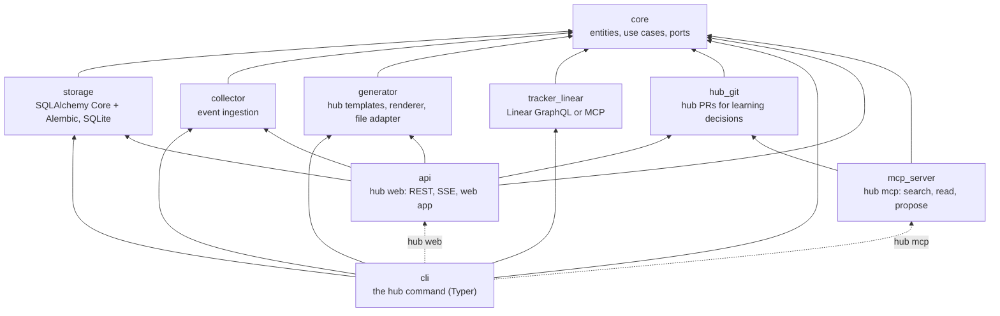

# Technical reference

## Architecture

agent-hub is a [uv](https://docs.astral.sh/uv/) workspace with one package per component, all in the implicit
namespace `agent_hub`, organized as a lean hexagonal architecture (ports and adapters): the domain and use cases live
in `core`, and every other package is an adapter around it. The CLI is the composition root that wires them together.



| Package | Distribution | Role |
| --- | --- | --- |
| `packages/core` | `agent-hub-core` | Entities, the canonical event, `HubConfig`, the init and sync planners, the doctor rules, ports (`EventStore`, `TrackerClient`), test fakes and contract suites |
| `packages/storage` | `agent-hub-storage` | SQLite event store and the Alembic migrations, shipped in the package |
| `packages/collector` | `agent-hub-collector` | Event collector adapter |
| `packages/generator` | `agent-hub-generator` | Hub templates as package data, the `@@` renderer, the managed/seeded registry, the file adapter |
| `packages/tracker_linear` | `agent-hub-tracker-linear` | `TrackerClient` over Linear's GraphQL API (stdlib only), and `McpTrackerClient` over the Linear MCP server through `claude -p` ([ADR 0015](adr/0015-linear-mcp-tracker-transport.md)) |
| `packages/hub_git` | `agent-hub-hub-git` | Opens a hub pull request for a learning accepted or rejected in `hub web`, with `git` and `gh` from a temporary clone ([ADR 0024](adr/0024-learning-actions-from-the-app.md)) |
| `packages/cli` | `agent-hub-cli` | The `hub` command |
| `packages/api` | `agent-hub-api` | `hub web`: the local REST and SSE API and the built web app ([ADR 0017](adr/0017-api-second-composition-root.md)) |
| `packages/mcp_server` | `agent-hub-mcp-server` | `hub mcp`: the hub's brain and repo docs as a local stdio MCP server for Claude Code, with the tools `search`, `read` and `propose` ([ADR 0044](adr/0044-team-memory-git-source-local-index-and-hub-mcp.md)) |
| `packages/agent-hub` | `agent-hub` | Meta-package that installs all of the above |

`core` imports nothing internal; the five adapters never import each other; nothing imports `cli`, `api` is
reached only from `hub web` and `mcp_server` only from `hub mcp`. import-linter enforces this in `make check`. Details: [docs/ARCHITECTURE.md](ARCHITECTURE.md).


## Folder structure

```text
.
├── packages/                # one uv workspace member per component (see Architecture)
│   └── <pkg>/
│       ├── src/agent_hub/<pkg>/
│       └── tests/{unit,contract,integration}/
├── tests/
│   ├── unit/scripts/        # tests of the repo scripts
│   └── e2e/                 # installed hub + gate self-tests
├── scripts/                 # repo tooling: test layout, pytest levels, coverage floors, PR title, release, schema export
├── docs/
│   ├── SPEC.md              # product spec: vision, layers, event model, phases
│   ├── ARCHITECTURE.md      # packages, dependency rule, where code goes
│   ├── CONVENTIONS.md       # code rules and the tool that enforces each
│   ├── TESTING.md           # test levels, layout, fixtures, coverage floors
│   ├── CONTRIBUTING.md      # task workflow, branches, PRs, releases
│   ├── API.md               # REST API standard (Phase 2)
│   ├── design/              # one design doc per subject (config, generator, sync, doctor, …)
│   └── adr/                 # architecture decision records
├── .github/workflows/       # ci (make check in parallel jobs), release (tags on dispatch, checks every v* tag)
├── llms.txt, llms-full.txt  # the docs for AI agents, generated by scripts/build_llms_txt.py
├── CHANGELOG.md             # notable changes per release (Keep a Changelog)
├── SECURITY.md              # how to report a vulnerability
├── LICENSE, NOTICE          # Apache License 2.0 and attribution
├── Makefile                 # the gates: check-fast and check
└── pyproject.toml           # virtual workspace root, ruff config, dev tools
```


## CLI reference

| Command | What it does |
| --- | --- |
| `hub init [PROJECT] --repos … --tracker kind:TEAM[,TEAM…] …` | Create a hub from flags (all flags: [Quick Start](../README.md#-quick-start) step 3 and `hub init --help`) |
| `hub init --config hub.json [--dir …]` | Create a hub from an existing `hub.json` |
| `hub sync [--check]` | Reapply the templates without overwriting what the project customized |
| `hub sync --adopt [--accept PATH]… [--check]` | Join a hand-made hub to `hub.lock` (from 0.7.0): record what matches, create what is missing, list what differs |
| `hub doctor [--only RULE]… [--json]` | Check rules, links, dead references, instruction size and template drift |
| `hub validate-output review\|eval FILE` | Check one agent JSON output (a reviewer's `reviews/<ticket>/<reviewer>-r<N>.json` or the evaluator's `evals/<delivery>.json`, with its `.md` and `../features.json`): exit 0 `<file>: valid`, 1 with one line per problem (the first 200, then the total), 2 on a usage error; needs no `hub.json` |
| `hub setup [--yes]` | Set up this machine for the hub: tools (uv, git, python3, claude, gh) and the tracker credential, the developer identity (`hub.local.json` proposed from git config and written after asking; `--yes` without asking), each repo cloned or fetched next to the hub, then `hub doctor`; exit 0 when every line is `ok`, else 1, each missing line naming its fix |
| `hub worktree NAME [--only REPO]... [--remove] [--no-fetch] [--base BRANCH \| --stack-on PR_URL]` | Create (or remove) one task's worktrees in the hub's repos, or in each `--only` repo; `--no-fetch` starts from the already-fetched base; `--base` starts every repo from `origin/BRANCH`; `--stack-on` starts the open pull request's repo from its head branch and the other repos from their default branch (a blocker still in review) |
| `hub brief [--no-network]` | Print the session brief: `now.md`, recent journal, repo/PR/CI state |
| `hub env list\|show NAME [--json]`, `hub env add\|set\|remove NAME … [--local]`, `hub env service add\|remove REPO SERVICE … [--local]` | List, show and change the declared environments and services (`environments`, `repos[].services`); writes `hub.json`, or `hub.local.json` with `--local` (where an access on a `hub.json` environment may only get stricter), without a prompt, checked before the write; exit 0, 1 when refused or invalid (the file unchanged), 2 on a usage error ([environments.md](design/environments.md)) |
| `hub repo list [--json]`, `hub repo add DIR --github OWNER/NAME --check C …`, `hub repo set DIR … [--unset KEY]…`, `hub repo remove DIR` | List the hub's repos (one line each: `dir (github, role, branch B): check_fast=X, check=Y`, from `hub.json` only) and add, change or remove one in `hub.json`, without a prompt, checked before the write; a remove is refused while a guard path, an event, `contract-sync` or your `hub.local.json` still names the repo, and leaves `../DIR` in place; each change names what to run next (`./hub sync`, and after an add `./hub setup` and `/onboard`) and runs nothing itself; exit 0, 1 when refused or invalid (the files unchanged), 2 on a usage error ([project-config.md](design/project-config.md)) |
| `hub action list [--json]`, `hub action plan\|run NAME --env ENV [--input NAME=VALUE]…` | List the hub's actions (`actions/<pack>/`) with their draft state; plan one call (its endpoints, content hash, plan-mode summary and policy decision, no credential) or run it: a deny exits 1 before any prompt, without a terminal only `read` actions run, an `ask` prompts `y/N`; the environment's env file and credentials reach the action's process alone ([scenarios.md](design/scenarios.md)) |
| `hub scenario list`, `hub scenario plan NAME --env ENV [--input NAME=VALUE]… [--json]` | List the hub's scenarios (`scenarios/<pack>/`, `kind: scenario`; `hub workflow list` never shows them); plan one: per step its action, effect, args (a run-time value as `<$CTX.<name> from <node>>`), endpoints, content hash, draft state, plan-mode summary (only when its args are known; no credential, no env file) and policy decision; nothing runs and no event is written; a deny, an undeclared environment or two unordered gates exit 1 ([scenarios.md](design/scenarios.md)) |
| `hub scenario run NAME --env ENV [--input NAME=VALUE]… [--mode interactive\|regression] [--run-id RUN] [--break ADDR]…` | Run a scenario once its plan holds no problem or deny (else exit 1, no scenario run): its snapshot pins each action's files and hash, a policy `ask` is an approval `<step>__ask` (answer with `hub workflow approve\|reject RUN`, which resumes it), each action is decided again when it runs and gets its environment's credentials alone; a write or destroy that started and never ended (the hub died) asks again on resume, and a loop group that may run such a write again asks before each of its writes until it ends. With `--mode regression` no agent runs and a divergence fails the scenario run with `step <id>: <reason>`; `interactive` (the default) pauses it at an investigation gate `<step>__investigation` and prints the link to its page in `hub web`, where a read-only session investigates and you pick an option, retry or stop (or `hub workflow respond RUN --node <step>__investigation --choice pick\|retry\|stop [--text OPTION]`). No flag removes a gate. `--break` (a scenario written as blocks, never on production) pauses the run before each block named ([scenarios.md](design/scenarios.md)) |
| `hub scenario break RUN [ADDR]… [--off\|--set]`, `hub scenario step RUN`, `hub scenario continue RUN` | Debug a scenario run written as blocks: `break` adds breakpoints before the blocks named (`--off` removes them, `--set` replaces them all, and `--set` with no address clears them), kept with the run and never in the file; `step` runs the next block of a run in a debug pause and pauses before the one after it; `continue` runs it to its next breakpoint or its end. Each is refused on a production environment, except a `break` that clears every breakpoint, and none answers a gate ([scenarios.md](design/scenarios.md) § Debugging, [ADR 0049](adr/0049-scenario-blocks-and-run-control.md)) |
| `hub scenario migrate [NAME]… [--check]` | Write graph-format scenarios (`version: 1`; every one when no name is given) again in place as blocks (`version: 2`), one stage named after the scenario, each checked to translate back to the same graph; when one cannot be migrated, nothing is written and each node it cannot map is named with why (exit 1); `--check` writes nothing and prints a line per file it would migrate ([scenarios.md](design/scenarios.md) § Tree format) |
| `hub scenario findings RUN [--json] [--issue FINDING \| --inbox FINDING]` | List a scenario run's findings; `--issue` prints a finding's tracker issue draft and creates it once after a `y` on a terminal, `--inbox` writes it as a `brain/_inbox/` note ([scenarios.md](design/scenarios.md)) |
| `hub scenario propose --run RUN` | Record an investigation's findings and workaround options (JSON on stdin), each option planned; the investigation session runs it, not you ([scenarios.md](design/scenarios.md)) |
| `hub agent [ARGS…]` | Start `claude` with every repo attached; all arguments go to `claude` |
| `hub next` | Print the tracker's ready issues (`tracker.ready_label`), oldest first: id, repo, title and url |
| `hub run ISSUE --repo REPO [--live] [--max-turns N] [--budget USD] [--model M] [--effort low\|medium\|high] [--from implement\|verify]` | Take one issue to a PR: worktree, a headless implementing session, the repo's gate, PR, tracker report. Refuses (exit 1) an issue whose description lacks a brief section. A dry run unless `--live`; defaults `--max-turns 40`, `--budget 3.0`, `--model` `hub.json`'s `models.tiers.medium` (else `sonnet`), `--effort medium`; `--from verify` runs the gate, PR and report on the commits already made. A live run exits 0 when it opened its PR or ended with no changes (a comment, no label), 3 when its session stopped to ask a human (the blocked label and a comment with the question) and 1 when it failed (the failed label and a diagnosis) or a tracker write failed ([ADR 0030](adr/0030-run-outcomes-in-the-tracker.md)) |
| `hub start ISSUE [--repo DIR]… [--no-agent]` | Start an issue: its worktrees (named `<issue>-<title slug>`), the issue moved to `tracker.states.started`, then `claude` from the hub with those worktrees attached and the issue as first prompt; a rerun resumes the task; `--no-agent` prints how to launch it |
| `hub bench [--validate] [--runs N] [--cases IDS] [--budget USD] …` | Benchmark the `hub-workflow` plugin on closed issues (module `bench`); `--validate` checks the graders |
| `hub web [--host HOST] [--port N] [--db PATH]` | Serve the control plane (REST API and web app) on `127.0.0.1:7420` until interrupted; another address only inside the agent-hub container (`AGENT_HUB_IN_CONTAINER=1`) |
| `hub collect [FILE\|-] [--db PATH]` | Ingest canonical events from JSON Lines, all or nothing |
| `hub --version` | Print the version |

Command contracts: [docs/design/hub-generator.md](design/hub-generator.md), [hub-sync.md](design/hub-sync.md),
[hub-adopt.md](design/hub-adopt.md), [hub-doctor.md](design/hub-doctor.md),
[hub-setup.md](design/hub-setup.md), [hub-start.md](design/hub-start.md),
[environments.md](design/environments.md).


## Stack and technical decisions

| Choice | Why | Decision |
| --- | --- | --- |
| Python 3.14, uv workspace, one package per component | Clear boundaries, one lockfile, `uv tool install` gets everything | [ADR 0001](adr/0001-uv-workspace-with-namespace-packages.md) |
| Lean hexagonal architecture | Domain logic testable with in-memory fakes; adapters swappable | [ADR 0002](adr/0002-lean-hexagonal-architecture.md) |
| SQLAlchemy Core + Alembic on SQLite | Local-first now, Postgres by config later | [ADR 0003](adr/0003-persistence-sqlalchemy-core-and-alembic.md) |
| CLI as the composition root | Only one place wires adapters to use cases | [ADR 0008](adr/0008-cli-as-composition-root.md) |
| Managed vs seeded files, guarded by `hub.lock` | Sync can upgrade a hub without touching project edits | [ADR 0009](adr/0009-hub-sync-by-file-ownership.md) |
| `hub.json` stays JSON with a Pydantic model | Hooks read it with the Python 3.9 standard library | [ADR 0010](adr/0010-hub-json-config-contract.md) |
| Templates as package data; hub logic in the CLI | Hubs hold files and thin shims; logic is versioned and tested here | [ADR 0011](adr/0011-templates-as-package-data.md), [ADR 0012](adr/0012-cli-subsumes-hub-scripts.md) |
| Releases are git tags run through `uvx` | No package index; each hub pins its own release | [ADR 0013](adr/0013-release-by-git-tags.md) |
| Tracker behind a core port; Linear over GraphQL | Swappable tracker; no SDK dependency | [ADR 0014](adr/0014-tracker-port-linear-graphql.md) |
| A Linear MCP transport, chosen by `tracker.transport` | Machines without a Linear API key reach the tracker; each `claude -p` call gets only the Linear tools it needs | [ADR 0015](adr/0015-linear-mcp-tracker-transport.md) |
| Identity from `hub.local.json`, then `hub.json`, then git config | A team shares one hub; each developer keeps their own branch prefix and author | [ADR 0016](adr/0016-per-developer-identity.md) |

Generated hooks are the exception to "logic lives in the CLI": they stay Python 3.9 standard-library scripts that never
need the CLI. All but the guard fail open (the guard asks instead), so a session never breaks because of the
platform. Details: [What the hooks do for you](DAILY-WORKFLOW.md#what-the-hooks-do-for-you).


## Development setup

Requirements: uv 0.9.0 or newer (CI pins 0.12.19) and a final Python 3.14 build. For the generator's hook tests, a
`python3.9` on `PATH` runs the rendered hooks on 3.9 as well (they are skipped locally without it).

```bash
uv sync --all-packages          # once per clone or worktree
uv run hub --help               # run the CLI from your checkout
make help                       # list the targets
```

The two gates:

- `make check-fast`, while working: format, lint, mypy `--strict`, test layout, version lockstep, unit and contract tests.
- `make check`, before a PR and in CI: `check-fast` plus integration and e2e tests, import contracts, migrations and
  coverage floors.

```bash
make check-fast > check-fast.log 2>&1; echo $?
make check > check.log 2>&1; echo $?
```

> [!TIP]
> Redirect the output and check the exit code: `make check | tail` hides it. Never run the gates with `-j`.

Coverage floors: `core` 90%, every other package 80%. Test levels and rules: [docs/TESTING.md](TESTING.md).
Code rules: [docs/CONVENTIONS.md](CONVENTIONS.md). Database migrations and the `hub.json` schema export:
[docs/CONTRIBUTING.md](CONTRIBUTING.md).

