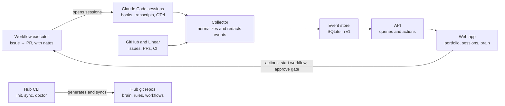

# Initial spec — Hubs and agents platform

2026-09-27 · José Henrique Roquette. This repo file (`docs/SPEC.md`) is the source of truth; the claude.ai document is history.

## Vision and problem

The platform turns what `loki-trader-hub` does by hand for one project into a product that builds, runs and observes AI agent hubs for N projects. It also manages itself and Loki Trader itself.

Today the Loki Trader hub already brings together the right pieces: versioned memory (`brain/`), cross-repo rules (`AGENTS.md`), a multi-repo launcher (`agent`), a workflow plugin with delivery agents, a runner that takes a Linear issue to a PR (`agent_runner.py`), transcript mining, retro and benchmark. The problem is that everything is coupled to one project:

- **It is not reusable.** Repo names, the Linear team, the rules and the paths are hard-coded. A new project starts from scratch.
- **It is not visible.** What the agents do, decide and learn is scattered across JSONL transcripts, logs in `.agent-runs/`, `brain/_inbox/` and PRs. There is no single place to see it together, live or over time.
- **It is not governed.** The workflow (plan → approval → code → CI → PR) is implicit in text rules, hooks and scripts. It cannot be defined, versioned or compared across projects.

## Goals and non-goals

Success for v1 is recreating `loki-trader-hub` through the platform without losing capability, and seeing on one screen what each agent did in a session.

**Goals**

1. **Create generic hubs.** One command builds the hub of any project (1 to N repos) with brain, rules, launcher, plugin and scripts.
2. **Define workflows as data.** Steps, gates, approvers and limits (turns, cost) are versioned in the hub, not scattered across text and scripts.
3. **Observe agents.** Show, live and in history, what each session did: task, repo, tools used, files touched, decisions and cost.
4. **Make knowledge visible.** Show what context the agent receives (rules, brain, memory), what it learned (learnings, inbox) and where each item came from.
5. **Audit the reasoning.** Reconstruct why a decision was made from the transcript: messages, reasoning summaries and tool calls.

**Non-goals (v1)**

- It is not a new agent or an LLM runtime. The platform orchestrates and observes Claude Code (and others later); it does not replace it.
- It is not a hosted multi-tenant service. v1 is local-first: a hub serves a team of developers who share one hub repo, each
  running the CLI and the hooks on their own machine or cloud session ([Team use and per-repo config](#team-use-and-per-repo-config)).
- It does not edit the brain on its own. It keeps the current hub's rule: agents propose in `_inbox/`, and the human decides.
- It does not promise to read the model's "mind". It shows what the transcript records, nothing more.

## Core concepts

The model has nine entities. All of them already exist implicitly in Loki Trader, and the platform only gives them a name and a schema.

| Concept | What it is | Today's equivalent in Loki Trader |
| --- | --- | --- |
| Project | A product with 1 to N repos and a task tracker | Loki Trader (team `LOK` in Linear) |
| Hub | The project's control repo: rules, brain, workflows, plugin, scripts | `loki-trader-hub` |
| Repo | A code repository managed by the hub, with its own `AGENTS.md` | `tradeSentinel`, `loki-trader-ui` |
| Workflow | A sequence of steps with gates, approvers and limits | The states of `agent_runner.py` and the plugin's `/feature` |
| Agent | A role with instructions, tools and a model | Agents in `plugin/loki-workflow/agents/` |
| Session | One concrete execution of an agent, with transcript, cost and outcome | JSONL transcripts and `.agent-runs/*.jsonl` |
| WorkflowRun | One execution of a workflow; it contains the Sessions it starts ("run" is never a synonym for Session) | One `agent_runner.py` pass from issue to PR |
| Brain | Curated, versioned knowledge, with provenance | `brain/` (index, now, decisions, learnings…) |
| Learning | Something learned in a session, proposed and then accepted or rejected | `brain/_inbox/` → `brain/learnings/` (team); `brain/auto/workspace/` (personal auto memory, gitignored, never committed) |

## Layer 1: hub generator (CLI)

A CLI creates and maintains hubs from a project configuration file. Everything that is Loki-specific today becomes a parameter or an optional module. The Phase 1 design (config contract, generation and sync, hooks, commands, releases, `hub doctor`) is indexed in [design/README.md](design/README.md).

The hub's logic lives in the `hub` CLI, versioned and tested in this repo; the generated hub holds files, `hub.json` and thin shims. A shim runs the CLI release pinned in `hub.json` (a semver git tag of this repo, no PyPI) through `uvx`, so no global install is needed and each hub on a machine can pin its own version. Hooks are the exception: they stay Python 3.9 stdlib scripts that read `hub.json` through the stdlib reader rendered with them, never need the CLI (SessionStart tries the pinned `hub brief` and falls back to a mini brief), and fail open.

The generator renders a hub in memory as a `RenderedHub`: its files (`RenderedFile`) and its symlinks (`RenderedLink`, one per base or project plugin agent and skill under `.claude/agents/` and `.claude/skills/`), contract types in `agent_hub.core.hub_files`. Besides the base rules and the brain skeleton, it ships the managed base plugin `plugin/hub-workflow/` (agents, skills, hooks and their reader), the managed `.claude/settings.json` that runs those hooks, the seeded project plugin `plugin/<project>/` with its guard extension stub, and the transcript mining, recall and retro metrics scripts.

`hub init` writes the rendered hub, a seeded `hub.json` and, last, `hub.lock` (v1), which records each managed file's SHA-256 and executable bit, each managed link's target and each seeded path. The init planner and the lock model are pure core code; the file adapter in `agent_hub.generator` reads the target tree and writes through temporary files in the same folder, never through a symlinked folder. `hub sync` reads the lock back, plans every path in core and applies the plan through the same adapter, `hub.lock` last ([design/hub-sync.md](design/hub-sync.md)).

An agent that uses agent-hub for another project (rather than changing agent-hub) follows [USING.md](USING.md) (`docs/USING.md`), a runbook from finding the release to a verified, pushed hub and its first session; a doc-check in `make check` runs its commands against the CLI.

```
hub init <project> --repos org/backend,org/frontend --tracker linear:LOK --branch-prefix jdoe/   # several teams: linear:APP,OPS
hub init --config hub.json   # generates from an existing project config
hub sync [--check]   # reapplies templates without overwriting what the project customized (--check: plan only)
hub sync --adopt [--accept PATH]…   # joins a hand-made hub: identical files become managed, differences are listed
hub doctor [--only RULE]… [--json]   # checks rules, links, dead references and instruction size
hub setup [--yes]   # onboards this machine: clones or fetches the repos, writes hub.local.json after confirmation, lists what is missing
hub worktree NAME [--only REPO] [--remove] [--no-fetch]   # isolated worktrees for one task (--remove removes them; --no-fetch starts from the already-fetched base)
hub start ISSUE [--repo DIR]… [--no-agent]   # issue to worktrees, In Progress and a claude session (resumes)
hub brief [--no-network]   # session brief: now, journal, repo/PR/CI state
hub agent [ARGS…]   # claude with every repo attached (./agent)
hub next   # the tracker's ready issues, one line each
hub run ISSUE --repo REPO [--live] [--budget USD] [--from implement|verify] …   # one issue to a PR through the tracker port
hub ship [ISSUE] [--draft] [--dry-run]   # each changed repo's check, push and PR, PRs linked, the issue to review
hub bench [--validate] [--runs N] [--cases IDS] [--budget USD] …   # configuration benchmark (module bench)
hub collect [FILE|-] [--db PATH]   # ingests canonical events from JSON Lines (stdin when FILE is omitted or -)
hub collect --transcript FILE [--project NAME]   # a Claude Code transcript, as metadata-only events
hub collect --runs PATH [--project NAME]   # hub run records (.agent-runs/ file or folder) as executor events
hub web [--host ADDR] [--port N] [--db PATH]   # the control plane: /api/v1 and the web app on 127.0.0.1 (port 7420)
```

A project starts with a minimal `hub init` (what is known: name, repos, tracker, branch prefix), then onboards in a session in that hub with the managed `/onboard` skill, which never runs `hub init` and also works on a hub joined with `hub sync --adopt`. It reads each repo read-only and proposes `hub.json` values, gates and the `AGENTS.project.md` rules with `path:line` evidence; it applies them only after approval. A run that cannot ask the user (headless, or `/onboard propose`) only writes the proposal to `brain/_inbox/onboard-proposal.md` with the `hub.json` hash it was made against, and a later interactive `/onboard apply` applies it once a human has approved it. A repo without a gate gets one composed from the tools it already declares, in its own task runner and through its own PR; `hub.json` names a gate command only after it has run green from the hub and, for a composed one, after that PR merges.

`hub collect` (Phase 0) writes to `$XDG_DATA_HOME/agent-hub/agent-hub.db` (only when `XDG_DATA_HOME` is absolute), else
`~/.local/share/agent-hub/agent-hub.db`, where `~` is `HOME` when it is non-empty and absolute, else the account's home
from the password database; with neither, `hub collect` exits 1 asking for `--db` or `AGENT_HUB_DB`. The environment
variable `AGENT_HUB_DB` overrides that default and `--db PATH` overrides both. It brings the database to the latest
schema before writing. A batch is all or nothing: an invalid line, a conflict, an input or storage error, or no usable
home directory writes nothing and exits 1, with one line per error (naming the input line when there is one); usage
errors exit 2. On success it prints `appended N, duplicates M`.

`hub collect --transcript FILE` (a regular file, at most 256 MiB, lines at most 1 MiB) and `hub collect --runs PATH` (a
`.agent-runs/*.jsonl` file or a folder of them, depth 1, at most 1,000 files of 64 MiB) map their input to canonical
events with the same all-or-nothing rule; their events name no project of their own, so `--project` names it, else the
`hub.json` of the hub folder they run in. FILE, `--transcript` and `--runs` exclude each other (exit 2). `hub run`
also appends its executor events to the same store as it writes each record; an unwritable store prints one
`hub run: event store unavailable: <reason>` line and the run carries on.

`hub web` serves the control plane from one local process ([Layer 2](#layer-2-control-plane-and-observability)): the
`/api/v1` REST and SSE API ([API.md](API.md)) and the committed build of the web app, from the database `hub collect`
uses. It binds `127.0.0.1` (`--host` may name another loopback address or `localhost`), prints `agent-hub at
http://127.0.0.1:<port>`, and exits 1 with one line naming the port when it is taken. Any other address exits 2
(`binding outside loopback needs AGENT_HUB_IN_CONTAINER=1`) unless `AGENT_HUB_IN_CONTAINER` is `1`, which only the
agent-hub image sets; there it binds `0.0.0.0` and Compose publishes the port on the host's `127.0.0.1` only
([ADR 0022](adr/0022-container-packaging.md)). The `Host` and `Origin` checks stay loopback-only, plus the exact
`host[:port]` names of `AGENT_HUB_ALLOWED_HOSTS` (never a wildcard). `AGENT_HUB_CLAUDE_PROJECTS` (absolute) replaces
`~/.claude/projects` as the only folder the transcript tail reads. Hubs are registered from the app (Settings › Hubs)
into `$XDG_CONFIG_HOME/agent-hub/hubs.json` (absolute only), else `~/.config/agent-hub/hubs.json` (mode 0600).
The repo's `make run` (local), `make up`/`down`/`logs`/`ps` (Docker Compose), `make dev` (API plus the Vite dev
server), `make demo` (synthetic data) and `make connect HUB=<path>` (register a hub, check its sensor) run it.

`hub next` reads `list_ready` once per team, in `hub.json` order, and prints `<id>  <repo>  <title>  <url>` per issue,
oldest first within each team. With several teams a failing team gets one `team <KEY>: <reason>` line on stderr while
the others are still listed, and the command exits 1. `hub run` reads
the issue once (dry run by default: it prints every command and tracker write), then makes the worktree, runs the
implementing `claude -p` session (no tracker tool: the issue's text is in its prompt), its own gate, the push and
`gh pr create`, and reports through the port (on success, like `hub ship`, it moves the issue to
`tracker.states.review`, default `In Review`); records go to the hub's `.agent-runs/` and `brain/_inbox/runs/`. Secret
scope: no child gets `LINEAR_API_KEY`. What may run the session's code (the session, the gate, git's reads of the
worktree, `worktree add` and the repo's setup script) gets no GitHub token either. The fetch, the push and `gh` are
the only calls that hold the tokens, each with git's hooks and fsmonitor off (and the push with signing off). Before
the fetch and before the push, a guard refuses the call when the repo's git config (local or worktree scope) holds a
key such a call would act on, or when `origin` is not the repo's GitHub url from `hub.json`. Residual risk: the
session and the gate run as the user, so they can read the user's stored credentials or change the global git config,
and a process they leave running could change the config between the guard's check and the call; only a sandbox
closes that (AGH-42).

`hub ship` ships an issue that may span repos (`ISSUE` defaults to the issue of the task worktree the cwd is in). Its
set is each `hub.json` repo whose task worktree for the issue (`<repo>/.claude/worktrees/<team>-<n>[-<desc>]`, at
most one per repo, on the task branch) has commits ahead of `origin/<default branch>` as last fetched: `hub ship`
never fetches. It reads the issue once, prints `ship: <repo>  <branch>` per repo in the set and `skipped: <repo> (no
commits ahead of origin/<base>)` per repo left out, then runs four phases, each in `hub.json` order. (1) With no
uncommitted tracked change in any worktree, every repo's `check` runs, before any push; each writes its output tails
to the owner-only `<hub>/.agent-runs/ship/<ISSUE>-<repo>.log` and prints `check passed: <repo>` when it passes; a
worktree left dirty, or a HEAD or task branch that moved, during the checks stops the ship before any push. (2) Per
repo, the push (behind `hub run`'s guard), then `gh pr create` (`--draft` when given; the title is the newest commit's
subject following the repo's conventions), or the PR already open for the branch: `opened: <repo>  <url>` or
`found: <repo>  <url>`. (3) With two PRs or more, each PR's Related PRs section is made to list the others, its body
edited through a file and only when that changes it. (4) The tracker writes: the move to the review state, the failed
label removed when the issue carries it, then one comment listing the PRs. Once the usage checks pass, every failure
line starts with `hub ship: `; a failure in a repo names the repo and what failed, and lists the PRs already open; the
first tracker write that fails is shown as not confirmed (it may have landed) and the later ones as not done, none
retried. Run again after a success, `hub ship` finds the open PRs, edits no PR body and posts one more comment.
`--dry-run` reads the issue and prints the set, then per repo the check, push and `gh pr create` it would run, then
each tracker write it would make, with placeholder PR urls (no link edit: the live one depends on the bodies); it runs
only git reads, writes no file and does not write to the tracker. Usage errors exit 2 before any tracker call, with no
child run but `git` reads (the hub's main checkout, the git identity a branch prefix may come from); every other
failure exits 1. No child gets `LINEAR_API_KEY`, and only the push and `gh` get a GitHub token.

`hub start ISSUE` reads the issue once, then looks for its task worktrees in every repo: a name found there resumes the
task, else the task is named `<issue lower>-<title slug>`. It checks the branches, creates the missing worktrees of the
touched repos (`--repo`, default all) and, last, moves the issue to `tracker.states.started` (a resume moves it only
from an unstarted state). Then it execs `claude` from the hub with the worktrees attached and the issue as the first
prompt; `--no-agent` prints that command instead. A failure keeps the worktrees and prints the lines that remove them.
Setup scripts get no `LINEAR_API_KEY`. Contracts: [design/hub-start.md](design/hub-start.md) and, for `hub setup`,
[design/hub-setup.md](design/hub-setup.md).

**What to extract from `loki-trader-hub`**

| Current piece | Becomes on the platform | Generic or module |
| --- | --- | --- |
| `brain/` (index, now, decisions, learnings, playbooks, journal, `_inbox/`, `auto/` (`auto/workspace/`: each developer's personal memory, gitignored)) | Brain skeleton with frontmatter and provenance, seeded once; the content stays the project's | Generic |
| `AGENTS.md`/`CLAUDE.md` with cross-repo rules | Managed base rules (authorship, worktree, no push to `main`) plus a seeded `AGENTS.project.md` for project rules | Generic + project rules |
| `agent` (launcher with `--add-dir` and appended AGENTS.md files) | Shim for `hub agent`, which reads the repo list | Generic |
| `scripts/worktree.sh` | `hub worktree`: isolated per-task worktrees, with their own ports and `.env` | Generic, with per-stack hooks |
| `scripts/brief.py` | `hub brief`: session brief (now, journal, git/PR/CI state) | Generic |
| `scripts/agent_runner.py` | `hub next` (the ready issues) and `hub run` (one issue to a PR, dry run by default) through the tracker port; later the workflow executor reading the workflow as data | Generic |
| `mine_transcripts.py`, `recall_transcripts.py`, `retro_metrics.py` | Stay hub files until Layer 2 ingestion and analysis replace them (Phase 2) | Generic |
| `bench.py` | `hub bench`: agent configuration benchmark on closed issues | Module |
| `agent_config_lint.py`, `features_check.py` | `hub doctor` rules, including feature validation | Generic |
| `plugin/loki-workflow/` (agents, skills, hooks) and marketplace | Managed base plugin `plugin/hub-workflow/` (its hooks stay stdlib scripts) + seeded project plugin `plugin/<project>/`; the marketplace is an optional module | Generic + project |
| `contract-sync.sh` (OpenAPI backend → frontend) | Cross-repo contract recipe | Module |
| Red-chain, Decimal, paper/testnet | Loki domain rules, in its `AGENTS.project.md` | Stays in the project |

Design rule: the generated hub is versioned files in a private GitHub repo, accessible only to the owners, plus the `hub` CLI pinned per hub; its hooks work without the CLI. That way it works in the terminal, in cloud sessions and without layer 2 running.

### Team use and per-repo config

One hub repo serves every developer of a project, so a value that belongs to one developer comes first from that
developer's gitignored `hub.local.json`, which `hub setup` writes; the committed `hub.json` keeps it only for a
single-developer hub. Real
projects also mix repos that differ in branch, check time and tracker
team, so these keys are added. Each is optional and additive under `schema_version: 1` (a hub without it behaves as
today), and the CLI's model and the hooks' stdlib reader accept it in the same change.

| Key | Meaning | When absent | Issue |
| --- | --- | --- | --- |
| `repos[].default_branch` | The repo's default branch: worktree and PR base, push guard | `project.default_branch` | AGH-46 |
| `repos[].check_fast_timeout` | Seconds the Stop gate gives the repo's `check_fast`, within the gate's total budget; `check_fast` itself becomes optional | The gate's default | AGH-52 |
| `tracker.teams` | Several tracker team keys, the first being the default; never set together with `tracker.team` | `[tracker.team]` | AGH-56 |
| `platform.repository` | The platform's git source: the repository root as `git+https://<host>/<path>` (no credential, port, query, fragment, ref or trailing `/`; at most 200 characters). The shim, SessionStart and cloud setup read it at every run and run `<repository>@v<platform.version>#subdirectory=packages/agent-hub`; the CI credential step reads it to map the read token; a bad value stops each of them and is never echoed; not settable in `hub.local.json`. Tokens stay on `github.com`: the CI step maps `AGENT_HUB_READ_TOKEN` only when the repository is on exactly `https://github.com/` (another host gets no token), and cloud setup's `GH_TOKEN` helper answers for `github.com` only, so a mirror on another host needs the repository attached or its own credential (follow-up) | `git+https://github.com/jroquette/agent-hub` | AGH-49 |
| `project.conventions`, `repos[].conventions` | Patterns for the task branch (`{prefix}`, `{ISSUE}`, `{issue_lower}`, `{slug}`; needs the issue) and the commit and PR titles (`{ISSUE}`, `{type}`, `{scope}`, `{summary}`; needs `{summary}`); a repo's keys override the project's, key by key; `hub worktree`, `hub run`, its prompt and `AGENTS.md` follow them; not settable in `hub.local.json` | Today's shapes: `{prefix}{issue_lower}-{slug}`, `{type}({scope}): {summary} ({ISSUE})`; a `pr_title` that no layer sets follows the effective `commit_title` | AGH-57 |
| `guard.infra.allow`, `guard.infra.prod_markers` | Regexes over infra commands (`aws`, `cdk`, `terraform`, `pulumi`, `kubectl`, `helm`, `sam`, `serverless`), checked by the guard per part of the command: a prod marker anywhere denies, an environment on the part itself that `allow` matches passes (deploy, destroy and delete verbs ask), a local-only form passes, anything else is denied; `guard.infra` present, even `{}`, turns it on (rule below), and the generated `.claude/settings.json` then drops its `Bash(terraform *)` and `Bash(aws *)` denies so the guard decides (run `./hub sync` after adding or removing it; a project re-adds them in `settings.project.json`); not settable in `hub.local.json` | The fixed infra rule: `terraform apply\|destroy\|import`, any `aws` subcommand, `pulumi up\|destroy`, `kubectl apply\|delete` and `cdk deploy\|destroy` (the verb right after `cdk`) are denied | AGH-45 |
| `tracker.states.started`, `tracker.states.review` | The workflow state names: `hub start` moves an issue to `started` on a fresh start, or on a resume while it is unstarted; `review` is reserved for the review step and read by nothing yet; not settable in `hub.local.json` | `In Progress`, `In Review` | AGH-62 |
| Developer identity: `project.author_name`, `author_email`, `branch_prefix` | Become optional. Effective value: the gitignored `hub.local.json`, else `hub.json`, else the hub repo's `git config user.name`/`user.email`; the prefix, when no file sets it, is the effective email's local part plus `/` (ADR 0016) | Set per developer, by `hub setup` in `hub.local.json`; `hub worktree`, `hub run` and `hub start` refuse without a prefix | AGH-65 |

`hub.local.json` may hold only those identity keys and `tracker.transport`; any other key is an error, and nothing in it
can relax a guard. Commits are authored by the developer running the session, and cloud setup writes `HUB_AUTHOR_NAME`/`HUB_AUTHOR_EMAIL`
repo-local, never global, only when `hub.json` holds no author.

**The infra guard.** With `guard.infra`, the guard hook checks a Bash command only when it names a covered tool: the
tool's word (case-sensitive) followed by an argument, by a redirection glued to it (`aws>/dev/null s3 ls`), by a
`$`, `,` or `}` (`aws$x`, `{aws,s3}`), or by nothing up to the end of its part or call (`… | xargs aws`, `(aws)`;
these never make a local-only form), wherever it sits, so wrappers, quotes and
nested calls do not hide it (`env aws …`, `bash -c "aws …"`, `$(aws …)`, `'aws' …`, even `grep aws notes.txt`). Only
the backslash-newlines bash joins are joined (after an odd run of backslashes, outside a comment and single quotes).
The command is split into parts at `;`, `&&`, `||`, `|` and newlines, then:

1. An unusable `guard.infra` (a wrong type, an unusable item, an unknown key under it) or a pattern the hooks' Python
   cannot compile (newer syntax on the system 3.9, e.g. `(?>…)`) denies, naming its location: it fails closed.
2. A `prod_markers` match anywhere in the whole command denies (`echo` of a marker alone names no tool and passes).
3. Each part, then each call inside it that names a tool (the part split again at a single `&`, `(`, `)`, a
   backtick, `$(`, `<(`, `{` and `}`), must match an `allow` pattern or hold only local-only forms, else the command
   is denied naming that part's or call's first tool; an allowed call never covers another one beside it. Text after an unquoted ` #` (a comment) is not
   evidence, for `allow` or for a local form.
4. Local-only forms, at the tool's first argument: `version`, `--version`, `help`, `--help` for any tool (`kubectl`'s
   `version` only with `--client` in the same call); `cdk synth|ls|list|init|doctor|context`; `terraform fmt|validate`, and
   `init` only with `-backend=false`, each voided by a later `--client=` other than `true` or `-backend=` other than
   `false` (the last flag wins); `helm template|lint`; `sam build|validate`. A glued redirection is never one.
5. In a part that something matched `allow` in, the first ask verb after each tool asks, as a word anywhere after
   the tool, quoted or not: `aws` `delete-*|remove-*|terminate-*|deregister-*`, `s3 … rm|rb` and
   `cloudformation … deploy|delete-stack`; `cdk deploy|destroy`; `terraform apply|destroy|import`;
   `pulumi up|destroy`; `kubectl apply|create|delete|replace|patch|scale`;
   `helm install|upgrade|uninstall|rollback`; `sam deploy|delete`; `serverless deploy|remove`.
6. Safe characters or ask: what would pass (an allowed part or a local-only form) passes only when every character
   of the whole command is an ASCII letter or digit, a space, a tab or one of `_ - . / : = @ , + %`, with the parts
   joined only by `;`, `&&`, `||`, `|` or a newline. Any other character (`$`, a quote, a brace, `<`, `>`, a
   backtick, `\`, `#`, `(`, `)`, `*`, `?`, `[`, `]`, `~`, `!`, a single `&`, other whitespace such as a carriage
   return, a vertical tab or a no-break space, anything non-ASCII) makes it ask, naming the first one. Then it asks on
   the first word that can run a command, or change its environment, out of the guard's sight: `sh`, `bash`, `zsh`,
   `dash`, `ksh`, `fish`, `python*`, `perl`, `node`, `ruby`, `php`, `xargs`, `eval`, `exec`, `source`, `sudo`, `su`,
   `doas` (anywhere, by the word's last path component, so `cdk init app --language python`, a local-only form, asks
   too), `.` as a
   command, `env`'s `-i` or `-u` in any spelling before its command (`-`, `-0i`, `-uNAME`, `--unset=…`,
   `--ignore-environment`) and a lone `--`; also `parallel`, and a `sed` whose script holds an `e` (its `e` command or
   the `s` command's `e` flag) or is read from a file (`-f`). Last, it asks when a part sets the environment twice (a
   second `AWS_PROFILE=`, `AWS_DEFAULT_PROFILE=`, `KUBECONFIG=` or `KUBE_CONTEXT=` word, `+=` too, or a second
   `--profile`, `--context`, `--kube-context`, `-chdir`, `--stack`, `--workspace`, `--stage` or `-var-file` flag, or
   one setting under two spellings: `AWS_PROFILE=`, `AWS_DEFAULT_PROFILE=` and `--profile`; `-s` with `--stack` or
   `--stage`), naming it. Then it asks when an environment selector lies outside every `allow` match on its part,
   naming it as written: any word anywhere in any part that holds, as an identifier, one of `AWS_PROFILE`, `AWS_DEFAULT_PROFILE`,
   `KUBECONFIG`, `KUBE_CONTEXT`, `HELM_KUBECONTEXT`, `TF_WORKSPACE`, `TF_DATA_DIR`, `TF_CLI_ARGS` and
   `TF_CLI_ARGS_*`, `PULUMI_BACKEND_URL`, `AWS_CONFIG_FILE`, `AWS_SHARED_CREDENTIALS_FILE`, `AWS_ROLE_ARN`,
   `CDK_DEFAULT_ACCOUNT` (the whole word: `NAME=v`, `NAME+=v`, and also `export NAME`, `read NAME`, `printf -v NAME`,
   `for NAME in`, `declare -n P=NAME`, `env --split-string=NAME=v` or `env -SNAME=v`); and, in a part that names a covered tool, the flags `--profile`, `--aws-profile`,
   `--context`, `--kube-context`, `--cluster`, `--server`, `--user`, `--kubeconfig`, `--kube-apiserver`,
   `-chdir`/`--chdir`, `--cwd`, `--stack`, `-s` (beside any covered tool: pulumi's stack, serverless's stage, kubectl's server), `--stage`,
   `--workspace`, `-var-file`/`--var-file`, `-backend-config`/`--backend-config` and, beside `pulumi`, `-C`, each as
   `--x v` (with the next word) or `--x=v`. So an `allow` pattern must match a whole setting (`--profile demo-dev`,
   `AWS_PROFILE=demo-dev`), not its value alone. Last, it asks on a command that changes a tool's own configuration:
   `aws configure set|import`, `kubectl config set-context|use-context|set-cluster|set-credentials|use|set|rename-context|delete-context`,
   `terraform workspace select|new`, `pulumi stack select`. An ask verb (5) keeps its reason and comes first; a deny stays a deny,
   and a command that names no covered tool is not affected. An `allow` match that overlaps a quoted region (`'…'`,
   `"…"`, `$'…'`) is text, not evidence: it neither allows nor denies, and the quote makes the command ask.

The strictest part wins, and an infra allow or ask does not end the check: a later deny (a secret file) still wins.
There is no carry-over: the environment must be on the part itself (`--profile <env>`, an `AWS_PROFILE=<env> `
prefix); one set by an earlier part, exported or inherited never counts. Nothing relaxes it: `hub.local.json` cannot
set `guard.infra`, and a `hub.json` named by `$HUB_CONFIG` cannot turn it on or widen `allow` (the mode and `allow` are
the hook root's; that file's `prod_markers` and unusable values are added). Values in the reasons are escaped and capped
at 100 characters. Patterns are searched with no flags, in Python 3.9 `re` syntax, on every Bash call that names a
covered tool, with no cost cap: avoid nested quantifiers. Bound an environment pattern by a space or tab, as a
whole word (`(?<![^ \t])--profile[= ]demo-dev(?![^ \t])`), and an `AWS_PROFILE` prefix by the start of the part
(`^[ \t]*AWS_PROFILE=demo-dev(?=[ \t])`): `\b` also matches inside a longer word (`demo-dev.x`, `demo-dev,staging`,
a redirection target `>--profile=demo-dev`), and `\s` also matches a carriage return, a vertical tab or a no-break
space, which the shell does not split words on. Without `guard.infra`, the fixed rule also denies a
redirection glued to `terraform`, `aws`, `pulumi`, `kubectl` or `cdk`. Settings (D11): with `guard.infra`, the
generated `.claude/settings.json` leaves out its `Bash(terraform *)` and `Bash(aws *)` denies, so the guard decides
those commands; every other deny, the hooks and the sandbox stay as they are, and without `guard.infra` the file is
unchanged. `./hub sync` applies it after `guard.infra` is added or removed; a project that wants the blanket denies
back lists them in `.claude/settings.project.json`. The sandbox still limits the network: a project adds its cloud API
hosts to `sandbox.network.allowedDomains` in `.claude/settings.project.json`, then runs `./hub sync`; listing the tools
in `sandbox.excludedCommands` instead runs them outside the sandbox with the host's credentials and network. Accepted limits:
tool names are matched case-sensitively (`AWS` is not seen); quoting or glob tricks inside a tool's word (`a""ws`,
`a?s`, `aws*`) hide it (AGH-127); the fixed rule (without `guard.infra`) misses options before the verb
(`terraform -chdir=x apply`) and a tool word with nothing after it (`xargs aws`), which only infra mode catches
(AGH-126); abbreviated long options (e.g. `--prof`) and short options glued to their value or clustered
(`-sdemo/prod`, `-ys demo/prod`) are not recognised as environment flags; which option takes the next word as its
value is not modelled, so an allowed environment can be another option's value (`aws s3 ls --query
--profile=demo-dev`, `kubectl get pods --field-manager --context=kind-demo`); only the names above count as setting
the environment twice (`--chdir` and `--var-file` count with `-chdir` and `-var-file`); only the selectors above are
checked, not others a tool reads (`--endpoint-url`, `--region`, `TF_VAR_*`, a tool's own config files); a command a
wrapper runs elsewhere (`ssh host aws …`) is checked as text only. The selector flags are not scoped per tool, so
`aws ecs … --cluster x` asks too.

## Layer 2: control plane and observability

A web app reads the hubs and the agents' events and answers five questions, one per view.

| View | Question it answers | Content |
| --- | --- | --- |
| Portfolio | How are my projects doing? | Hubs, repos, tasks in progress, open PRs, CI, cost of the week |
| Workflows | How should work flow? | Editor and visualization of steps and gates; which step each task is at; where it gets stuck |
| Live sessions | What are the agents doing right now? | Active sessions by repo and task, last action, accumulated turns and cost, pending approvals |
| Session timeline | Why did the agent do that? | Messages, reasoning summaries, tool calls, files and diffs, marked decisions and the final outcome |
| Knowledge | What does it know and what did it learn? | Context loaded in the session (rules, brain, memory), proposed learnings, inbox triage, evolution over time |

**Decisions as objects.** A decision is a stretch of the session with a choice, discarded alternatives and a rationale. In v1 it is extracted from the transcript. Later, agents can record it explicitly through a skill or hook (`/decide`).

**Learning with provenance.** Every brain item and every learning keeps its source session, its author (human or agent) and its status. The knowledge view shows the path session → proposal → accepted → rule and measures whether the rule reduced the failure that motivated it (which `mine_transcripts.py` and `retro_metrics.py` already start to do).

**Actions, not just reading (after v1).** Start a workflow on an issue, approve a gate, pause or cancel a session, accept a learning.

**Phase 2, read-only (built).** `hub web` serves the views above that Phase 2 covers: Portfolio, Project overview,
Approvals (read-only), Live sessions, Sessions and Session detail (Timeline, Files, Cost, Raw events), Workflow runs and
Run detail, Features and Feature detail, Health (the doctor rules run in process per hub, cached 15 min), Knowledge ›
Learnings (tagged Phase 3), Settings and Welcome. Session, WorkflowRun, Learning and Approval are pure folds in core,
recomputed on read and memoized in process by the store's high-water mark ([event-derivations.md](design/event-derivations.md)).
Cost is estimated from transcript usage times a dated price table and always labelled so; OpenTelemetry, GitHub and
Linear are not connected in this version and their cells say so. Actions (approving, starting, retrying, accepting)
appear only as disabled, phase-tagged buttons. The server is local only: loopback bind, `Host` and `Origin` checks,
1 MiB request bodies, no CORS, and a CSP that keeps the app on its own origin. The approved UI design and the
departures from it are in [design/control-plane/](design/control-plane/README.md); the decisions are ADRs 0017 to 0021.

## Data sources and event model

Almost all of the data already exists. The platform normalizes five sources into a single event stream per session.

| Source | What it brings | Latency |
| --- | --- | --- |
| Claude Code hooks | Session start and end, each tool use, prompts, permission requests | Real time |
| Transcripts (`~/.claude/projects/*.jsonl`) | Full messages, recorded reasoning, tool calls and results | After each turn |
| Claude Code OpenTelemetry | Tokens, cost, duration, errors | Real time |
| Workflow executor logs (today `.agent-runs/`) | Step, gate, outcome, failure reason | Per step |
| GitHub and tracker (Linear) | Issues, PRs, commits, CI, review | Polling or webhook |

**Canonical event:** `{project, session, type, timestamp, source, source_id, payload, repo, agent, workflow, step}`.
`project`, `session`, `type`, `timestamp`, `source` and `source_id` are required; `payload` is a JSON object (empty by
default); `repo`, `agent`, `workflow` and `step` are optional. Unknown fields are rejected.

- `type` is a closed list: `session.start`, `session.end`, `tool.call`, `tool.result`, `message`, `reasoning`, `decision`,
  `gate.request`, `gate.result`, `learning.proposed`, `learning.accepted`, `learning.rejected`, `step.start`,
  `step.end`, `run.end` and `session.summary` (the last five added in Phase 2 for runs, rejected learnings and stored
  summaries).
- `source` is a closed list: `claude_code`, `transcript`, `otel`, `executor`, `github` and `linear`. Widening either list
  later is a compatible change.
- `timestamp` is an ISO 8601 string with an offset (numbers and naive times are rejected) and is stored in UTC.
- `project`, `session` and a payload's `run` are at most 200 characters; a longer one is refused at ingestion (the
  line's reason in `hub collect`, 422 on the hook route), so every id fits a detail path and a list cursor.
- **Identity and idempotency:** `(source, source_id)` identifies an event. Ingesting an identical event again is a
  duplicate and is skipped; a different event with the same key is a conflict and fails the batch. Nothing stored is
  ever overwritten.
- The input format of `hub collect` is JSON Lines, UTF-8, one event per line (records split on `\n`); blank lines are
  skipped and duplicate JSON keys are rejected.
- The store adds two fields of its own at append: `event_id` (a UUIDv7, the SSE id and the API's event id) and
  `received_at` (UTC; NULL for rows stored before Phase 2). The identity stays `(source, source_id)`; session and run
  ids stay the sources' own.

**Privacy: metadata only, redacted.** Transcripts and hooks can contain secrets and personal data, so every entry point
(hooks, transcripts, run records and JSON Lines) goes through one core use case, `IngestEvents`, which applies two rules
before anything is appended, and the data stays on the machine in v1:

- **Redaction** (rule set `r1`, `agent_hub.core.redaction`): every string of the payload, at any depth, keys included,
  and the labels `repo`, `agent`, `workflow` and `step`. A known secret is replaced whole by `[redacted: <kind>]`; the
  kinds are `github token` (`ghp_`, `gho_`, `ghu_`, `ghs_`, `ghr_`, `github_pat_`), `linear key` (`lin_api_`),
  `anthropic key` (`sk-ant-`), `openai key` (`sk-`, `sk-proj-`), `aws access key` (`AKIA`/`ASIA` + 16), `aws secret`
  (`aws_secret_access_key` assignments), `bearer token`, `private key` (a whole PEM block), `url credentials`
  (`scheme://user:pass@`) and `secret` (a `NAME=value` or `"name": "value"` whose name says secret, token, password,
  passwd, api_key, apikey, private_key or credential, with a value of 8+ characters). Redaction is idempotent and runs
  before any truncation; a rule change is a new rule set version and a release note.
- **Metadata only**: no prompt, message, reasoning, tool output, file content or diff text is stored. Each type keeps
  only the payload keys of one table in core (`agent_hub.core.events.payload_keys`, the spec's "Payload kept": e.g.
  `tool.call` keeps tool, tool use id, repo-relative path, line counts, a 500-character Bash command, a Grep/Glob
  pattern, a WebFetch URL without query, MCP server, tool and argument names; `message` keeps role, size, turn,
  slash-command name and token usage), plus `run`, `step`, `attempt` and `agent_id` on any type. The source adapters
  build payloads from that table, and `IngestEvents` drops (never rejects) any other key after redaction. **Change to
  `hub collect FILE` (Phase 2):** a canonical JSON Lines payload is now trimmed to that table too, so a key outside it
  (a Phase 0 payload's `input`, `output`, `prompt`, `content`…) is not stored. Release note: re-collecting a file whose
  events were stored before this change, with keys the table drops, now reports a conflict for those events (the
  trimmed event differs from the stored one), as any changed re-ingest does.

## Proposed architecture

v1 runs entirely on the owner's machine: a collector, an event store and a web app, plus the CLI that generates the hubs.



The sessions and GitHub/Linear feed the collector, and the web app reads everything through the API. The app's actions go back to the workflow executor. The API also reads the hub repos to show brain, rules and workflows.

- **Stack (decided, ADRs 0001–0004, 0008, 0011, 0014, 0015, 0017 and 0020):** Python 3.14 in a uv workspace with one package per component (`core`, `storage`, `collector`, `generator`, `tracker_linear`, `cli`, `api`) under a lean hexagonal architecture: entities, use cases and ports in `core`, adapters in the other packages. Persistence is SQLAlchemy Core + Alembic on SQLite, moving to Postgres via config when there are multiple users. The API is FastAPI + Pydantic in `packages/api`, a second composition root that `hub web` serves; the front end is React 18 + TypeScript in `apps/web`, whose production build is committed to `packages/api` so a `uvx` install needs no Node.
- **Hooks as sensors** ([ADR 0021](adr/0021-hook-event-sensor.md)): the generated hub registers a stdlib Python 3.9 sensor, `plugin/hub-workflow/hooks/event_sensor.py`, for eleven Claude Code hooks (SessionStart, UserPromptSubmit, PreToolUse, PostToolUse, PostToolUseFailure, Notification, Stop, SubagentStart, SubagentStop, PreCompact, SessionEnd). It wraps the hook input in a versioned envelope (`v: 1`, project, repo, the `hub run` run, step and attempt) and posts it to `POST /api/v1/events/hooks` with a 0.5 s timeout; it prints nothing and exits 0 on any failure, so without `hub web` the session carries on normally. `AGENT_HUB_WEB_URL` may only name a loopback URL. The guard and the Stop gate send their own decisions (a denial, an ask, a blocked Stop) the same way, after deciding, without changing their output or exit codes. On Stop, SubagentStop and SessionEnd the server reads the session's transcript from its last offset, only under `~/.claude/projects/` and never through a link.
- **Packaging ([ADR 0022](adr/0022-container-packaging.md)):** besides `uvx`/`uv tool install`, the control plane
  ships as a container image built from the repo (`Dockerfile`, `compose.yaml`): multi-stage (the web app built from
  its lockfile, the workspace installed from `uv.lock`), base images pinned by digest, a non-root user (uid 10001), a
  read-only root file system, every capability dropped, a `/data` volume for the database and registry, and the hubs
  and transcripts mounted read-only at their host paths. It is local-only like `hub web`: published on `127.0.0.1`.
- **Adapters:** Claude Code is the first. Other agents (Codex, Cursor) come in as adapters that emit the same canonical event.

## MVP and phases

The MVP goes up to Phase 2: generate hubs from Loki and see the agents' sessions on one screen. Each phase starts only when the previous one's gate passes.

| Phase | Content | Gate to the next |
| --- | --- | --- |
| 0 · Foundation (MVP) | New GitHub repo, approved spec, the foundation (stack and standards in [ADRs 0001–0008](adr/), uv workspace, `make check-fast`/`make check` gates, CI), CLI and collector skeleton | Skeleton done: canonical event, `hub collect`, and `hub init`/`sync`/`doctor` as stubs |
| 1 · Hub generator (MVP) | First, `hub init` generating the platform's own hub; then extract brain, rules, launcher, worktrees, brief and plugin; `hub sync` (with `--adopt`) and `hub doctor` | Loki hub recreated, same `make check` and bench |
| 2 · Read-only observability (MVP) | Hooks and transcripts collector, session timeline, portfolio and live sessions | Sessions of both projects live and in history |
| 3 · Knowledge and decisions | Provenance in the brain, inbox triage in the UI, extracted decisions, learning metrics | One learning traced from the session to the rule |
| 4 · Workflows as data and actions | Generic executor reading the workflow, gates approved from the UI, adapters for other agents | — |

Status (2026-10-12): Phase 0 done. Phase 1 in progress: `init`, `sync` (`--adopt`), `doctor`, `worktree`, `brief`,
`agent`, `next`, `run` and `bench` shipped in v0.8.0; `setup` and `start` are on `main` (version 0.9.0, not tagged
yet), with Phase 2's first slice, the read-only control plane `hub web` (AGH-200). The Phase 1 gate (Loki hub
recreated) is open; pilot: AGH-54.

The order follows dogfooding: the first generated hub is the platform's own, and the second replaces `loki-trader-hub`. Editable workflows come later because they depend on observation already showing where the current flow gets stuck.

## Open decisions

The recommendations are a starting point.

| Decision | Options | Recommendation |
| --- | --- | --- |
| Name and where it lives | **Decided:** `agent-hub`, public repo in the personal account `jroquette` (AGH-51, D-access); each hub repo stays private | — |
| Agent scope | Only Claude Code, or several from the start | Only Claude Code in v1, with the canonical event ready for adapters |
| Where it runs | Local-first or hosted service | Local-first in v1, shared by a team through the hub repo. Hosted only when there is a second organization |
| Stack | **Decided:** see [ADR 0001](adr/0001-uv-workspace-with-namespace-packages.md), [ADR 0002](adr/0002-lean-hexagonal-architecture.md), [ADR 0003](adr/0003-persistence-sqlalchemy-core-and-alembic.md), [ADR 0004](adr/0004-rest-api-standard.md) and [ADR 0008](adr/0008-cli-as-composition-root.md) | — |
| Task tracker | **Decided:** a generic core port (`TrackerClient`) with Linear as the first adapter, selected by `tracker.kind` in `hub.json` ([project-config.md](design/project-config.md)): the Linear GraphQL adapter in `tracker_linear`, keyed by the `LINEAR_API_KEY` environment variable, never by `hub.json` ([ADR 0014](adr/0014-tracker-port-linear-graphql.md)); `tracker.transport: "mcp"` selects the Linear MCP adapter instead, short headless `claude -p` calls to the user's Linear MCP server, each allowed the Linear tools it needs and denied every other Linear tool, with hooks off ([ADR 0015](adr/0015-linear-mcp-tracker-transport.md)) | — |

## Defined directions (2026-09-27)

**1. Workflow: declarative YAML executed by a Python engine.**

- The workflow is a declarative document (YAML or JSON) validated by a Pydantic schema. It holds the steps, the type of each one (`agent`, `script`, `gate`, `human`), inputs, outputs, limits and what to execute.
- A deterministic Python engine reads the document and drives the steps. Orchestration spends no tokens: the LLM only runs inside `agent` steps and only receives that step's instruction, not the whole workflow.
- Deterministic work (tests, lint, contract sync, opening a PR) becomes a `script` step, with no LLM.
- The UI edits the same document. It is stored on the platform with a version and history, and each execution records the workflow version it used.

**2. Brain: stays in the hub repo, which is private and ours only.**

- The hub remains versioned files in git plus the pinned CLI, as in Layer 1. The hub repo is private and only the owners have access.
- The generic templates (base workflow plugin, base rules, base hooks, brain skeleton) are the product: they live in agent-hub, which is public, and ship with the CLI. Only project-owned material (brain content, project rules, project workflows, project plugin) lives only in the hub. The code repos get the minimum: an `AGENTS.md` with basic commands and conventions.
- Our agent receives the brain because it is launched from the hub (launcher with the repos attached, as today). Another agent that opens only the code repos does not receive that knowledge.
- `hub doctor` checks that nothing from the brain was copied into the code repos.
- Cloud sessions need access to the hub repo through the GitHub App, granted only on our account.
- A hosted brain service waits until the platform becomes a product with customers.

**3. Transcripts: temporary raw material, not working memory.**

The hub keeps working with derived data that is small and structured. The raw transcript only serves for auditing and for generating those derivatives.

| Layer | What it keeps | Proposed retention |
| --- | --- | --- |
| Structured events | Tool calls, files touched, steps, gates, cost, outcome | Long (as long as the project exists) |
| Session derivatives | Summary, decisions with rationale, proposed learnings | Long; accepted ones become brain |
| Raw transcript | Full conversation, with secrets redacted before writing | Short, compressed in cold storage; period to be defined |

Continuity between sessions comes from the brain and the summaries, not from rereading transcripts. A job after each session extracts the derivatives. After the period, the raw transcript is deleted.

**Impacts on the rest of the spec**

- No architecture change: v1 remains local-first, with the hub in git. The difference is that the hub repo is private and is the only place where the brain exists.

**Open questions**

- [ ] What is the retention period for the raw transcript?
- [ ] When the platform becomes a product, does the agent run on our infrastructure (protected brain) or in the customer's environment (mitigations only)?
- [ ] Should cloud sessions (claude.ai/code) emit events to the collector, and how?
